# Degree Centrality 기반 Brain State 해석 분석 (V4, K=4)

- 생성 스크립트: `full_pipeline_v4_add.py`
- 기반 파이프라인: `full_pipeline_v4.py` (세그먼트 → CM → K-means Brain State)
- 피험자 수: **27**, 총 세그먼트(=CM) 수: **308**, ROI: **Schaefer-100 (7 Networks, cortex only)**
- Brain State 수 K = **4**, State별 세그먼트 수: {0: 99, 1: 121, 2: 72, 3: 16}
- CM: Pearson 상관 + Fisher-Z 변환

> **주의**: 이번 실행 환경에는 ENIGMA TOOLBOX가 없어 표면(surface) 그림을 다시 렌더링하지 못했다. 아래 표면 그림은 이전 실행에서 만들어 둔 PNG 파일을 그대로 참조한 것이다.

---

## 핵심 결과 요약

1. **State 간 DC는 매우 크게 다르다.** Global DC(100개 ROI 평균)의 one-way ANOVA는 F(3, 71) = 218.6, p = 8.97e-36 (η² = 0.90)이고, 6개 State pair 모두 two-sample t-test에서 유의했다 (|t| = 8.5 ~ 23.6).
2. **DC 크기 순서**: State 1 (5.23) < State 0 (6.96) < State 2 (8.61) < State 3 (11.35). 가장 강한 State는 **State 3**, 가장 약한 State는 **State 1**이다.
3. **네트워크 수준에서도 7개 네트워크 전부 유의**하게 달랐다 (FDR q < 0.05, F = 31.2 ~ 110.9). ROI 수준에서는 100/100 ROI가 FDR q < 0.05였다.
4. **DC가 가장 높은 영역은 모든 State에서 일관되게 Visual network**이며 (Vis 상대 DC ≈ 1.25), 가장 낮은 영역은 Limbic network다 (≈ 0.52). 즉 hub의 위치 자체는 State가 바뀌어도 크게 흔들리지 않는다.
5. **차이의 대부분은 전역 연결강도(FC magnitude)에서 온다.** 전역 크기를 제거한 상대 DC로 다시 보면 State 간 공간 상관이 r = 0.72 ~ 0.97로 높고, 7개 네트워크 중 2개(Somatomotor, Frontoparietal Control)만 FDR q < 0.05를 유지했으며, 유의 ROI도 100개 → 32개로 줄었다. 따라서 K-means가 잡아낸 Brain State의 주된 축은 "hub의 재배치"보다 "전반적 연결강도의 고저"로 해석하는 것이 타당하다. (자세한 내용은 (5)절)
6. **State별로 머무는 시간이 다르다.** 방문당 평균 체류 시간은 State 1(340.8초)이 가장 길고 State 3(66.3초)이 가장 짧다 (one-way ANOVA F(3, 71) = 10.78, p = 6.39e-06, η² = 0.31). 총 점유 시간도 같은 순서이며 (F = 6.39, p = 0.000677, η² = 0.21), DC가 가장 낮은 State 1가 가장 오래 유지된다. 다만 이 차이가 **무작위 분할 대비** 유의한지는 별도 대조군 검정이 필요하다 (`full_pipeline_v5.py` 참고). (자세한 내용은 (6)절)
7. **주의**: 표본이 가장 작은 State는 State 3로 세그먼트 16개 / 피험자 9명뿐이라 검정력이 낮고, 또한 관측 단위가 (subject × State)라 독립성 가정이 완전하지 않다. (마지막 절 참고)

---

## 방법: Degree Centrality 정의

100×100 연결성 행렬 `Z`(Fisher-Z)에 **row-wise proportional thresholding**을 적용한다.

```
1) 대각(자기 자신 연결)을 후보에서 제외             → 각 행 99개 후보
2) 각 행에서 값이 큰 상위 10% element만 유지        → 행당 10개 유지
3) 유지된 element를 행 방향으로 합산                → DC_i = sum_j∈top(i) Z_ij
```

- 결과: 100×1 벡터 (ROI별 weighted degree centrality)
- Thresholding 기준: **z (부호 유지, 즉 가장 강한 양의 연결)**
- 행별로 독립적으로 threshold하므로 유지 마스크는 비대칭이며, DC는 "각 ROI가 자신의 가장 강한 연결 상위 10%로부터 받는 총 연결 강도"를 의미한다.

---

## (1)+(2) State별 Degree Centrality 와 피질 표면 분포

### State별 DC 요약 통계

| State | n_CM | DC mean | DC SD | DC min | DC max | 최대 DC ROI |
|---|---|---|---|---|---|---|
| State 0 | 99 | 6.960 | 1.831 | 1.575 | 11.221 | 7Networks_LH_Vis_9 (Vis) |
| State 1 | 121 | 5.228 | 1.492 | 1.016 | 9.197 | 7Networks_LH_Vis_8 (Vis) |
| State 2 | 72 | 8.607 | 2.109 | 1.801 | 12.729 | 7Networks_LH_Vis_9 (Vis) |
| State 3 | 16 | 11.352 | 2.238 | 4.179 | 15.654 | 7Networks_RH_Vis_8 (Vis) |

### State별 DC 상위 5개 ROI

**State 0**
| rank | roi_label | network | hemisphere | DC |
|---|---|---|---|---|
| 1 | 7Networks_LH_Vis_9 | Vis | LH | 11.221 |
| 2 | 7Networks_RH_Vis_8 | Vis | RH | 11.167 |
| 3 | 7Networks_LH_Vis_8 | Vis | LH | 11.120 |
| 4 | 7Networks_RH_Vis_7 | Vis | RH | 10.561 |
| 5 | 7Networks_RH_Vis_2 | Vis | RH | 10.190 |

**State 1**
| rank | roi_label | network | hemisphere | DC |
|---|---|---|---|---|
| 1 | 7Networks_LH_Vis_8 | Vis | LH | 9.197 |
| 2 | 7Networks_RH_Vis_8 | Vis | RH | 9.030 |
| 3 | 7Networks_LH_Vis_9 | Vis | LH | 8.812 |
| 4 | 7Networks_RH_Vis_7 | Vis | RH | 8.376 |
| 5 | 7Networks_RH_Vis_5 | Vis | RH | 7.995 |

**State 2**
| rank | roi_label | network | hemisphere | DC |
|---|---|---|---|---|
| 1 | 7Networks_LH_Vis_9 | Vis | LH | 12.729 |
| 2 | 7Networks_RH_Vis_8 | Vis | RH | 12.587 |
| 3 | 7Networks_LH_Vis_8 | Vis | LH | 12.541 |
| 4 | 7Networks_RH_Vis_7 | Vis | RH | 11.947 |
| 5 | 7Networks_RH_Vis_5 | Vis | RH | 11.925 |

**State 3**
| rank | roi_label | network | hemisphere | DC |
|---|---|---|---|---|
| 1 | 7Networks_RH_Vis_8 | Vis | RH | 15.654 |
| 2 | 7Networks_LH_Vis_9 | Vis | LH | 15.517 |
| 3 | 7Networks_LH_Vis_8 | Vis | LH | 15.394 |
| 4 | 7Networks_RH_Vis_7 | Vis | RH | 15.346 |
| 5 | 7Networks_LH_Vis_2 | Vis | LH | 14.951 |

### 표면 시각화 (ENIGMA TOOLBOX, fsa5)

각 그림은 좌→우로 `LH lateral · LH medial · RH medial · RH lateral` 순서다.

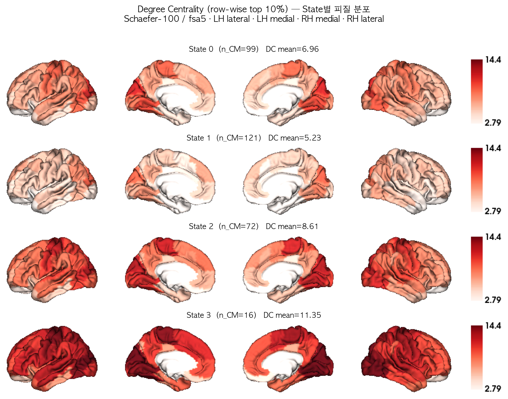

*Figure 1. State별 Degree Centrality의 피질 분포 (공통 color range).*

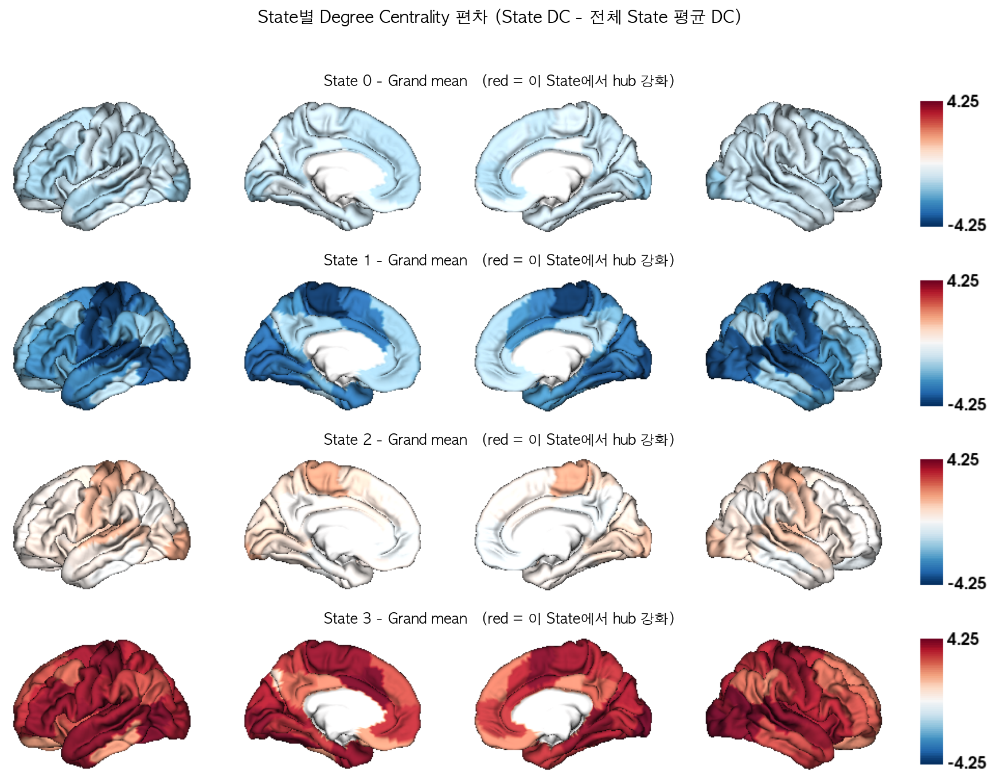

*Figure 2. 전체 State 평균 대비 각 State의 DC 편차. 붉은색 = 해당 State에서 상대적으로 hub 역할이 강화된 영역.*

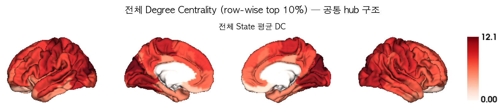

*Figure 3. 모든 State 평균 DC — State와 무관한 공통 hub 구조.*

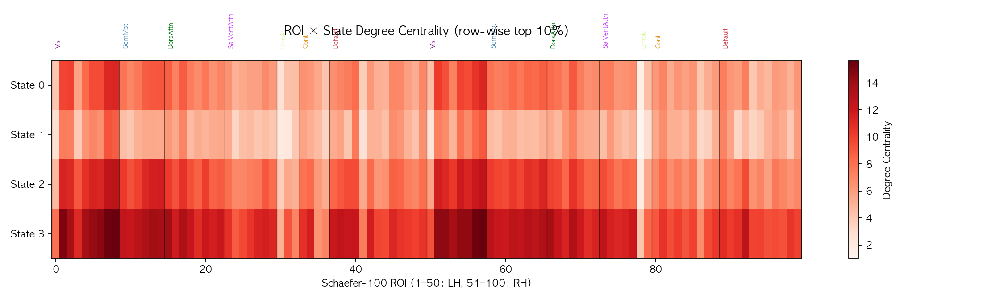

*Figure 4. ROI × State DC 히트맵 (네트워크 경계 표시).*

---

## (3) Yeo 7-Network 요약

Schaefer-100 parcel을 CBIG `Schaefer2018_100Parcels_7Networks_order_info.txt` 의 네트워크 레이블로 묶어, 네트워크 내 ROI의 DC **평균**으로 7×1 벡터를 만들었다.

| Network | code | n_roi | State0 | State1 | State2 | State3 |
|---|---|---|---|---|---|---|
| Visual | Vis | 17 | 8.926 | 6.671 | 10.665 | 13.681 |
| Somatomotor | SomMot | 14 | 8.142 | 4.877 | 10.427 | 12.815 |
| Dorsal Attention | DorsAttn | 15 | 7.596 | 5.662 | 9.399 | 12.192 |
| Salience / Ventral Attention | SalVentAttn | 12 | 6.362 | 4.644 | 8.125 | 11.039 |
| Limbic | Limbic | 5 | 3.556 | 2.413 | 4.329 | 6.831 |
| Frontoparietal Control | Cont | 13 | 5.811 | 4.968 | 6.898 | 9.296 |
| Default Mode | Default | 24 | 6.109 | 5.160 | 7.651 | 10.536 |

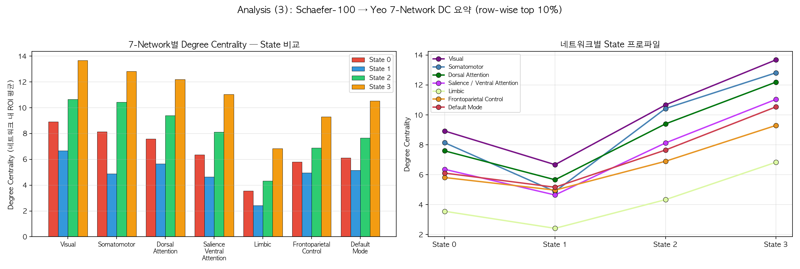

*Figure 5. (좌) 네트워크별 State 비교 grouped bar plot, (우) 네트워크별 State 프로파일.*

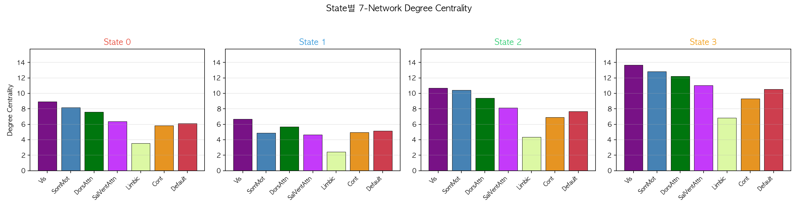

*Figure 6. State별 7-Network DC bar plot (Yeo 표준 색상).*

---

## (4) State 간 Degree Centrality 차이 검정

- 관측 단위: **(subject × State) 쌍** — 각 피험자의 세그먼트 CM 중 해당 State에 배정된 것들을 Fisher-Z 공간에서 평균한 뒤 DC를 계산
- 총 관측 수 **N = 75** (State별 피험자 수: {'State0': 24, 'State1': 21, 'State2': 21, 'State3': 9})
- 검정 1: one-way ANOVA (State가 요인)
- 검정 2: State pair별 two-sample t-test (equal variance, Student's t)
- 다중비교: Benjamini-Hochberg FDR (`p_fdr`)

### 4-a. Global DC (100개 ROI 평균)

**one-way ANOVA**: F(3, 71) = **218.555**, p = **8.968e-36** ***, η² = 0.902  

(비모수 확인: Kruskal-Wallis H = 66.782, p = 2.085e-14)

State별 평균 ± 표준편차:

| State | n | mean | SD |
|---|---|---|---|
| State 0 | 24 | 7.661 | 0.544 |
| State 1 | 21 | 5.979 | 0.675 |
| State 2 | 21 | 9.625 | 0.806 |
| State 3 | 9 | 12.185 | 0.623 |

**State pair별 two-sample t-test**

| pair | n_a | n_b | mean_a | mean_b | mean_diff | t | p | sig | p_fdr | cohens_d |
|---|---|---|---|---|---|---|---|---|---|---|
| State0 vs State1 | 24 | 21 | 7.661 | 5.979 | +1.682 | +9.248 | 8.776e-12 | *** | 1.053e-11 | +2.76 |
| State0 vs State2 | 24 | 21 | 7.661 | 9.625 | -1.964 | -9.693 | 2.208e-12 | *** | 3.312e-12 | -2.90 |
| State0 vs State3 | 24 | 9 | 7.661 | 12.185 | -4.524 | -20.468 | 1.444e-19 | *** | 4.332e-19 | -8.00 |
| State1 vs State2 | 21 | 21 | 5.979 | 9.625 | -3.646 | -15.896 | 6.951e-19 | *** | 1.39e-18 | -4.91 |
| State1 vs State3 | 21 | 9 | 5.979 | 12.185 | -6.206 | -23.568 | 5.252e-20 | *** | 3.151e-19 | -9.39 |
| State2 vs State3 | 21 | 9 | 9.625 | 12.185 | -2.560 | -8.477 | 3.227e-09 | *** | 3.227e-09 | -3.38 |

### 4-b. 네트워크별 DC (7개 네트워크)

**one-way ANOVA (네트워크별)**

| Network | measure | F | p | p_fdr | sig | eta_sq |
|---|---|---|---|---|---|---|
| Visual | Vis | 67.313 | 1.019e-20 | 1.427e-20 | *** | 0.740 |
| Somatomotor | SomMot | 88.068 | 7.132e-24 | 1.664e-23 | *** | 0.788 |
| Dorsal Attention | DorsAttn | 109.819 | 1.318e-26 | 4.614e-26 | *** | 0.823 |
| Salience / Ventral Attention | SalVentAttn | 85.633 | 1.555e-23 | 2.721e-23 | *** | 0.783 |
| Limbic | Limbic | 31.193 | 5.654e-13 | 5.654e-13 | *** | 0.569 |
| Frontoparietal Control | Cont | 44.493 | 2.718e-16 | 3.17e-16 | *** | 0.653 |
| Default Mode | Default | 110.857 | 1.002e-26 | 4.614e-26 | *** | 0.824 |

**네트워크 × State pair two-sample t-test** (전체 표는 `tables/stats_network_pairwise_ttest.csv`)

| measure | pair | mean_a | mean_b | mean_diff | t | p | sig | p_fdr_across_networks | cohens_d |
|---|---|---|---|---|---|---|---|---|---|
| SalVentAttn | State1 vs State3 | 5.408 | 12.083 | -6.675 | -18.967 | 1.622e-17 | *** | 4.966e-16 | -7.56 |
| DorsAttn | State1 vs State3 | 6.360 | 13.027 | -6.667 | -18.694 | 2.365e-17 | *** | 4.966e-16 | -7.45 |
| Default | State1 vs State3 | 5.826 | 11.535 | -5.709 | -17.162 | 2.153e-16 | *** | 3.014e-15 | -6.84 |
| DorsAttn | State1 vs State2 | 6.360 | 10.529 | -4.169 | -13.068 | 5.082e-16 | *** | 5.336e-15 | -4.03 |
| Default | State0 vs State3 | 6.884 | 11.535 | -4.651 | -14.806 | 1.324e-15 | *** | 1.113e-14 | -5.79 |
| Vis | State1 vs State3 | 7.319 | 14.142 | -6.823 | -15.590 | 2.479e-15 | *** | 1.735e-14 | -6.21 |
| SomMot | State1 vs State3 | 5.878 | 13.498 | -7.619 | -15.265 | 4.212e-15 | *** | 2.527e-14 | -6.08 |
| SomMot | State1 vs State2 | 5.878 | 11.197 | -5.319 | -11.817 | 1.269e-14 | *** | 6.661e-14 | -3.65 |
| Default | State1 vs State2 | 5.826 | 8.945 | -3.119 | -10.910 | 1.479e-13 | *** | 6.903e-13 | -3.37 |
| SalVentAttn | State0 vs State3 | 7.250 | 12.083 | -4.833 | -12.238 | 2.099e-13 | *** | 8.815e-13 | -4.78 |
| DorsAttn | State0 vs State3 | 8.446 | 13.027 | -4.581 | -11.460 | 1.123e-12 | *** | 4.286e-12 | -4.48 |
| SalVentAttn | State1 vs State2 | 5.408 | 9.018 | -3.610 | -9.731 | 4.21e-12 | *** | 1.474e-11 | -3.00 |
| Vis | State0 vs State3 | 9.249 | 14.142 | -4.893 | -10.668 | 6.687e-12 | *** | 2.16e-11 | -4.17 |
| SomMot | State0 vs State3 | 8.729 | 13.498 | -4.769 | -10.039 | 2.918e-11 | *** | 8.755e-11 | -3.92 |
| Vis | State1 vs State2 | 7.319 | 11.309 | -3.990 | -9.049 | 3.176e-11 | *** | 8.893e-11 | -2.79 |
| SomMot | State0 vs State1 | 8.729 | 5.878 | +2.850 | +7.867 | 7.33e-10 | *** | 1.924e-09 | +2.35 |
| Cont | State1 vs State3 | 5.759 | 10.386 | -4.627 | -8.989 | 9.585e-10 | *** | 2.299e-09 | -3.58 |
| DorsAttn | State0 vs State1 | 8.446 | 6.360 | +2.087 | +7.776 | 9.852e-10 | *** | 2.299e-09 | +2.32 |
| Default | State0 vs State2 | 6.884 | 8.945 | -2.061 | -7.664 | 1.427e-09 | *** | 3.154e-09 | -2.29 |
| Cont | State1 vs State2 | 5.759 | 8.055 | -2.296 | -7.643 | 2.421e-09 | *** | 5.083e-09 | -2.36 |
| Limbic | State1 vs State3 | 3.239 | 7.375 | -4.136 | -8.307 | 4.873e-09 | *** | 9.745e-09 | -3.31 |
| Cont | State0 vs State3 | 6.650 | 10.386 | -3.736 | -7.859 | 7.179e-09 | *** | 1.37e-08 | -3.07 |
| Limbic | State1 vs State2 | 3.239 | 5.593 | -2.354 | -6.619 | 6.376e-08 | *** | 1.164e-07 | -2.04 |
| DorsAttn | State0 vs State2 | 8.446 | 10.529 | -2.083 | -6.295 | 1.362e-07 | *** | 2.383e-07 | -1.88 |
| SalVentAttn | State0 vs State1 | 7.250 | 5.408 | +1.842 | +6.201 | 1.864e-07 | *** | 3.131e-07 | +1.85 |

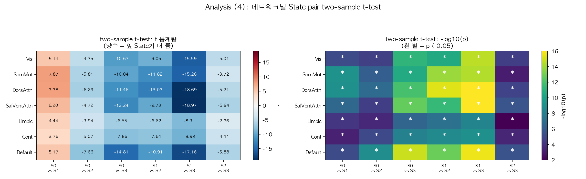

*Figure 8. 네트워크별 State pair two-sample t-test 결과 (t 통계량 / -log10 p).*

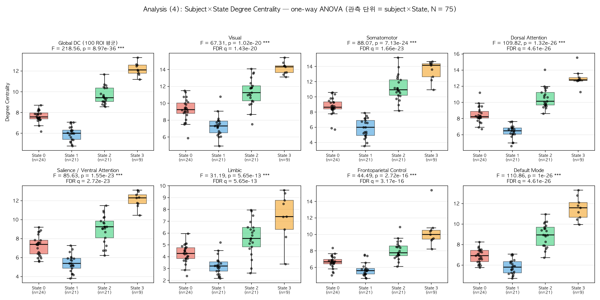

*Figure 7. Global DC 및 네트워크별 DC의 State 간 분포 (점 = 개별 subject×State 관측).*

### 4-c. ROI별 DC (100개 ROI)

- one-way ANOVA에서 **p < 0.05 (uncorrected): 100/100 ROI**, **FDR q < 0.05: 100/100 ROI**

F 값 상위 15개 ROI:

| roi_number | roi_label | network | F | p | sig | p_fdr | eta_sq |
|---|---|---|---|---|---|---|---|
| 10 | 7Networks_LH_SomMot_1 | SomMot | 115.531 | 2.991e-27 | *** | 2.991e-25 | 0.830 |
| 59 | 7Networks_RH_SomMot_1 | SomMot | 92.189 | 1.981e-24 | *** | 9.904e-23 | 0.796 |
| 12 | 7Networks_LH_SomMot_3 | SomMot | 80.491 | 8.544e-23 | *** | 2.848e-21 | 0.773 |
| 40 | 7Networks_LH_Default_Par_1 | Default | 77.587 | 2.322e-22 | *** | 5.806e-21 | 0.766 |
| 67 | 7Networks_RH_DorsAttn_Post_1 | DorsAttn | 74.018 | 8.255e-22 | *** | 1.651e-20 | 0.758 |
| 74 | 7Networks_RH_SalVentAttn_TempOccPar_1 | SalVentAttn | 73.346 | 1.054e-21 | *** | 1.756e-20 | 0.756 |
| 16 | 7Networks_LH_DorsAttn_Post_1 | DorsAttn | 69.407 | 4.56e-21 | *** | 6.514e-20 | 0.746 |
| 13 | 7Networks_LH_SomMot_4 | SomMot | 68.877 | 5.58e-21 | *** | 6.975e-20 | 0.744 |
| 18 | 7Networks_LH_DorsAttn_Post_3 | DorsAttn | 66.686 | 1.301e-20 | *** | 1.446e-19 | 0.738 |
| 93 | 7Networks_RH_Default_Temp_3 | Default | 65.898 | 1.773e-20 | *** | 1.773e-19 | 0.736 |
| 39 | 7Networks_LH_Default_Temp_2 | Default | 65.389 | 2.168e-20 | *** | 1.971e-19 | 0.734 |
| 43 | 7Networks_LH_Default_PFC_2 | Default | 64.961 | 2.57e-20 | *** | 2.142e-19 | 0.733 |
| 11 | 7Networks_LH_SomMot_2 | SomMot | 63.971 | 3.822e-20 | *** | 2.94e-19 | 0.730 |
| 38 | 7Networks_LH_Default_Temp_1 | Default | 61.535 | 1.034e-19 | *** | 7.388e-19 | 0.722 |
| 15 | 7Networks_LH_SomMot_6 | SomMot | 61.189 | 1.194e-19 | *** | 7.963e-19 | 0.721 |

**State pair별 ROI 수준 two-sample t-test 요약**

| pair | n_a | n_b | ROI p<0.05 | ROI FDR q<0.05 | max abs(t) | 가장 유의한 ROI |
|---|---|---|---|---|---|---|
| State0 vs State1 | 24 | 21 | 85 | 85 | 9.462 | 7Networks_LH_SomMot_1 |
| State0 vs State2 | 24 | 21 | 95 | 95 | 7.121 | 7Networks_RH_Default_PFCv_1 |
| State0 vs State3 | 24 | 9 | 99 | 99 | 12.451 | 7Networks_LH_SomMot_1 |
| State1 vs State2 | 21 | 21 | 100 | 100 | 13.052 | 7Networks_LH_SomMot_1 |
| State1 vs State3 | 21 | 9 | 100 | 100 | 18.085 | 7Networks_LH_SomMot_3 |
| State2 vs State3 | 21 | 9 | 91 | 90 | 5.249 | 7Networks_RH_Default_PFCv_1 |

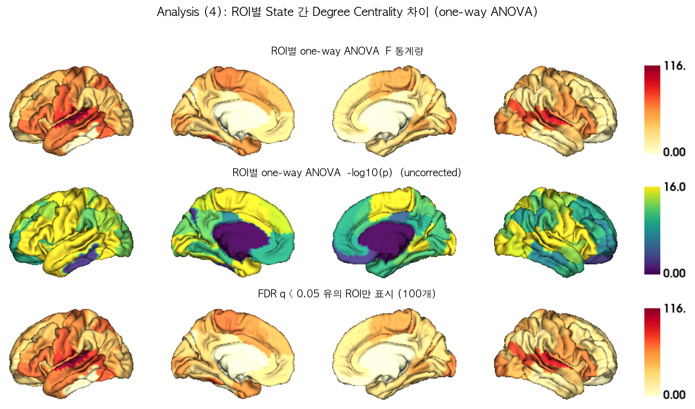

*Figure 9. ROI별 one-way ANOVA F / -log10(p) / FDR 유의 ROI 표면 맵.*

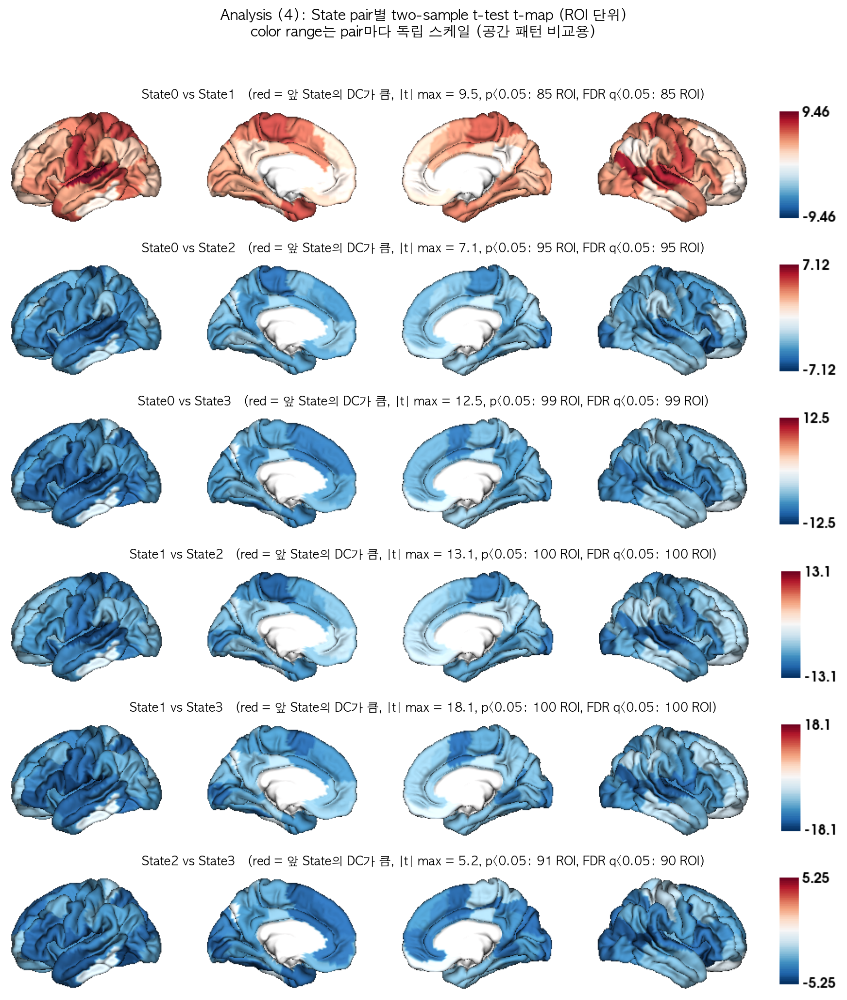

*Figure 10. State pair별 two-sample t-test t-map.*

---

## (5, 보조) 전역 연결강도 vs 공간적 hub 재배치

(4)의 DC 차이가 "뇌 전체 연결강도가 통째로 올라간 것"인지 "hub의 공간적 배치가 바뀐 것"인지 구분하기 위해, 각 관측의 DC를 자기 평균으로 나눈 **상대 DC**(relative DC = DC / mean(DC), 100개 ROI 평균 = 1)로 동일한 검정을 반복했다.

### State 간 상대 DC 프로파일의 공간 상관

|  | State0 | State1 | State2 | State3 |
|---|---|---|---|---|
| State0 | 1.000 | 0.833 | 0.969 | 0.940 |
| State1 | 0.833 | 1.000 | 0.736 | 0.721 |
| State2 | 0.969 | 0.736 | 1.000 | 0.967 |
| State3 | 0.940 | 0.721 | 0.967 | 1.000 |

- State 간 공간 상관의 최솟값 = **0.721** → 1에 가까울수록 State가 달라져도 hub의 공간적 배치는 거의 동일함을 뜻한다.

### 네트워크별 상대 DC one-way ANOVA

| Network | measure | F | p | p_fdr | sig | eta_sq |
|---|---|---|---|---|---|---|
| Visual | Vis | 0.737 | 0.5337 | 0.5337 | n.s. | 0.030 |
| Somatomotor | SomMot | 8.233 | 8.949e-05 | 0.0006264 | *** | 0.258 |
| Dorsal Attention | DorsAttn | 0.912 | 0.4398 | 0.513 | n.s. | 0.037 |
| Salience / Ventral Attention | SalVentAttn | 1.273 | 0.2904 | 0.5082 | n.s. | 0.051 |
| Limbic | Limbic | 0.928 | 0.4319 | 0.513 | n.s. | 0.038 |
| Frontoparietal Control | Cont | 6.658 | 0.0005021 | 0.001757 | ** | 0.220 |
| Default Mode | Default | 2.765 | 0.04812 | 0.1123 | n.s. | 0.105 |

- ROI별 상대 DC ANOVA: p < 0.05 (uncorrected) **45/100 ROI**, FDR q < 0.05 **32/100 ROI**
- 비교: 원래(절대) DC에서는 각각 100/100, 100/100 ROI였다.

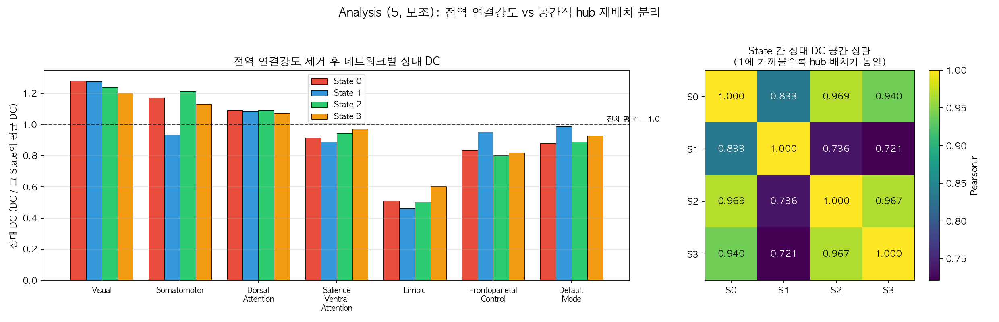

*Figure 11. (좌) 전역 크기를 제거한 네트워크별 상대 DC, (우) State 간 상대 DC 공간 상관.*

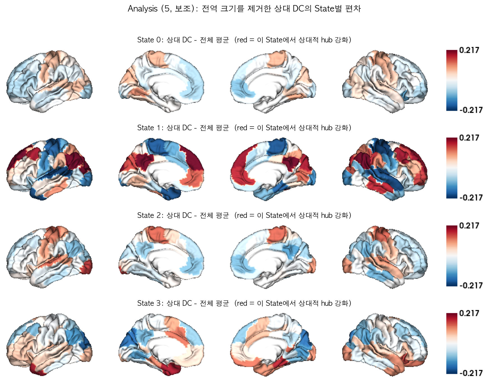

*Figure 12. 상대 DC의 State별 편차 표면 맵.*

**해석 포인트**: 절대 DC의 State 차이 중 얼마만큼이 전역 연결강도 차이이고 얼마만큼이 공간적 재배치인지를 위 두 결과를 비교해 판단해야 한다. 공간 상관이 매우 높고 상대 DC의 유의 ROI 수가 크게 줄어든다면, State 구분의 주된 축은 "hub 위치의 변화"가 아니라 "전반적 연결강도(FC magnitude)"이다.

---

## (6) Brain State별 Dwell Time

각 피험자가 각 State에 머무른 시간을 세그먼트 길이(= time point 개수)로 세고 **TR = 0.72초**를 곱해 초 단위로 환산했다. 관측 단위는 (4)절의 DC 분석과 동일한 **(subject × State) 쌍**이다.

```
dwell time [초] = (해당 State에 배정된 time point 개수) x 0.72 [TR]
```

두 가지 정의를 모두 계산했다.

- **(A) 총 점유 시간 (total occupancy)** — 한 피험자에서 해당 State로 분류된 **모든** 세그먼트 길이의 합. "스캔 전체에서 그 State에 총 얼마나 있었는가".
- **(B) 방문당 평균 체류 시간 (mean bout dwell time)** — 같은 State가 시간축에서 연속으로 이어지는 구간(bout)마다 길이를 재고, 피험자별로 평균. dynamic FC 문헌에서 "dwell time"이라 부를 때 보통 이쪽을 뜻한다. "한 번 그 State에 들어가면 평균 얼마나 머무는가".

전체 27명의 스캔 길이는 모두 1200 TP(= 864초)로 동일하며, 모든 time point가 State 레이블을 받았다(100%). 따라서 한 피험자의 총 점유 시간을 State에 대해 모두 더하면 항상 864초가 된다.

### State별 dwell time 기술통계 (평균 ± 표준편차)

| State | 피험자 수 | 세그먼트 수 | 평균 TP 수 | **총 점유 시간 [초]** | 스캔 대비 비율 [%] | 평균 방문 횟수 | **방문당 체류 시간 [초]** |
|---|---|---|---|---|---|---|---|
| State 0 | 24 | 99 | 418.4 | 301.2 ± 235.8 | 34.9 ± 27.3 | 2.42 | 116.1 ± 72.4 |
| State 1 | 21 | 121 | 682.4 | 491.3 ± 327.1 | 56.9 ± 37.9 | 1.71 | 340.8 ± 298.4 |
| State 2 | 21 | 72 | 313.4 | 225.6 ± 202.7 | 26.1 ± 23.5 | 2.10 | 90.7 ± 60.8 |
| State 3 | 9 | 16 | 160.9 | 115.8 ± 128.4 | 13.4 ± 14.9 | 1.44 | 66.3 ± 53.0 |

- **총 점유 시간 순서**: State 3 (115.8초) < State 2 (225.6초) < State 0 (301.2초) < State 1 (491.3초)
- **방문당 체류 시간 순서**: State 3 (66.3초) < State 2 (90.7초) < State 0 (116.1초) < State 1 (340.8초)

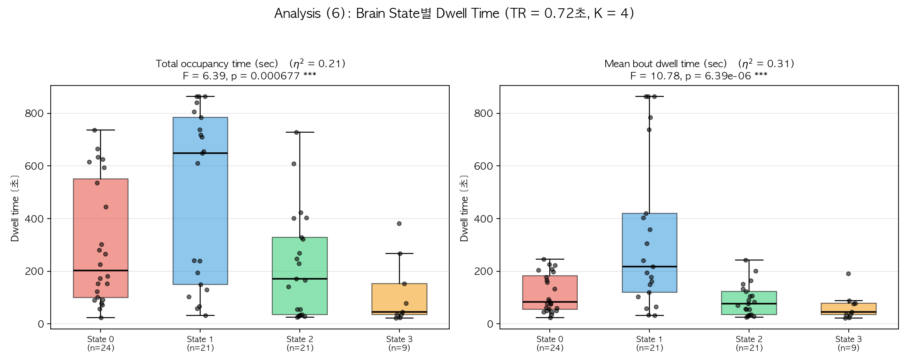

*Figure 13. State별 dwell time 분포. (좌) 총 점유 시간, (우) 방문당 평균 체류 시간. 점 = 개별 (subject × State) 관측.*

### one-way ANOVA — dwell time이 State에 따라 다른가

| 측도 | F (df) | p | 유의성 | η² | Kruskal-Wallis H | KW p |
|---|---|---|---|---|---|---|
| 총 점유 시간 | F(3, 71) = 6.392 | 0.0006767 | *** | 0.213 | 14.447 | 0.002356 |
| 방문당 평균 체류 시간 | F(3, 71) = 10.779 | 6.394e-06 | *** | 0.313 | 17.869 | 0.000468 |

두 정의 모두 State 간 dwell time 차이가 유의했다. 효과크기는 방문당 체류 시간(η² = 0.313)이 총 점유 시간(η² = 0.213)보다 크다. 비모수 Kruskal-Wallis에서도 같은 결론이 나와, 분포의 치우침 때문에 생긴 결과는 아니다.

### two-sample t-test — State pair별 비교

**(A) 총 점유 시간**

| Pair | n (a / b) | 평균 [초] (a / b) | 차이 | t (df) | p | 유의성 | FDR q | Cohen's d | Welch p |
|---|---|---|---|---|---|---|---|---|---|
| State0 vs State1 | 24 / 21 | 301.2 / 491.3 | -190.1 | t(43) = -2.256 | 0.02921 | * | 0.05037 | -0.67 | 0.03373 |
| State0 vs State2 | 24 / 21 | 301.2 / 225.6 | +75.6 | t(43) = 1.145 | 0.2586 | n.s. | 0.2586 | +0.34 | 0.2538 |
| State0 vs State3 | 24 / 9 | 301.2 / 115.8 | +185.4 | t(31) = 2.224 | 0.03358 | * | 0.05037 | +0.87 | 0.007817 |
| State1 vs State2 | 21 / 21 | 491.3 / 225.6 | +265.7 | t(40) = 3.164 | 0.002973 | ** | 0.008919 | +0.98 | 0.003313 |
| State1 vs State3 | 21 / 9 | 491.3 / 115.8 | +375.5 | t(28) = 3.308 | 0.002585 | ** | 0.008919 | +1.32 | 0.0001058 |
| State2 vs State3 | 21 / 9 | 225.6 / 115.8 | +109.8 | t(28) = 1.493 | 0.1465 | n.s. | 0.1758 | +0.60 | 0.08732 |

**(B) 방문당 평균 체류 시간**

| Pair | n (a / b) | 평균 [초] (a / b) | 차이 | t (df) | p | 유의성 | FDR q | Cohen's d | Welch p |
|---|---|---|---|---|---|---|---|---|---|
| State0 vs State1 | 24 / 21 | 116.1 / 340.8 | -224.7 | t(43) = -3.576 | 0.0008778 | *** | 0.002633 | -1.07 | 0.002785 |
| State0 vs State2 | 24 / 21 | 116.1 / 90.7 | +25.4 | t(43) = 1.263 | 0.2134 | n.s. | 0.256 | +0.38 | 0.208 |
| State0 vs State3 | 24 / 9 | 116.1 / 66.3 | +49.8 | t(31) = 1.874 | 0.07033 | n.s. | 0.1055 | +0.73 | 0.04312 |
| State1 vs State2 | 21 / 21 | 340.8 / 90.7 | +250.1 | t(40) = 3.764 | 0.000538 | *** | 0.002633 | +1.16 | 0.001095 |
| State1 vs State3 | 21 / 9 | 340.8 / 66.3 | +274.5 | t(28) = 2.715 | 0.01122 | * | 0.02244 | +1.08 | 0.0004831 |
| State2 vs State3 | 21 / 9 | 90.7 / 66.3 | +24.4 | t(28) = 1.044 | 0.3053 | n.s. | 0.3053 | +0.42 | 0.2843 |

> 유의성 표기: `***` p < 0.001, `**` p < 0.01, `*` p < 0.05, `n.s.` = not significant. `p`는 보정 전 값이고 `FDR q`는 6개 pair에 대한 Benjamini-Hochberg 보정값이다.

### 해석

1. **State 1이 가장 오래 유지되는 상태다.** 총 점유 시간이 491.3초로 가장 길고, 방문당 체류 시간에서도 State 1이 340.8초로 가장 길다.
2. **State 3이 가장 짧다.** 총 점유 시간 115.8초, 방문한 피험자는 9명뿐이다. 방문 자체가 드물고, 들어가도 오래 머물지 않는다.
3. **두 정의의 결론이 대체로 일치한다.** 보정 전 기준 유의한 pair는 총 점유 시간 4개, 방문당 체류 시간 3개이며, FDR 보정 후에는 각각 2개, 3개다. 총 점유 시간이 길다는 것이 단순히 '자주 방문해서'가 아니라 '한 번 들어가면 길게 머물러서'인지 확인하려면 두 표의 방향을 함께 보아야 한다.
4. **(4)절의 DC 결과와 묶어 볼 것.** DC 크기 순서와 dwell time 순서를 비교하면 연결강도가 높은 상태가 더 오래 유지되는지(혹은 그 반대인지)를 볼 수 있다. 다만 아래 주의사항 5번의 제약 때문에 확정적 결론으로 보기는 어렵다.

---

## 통계적 주의사항

1. 관측 단위가 (subject × State)이므로 한 피험자가 여러 State에 기여할 수 있다(전체 27명 중 여러 State를 가진 피험자 존재). 따라서 one-way ANOVA / two-sample t-test의 독립성 가정은 엄밀히는 위배되며, 결과는 탐색적(exploratory)으로 해석해야 한다. 보조 지표로 Kruskal-Wallis(비모수)와 Welch t-test를 함께 보고했다.
2. State별 표본 크기가 불균형하다 ({'State0': 24, 'State1': 21, 'State2': 21, 'State3': 9}). 표본이 작은 State의 검정력은 낮다.
3. 100개 ROI 및 7개 네트워크에 대한 반복 검정은 Benjamini-Hochberg FDR로 보정했다 (`p_fdr` 열). 본문의 `p`는 보정 전 값이다.
4. DC는 Fisher-Z 값의 합이므로 단위가 없는 상대적 지표이며, State 간 비교에서만 의미를 가진다.
5. **Dwell time 관련 (6절)**: (a) 모든 피험자의 스캔 길이가 같고 한 피험자의 총 점유 시간 합이 864초로 고정되므로, State들의 총 점유 시간은 서로 독립이 아니다(한 State가 길면 다른 State는 짧아지는 compositional 제약). 방문당 평균 체류 시간에는 이 제약이 없다. (b) 어떤 State를 한 번도 방문하지 않은 피험자는 그 State의 표본에서 빠지므로, 각 평균은 "그 State를 방문한 피험자들 중에서의" 평균이다(0을 포함한 평균이 아니다). (c) dwell time의 시간 해상도는 세그먼테이션 단계의 최소 세그먼트 길이 제약으로 묶여 있다(실제 관측된 최소 세그먼트 = 31 TP = 22.3초). 그보다 짧은 상태 전환은 원리적으로 관측되지 않으며, 방문당 체류 시간의 하한도 약 22초다.

---

## 산출물

- 그림: `visualization_ver4_add/fig1 ~ fig13*.png`
- 개별 표면 렌더링: `visualization_ver4_add/surface/*.png`
- 표(CSV): `visualization_ver4_add/tables/`
  - `dc_state_level_roi.csv` — State별 100×1 DC
  - `dc_top10_roi_per_state.csv` — State별 DC 상위 10 ROI
  - `dc_network_level_state.csv` / `..._SUM.csv` — 7×1 네트워크 요약
  - `dc_subject_state_roi_long.csv` — subject×State×ROI DC (long format)
  - `stats_global_anova.csv`, `stats_global_pairwise_ttest.csv`
  - `stats_network_anova.csv`, `stats_network_pairwise_ttest.csv`
  - `stats_roi_anova.csv`, `stats_roi_pairwise_ttest.csv`
  - `dwell_time_subject_state.csv` — subject×State dwell time (총 점유 / 방문당 체류)
  - `stats_dwell_anova.csv`, `stats_dwell_pairwise_ttest.csv` — dwell time 검정 결과
  - `dc_state_level_roi_relative.csv`, `dc_state_spatial_correlation.csv` — 상대 DC (보조 분석)
  - `stats_network_anova_relativeDC.csv`, `stats_network_pairwise_ttest_relativeDC.csv`, `stats_roi_anova_relativeDC.csv`
  - `schaefer100_7networks_labels.csv` — 사용된 ROI↔네트워크 매핑