# Degree Centrality 기반 Brain State 해석 분석 (V4, K=2)

- 생성 스크립트: `full_pipeline_v4_add.py`
- 기반 파이프라인: `full_pipeline_v4_k2.py` (세그먼트 → CM → K-means Brain State)
- 피험자 수: **27**, 총 세그먼트(=CM) 수: **308**, ROI: **Schaefer-100 (7 Networks, cortex only)**
- Brain State 수 K = **2**, State별 세그먼트 수: {0: 138, 1: 170}
- CM: Pearson 상관 + Fisher-Z 변환

> **주의**: 이번 실행 환경에는 ENIGMA TOOLBOX가 없어 표면(surface) 그림을 다시 렌더링하지 못했다. 아래 표면 그림은 이전 실행에서 만들어 둔 PNG 파일을 그대로 참조한 것이다.

---

## 핵심 결과 요약

1. **State 간 DC는 매우 크게 다르다.** Global DC(100개 ROI 평균)의 one-way ANOVA는 F(1, 46) = 118.3, p = 2.63e-14 (η² = 0.72)이고, State pair는 t = +10.9, p = 2.63e-14로 유의했다.
2. **DC 크기 순서**: State 1 (5.58) < State 0 (8.47). 가장 강한 State는 **State 0**, 가장 약한 State는 **State 1**이다.
3. **네트워크 수준에서도 7개 네트워크 전부 유의**하게 달랐다 (FDR q < 0.05, F = 34.2 ~ 121.5). ROI 수준에서는 100/100 ROI가 FDR q < 0.05였다.
4. **DC가 가장 높은 영역은 모든 State에서 일관되게 Visual network**이며 (Vis 상대 DC ≈ 1.26), 가장 낮은 영역은 Limbic network다 (≈ 0.50). 즉 hub의 위치 자체는 State가 바뀌어도 크게 흔들리지 않는다.
5. **차이의 대부분은 전역 연결강도(FC magnitude)에서 온다.** 전역 크기를 제거한 상대 DC로 다시 보면 State 간 공간 상관이 r = 0.84로 높고, 7개 네트워크 중 2개(Somatomotor, Frontoparietal Control)만 FDR q < 0.05를 유지했으며, 유의 ROI도 100개 → 23개로 줄었다. 따라서 K-means가 잡아낸 Brain State의 주된 축은 "hub의 재배치"보다 "전반적 연결강도의 고저"로 해석하는 것이 타당하다. (자세한 내용은 (5)절)
6. **State별로 머무는 시간이 다르다.** 방문당 평균 체류 시간은 State 1(361.5초)이 가장 길고 State 0(268.7초)이 가장 짧다 (one-way ANOVA F(1, 46) = 1.39, p = 0.244, η² = 0.03). 총 점유 시간도 같은 순서이며 (F = 1.83, p = 0.183, η² = 0.04), DC가 가장 낮은 State 1가 가장 오래 유지된다. 다만 이 차이가 **무작위 분할 대비** 유의한지는 별도 대조군 검정이 필요하다 (`full_pipeline_v5.py` 참고). (자세한 내용은 (6)절)
7. **주의**: State별 피험자 수는 22~26명으로 비교적 균형이 있으나, 관측 단위가 (subject × State)라 독립성 가정이 완전하지 않다. (마지막 절 참고)

---

## 방법: Degree Centrality 정의

100×100 연결성 행렬 `Z`(Fisher-Z)에 **row-wise proportional thresholding**을 적용한다.

```
1) 대각(자기 자신 연결)을 후보에서 제외             → 각 행 99개 후보
2) 각 행에서 값이 큰 상위 10% element만 유지        → 행당 10개 유지
3) 유지된 element를 행 방향으로 합산                → DC_i = sum_j∈top(i) Z_ij
```

- 결과: 100×1 벡터 (ROI별 weighted degree centrality)
- Thresholding 기준: **z (부호 유지, 즉 가장 강한 양의 연결)**
- 행별로 독립적으로 threshold하므로 유지 마스크는 비대칭이며, DC는 "각 ROI가 자신의 가장 강한 연결 상위 10%로부터 받는 총 연결 강도"를 의미한다.

---

## (1)+(2) State별 Degree Centrality 와 피질 표면 분포

### State별 DC 요약 통계

| State | n_CM | DC mean | DC SD | DC min | DC max | 최대 DC ROI |
|---|---|---|---|---|---|---|
| State 0 | 138 | 8.465 | 2.079 | 2.071 | 12.713 | 7Networks_LH_Vis_9 (Vis) |
| State 1 | 170 | 5.576 | 1.513 | 1.076 | 9.546 | 7Networks_LH_Vis_8 (Vis) |

### State별 DC 상위 5개 ROI

**State 0**
| rank | roi_label | network | hemisphere | DC |
|---|---|---|---|---|
| 1 | 7Networks_LH_Vis_9 | Vis | LH | 12.713 |
| 2 | 7Networks_RH_Vis_8 | Vis | RH | 12.622 |
| 3 | 7Networks_LH_Vis_8 | Vis | LH | 12.607 |
| 4 | 7Networks_RH_Vis_7 | Vis | RH | 12.170 |
| 5 | 7Networks_RH_Vis_2 | Vis | RH | 11.742 |

**State 1**
| rank | roi_label | network | hemisphere | DC |
|---|---|---|---|---|
| 1 | 7Networks_LH_Vis_8 | Vis | LH | 9.546 |
| 2 | 7Networks_RH_Vis_8 | Vis | RH | 9.485 |
| 3 | 7Networks_LH_Vis_9 | Vis | LH | 9.339 |
| 4 | 7Networks_RH_Vis_7 | Vis | RH | 8.710 |
| 5 | 7Networks_RH_Vis_5 | Vis | RH | 8.304 |

### 표면 시각화 (ENIGMA TOOLBOX, fsa5)

각 그림은 좌→우로 `LH lateral · LH medial · RH medial · RH lateral` 순서다.

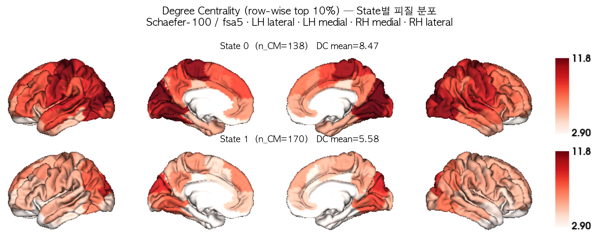

*Figure 1. State별 Degree Centrality의 피질 분포 (공통 color range).*

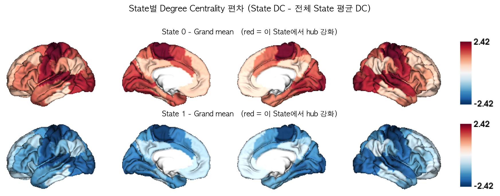

*Figure 2. 전체 State 평균 대비 각 State의 DC 편차. 붉은색 = 해당 State에서 상대적으로 hub 역할이 강화된 영역.*

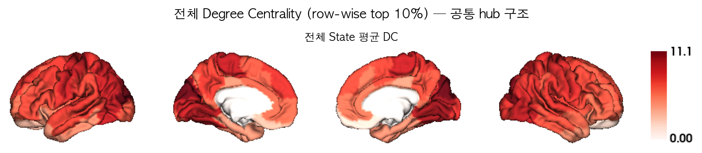

*Figure 3. 모든 State 평균 DC — State와 무관한 공통 hub 구조.*

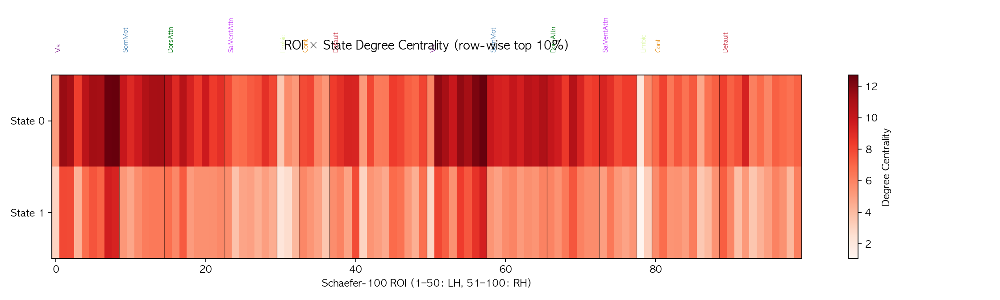

*Figure 4. ROI × State DC 히트맵 (네트워크 경계 표시).*

---

## (3) Yeo 7-Network 요약

Schaefer-100 parcel을 CBIG `Schaefer2018_100Parcels_7Networks_order_info.txt` 의 네트워크 레이블로 묶어, 네트워크 내 ROI의 DC **평균**으로 7×1 벡터를 만들었다.

| Network | code | n_roi | State0 | State1 |
|---|---|---|---|---|
| Visual | Vis | 17 | 10.619 | 7.111 |
| Somatomotor | SomMot | 14 | 10.104 | 5.598 |
| Dorsal Attention | DorsAttn | 15 | 9.291 | 5.993 |
| Salience / Ventral Attention | SalVentAttn | 12 | 7.969 | 4.973 |
| Limbic | Limbic | 5 | 4.420 | 2.626 |
| Frontoparietal Control | Cont | 13 | 6.803 | 5.150 |
| Default Mode | Default | 24 | 7.460 | 5.361 |

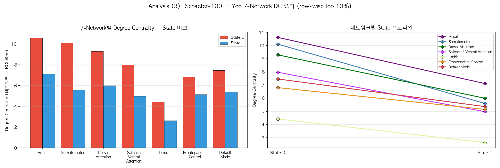

*Figure 5. (좌) 네트워크별 State 비교 grouped bar plot, (우) 네트워크별 State 프로파일.*

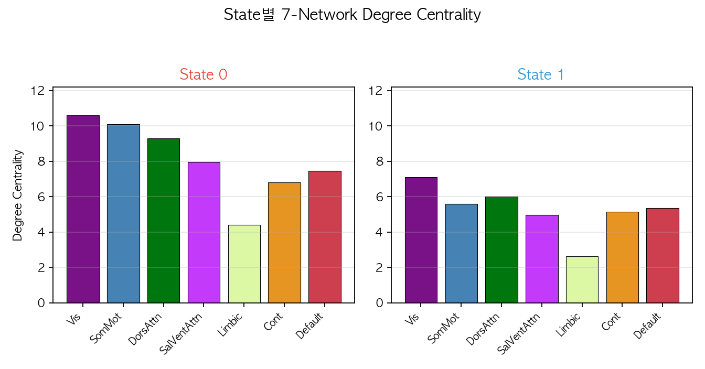

*Figure 6. State별 7-Network DC bar plot (Yeo 표준 색상).*

---

## (4) State 간 Degree Centrality 차이 검정

- 관측 단위: **(subject × State) 쌍** — 각 피험자의 세그먼트 CM 중 해당 State에 배정된 것들을 Fisher-Z 공간에서 평균한 뒤 DC를 계산
- 총 관측 수 **N = 48** (State별 피험자 수: {'State0': 22, 'State1': 26})
- 검정 1: one-way ANOVA (State가 요인)
- 검정 2: State pair별 two-sample t-test (equal variance, Student's t)
- 다중비교: Benjamini-Hochberg FDR (`p_fdr`)

### 4-a. Global DC (100개 ROI 평균)

**one-way ANOVA**: F(1, 46) = **118.297**, p = **2.63e-14** ***, η² = 0.720  

(비모수 확인: Kruskal-Wallis H = 33.566, p = 6.887e-09)

> **참고 (K=2)**: 그룹이 2개일 때 one-way ANOVA와 two-sample t-test는 수학적으로 동일한 검정이다 (F = t², p 값 동일). 따라서 아래 ANOVA와 4-a의 pairwise t-test는 같은 결과를 다른 형식으로 보여 주는 것이며, 서로 독립된 근거가 아니다.

State별 평균 ± 표준편차:

| State | n | mean | SD |
|---|---|---|---|
| State 0 | 22 | 9.047 | 0.757 |
| State 1 | 26 | 6.423 | 0.891 |

**State pair별 two-sample t-test**

| pair | n_a | n_b | mean_a | mean_b | mean_diff | t | p | sig | p_fdr | cohens_d |
|---|---|---|---|---|---|---|---|---|---|---|
| State0 vs State1 | 22 | 26 | 9.047 | 6.423 | +2.623 | +10.876 | 2.63e-14 | *** | 2.63e-14 | +3.15 |

### 4-b. 네트워크별 DC (7개 네트워크)

**one-way ANOVA (네트워크별)**

| Network | measure | F | p | p_fdr | sig | eta_sq |
|---|---|---|---|---|---|---|
| Visual | Vis | 48.221 | 1.105e-08 | 1.547e-08 | *** | 0.512 |
| Somatomotor | SomMot | 77.427 | 2.019e-11 | 7.068e-11 | *** | 0.627 |
| Dorsal Attention | DorsAttn | 121.457 | 1.691e-14 | 1.184e-13 | *** | 0.725 |
| Salience / Ventral Attention | SalVentAttn | 66.172 | 1.874e-10 | 3.28e-10 | *** | 0.590 |
| Limbic | Limbic | 34.226 | 4.852e-07 | 4.852e-07 | *** | 0.427 |
| Frontoparietal Control | Cont | 38.463 | 1.442e-07 | 1.682e-07 | *** | 0.455 |
| Default Mode | Default | 69.220 | 1.003e-10 | 2.34e-10 | *** | 0.601 |

**네트워크 × State pair two-sample t-test** (전체 표는 `tables/stats_network_pairwise_ttest.csv`)

| measure | pair | mean_a | mean_b | mean_diff | t | p | sig | p_fdr_across_networks | cohens_d |
|---|---|---|---|---|---|---|---|---|---|
| DorsAttn | State0 vs State1 | 9.970 | 6.809 | +3.161 | +11.021 | 1.691e-14 | *** | 1.184e-13 | +3.19 |
| SomMot | State0 vs State1 | 10.433 | 6.582 | +3.850 | +8.799 | 2.019e-11 | *** | 7.068e-11 | +2.55 |
| Default | State0 vs State1 | 8.152 | 6.145 | +2.007 | +8.320 | 1.003e-10 | *** | 2.34e-10 | +2.41 |
| SalVentAttn | State0 vs State1 | 8.592 | 5.945 | +2.647 | +8.135 | 1.874e-10 | *** | 3.28e-10 | +2.36 |
| Vis | State0 vs State1 | 10.895 | 7.896 | +2.999 | +6.944 | 1.105e-08 | *** | 1.547e-08 | +2.01 |
| Cont | State0 vs State1 | 7.651 | 5.979 | +1.672 | +6.202 | 1.442e-07 | *** | 1.682e-07 | +1.80 |
| Limbic | State0 vs State1 | 5.125 | 3.450 | +1.675 | +5.850 | 4.852e-07 | *** | 4.852e-07 | +1.69 |

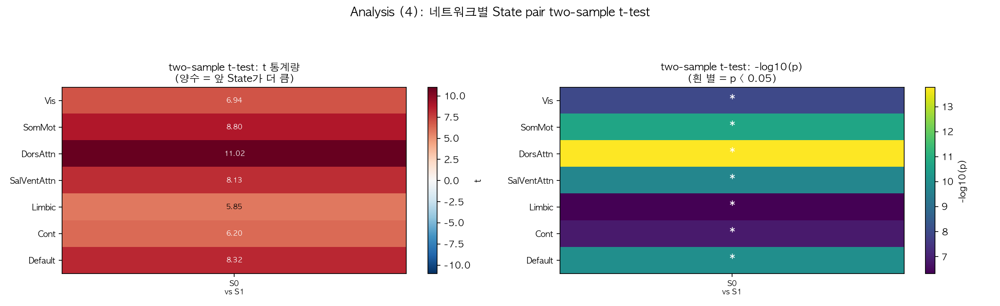

*Figure 8. 네트워크별 State pair two-sample t-test 결과 (t 통계량 / -log10 p).*

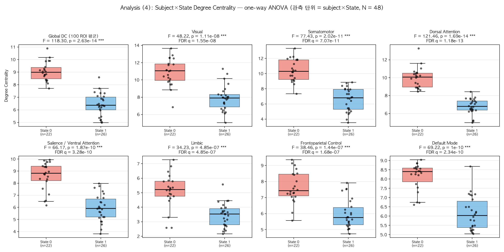

*Figure 7. Global DC 및 네트워크별 DC의 State 간 분포 (점 = 개별 subject×State 관측).*

### 4-c. ROI별 DC (100개 ROI)

- one-way ANOVA에서 **p < 0.05 (uncorrected): 100/100 ROI**, **FDR q < 0.05: 100/100 ROI**

F 값 상위 15개 ROI:

| roi_number | roi_label | network | F | p | sig | p_fdr | eta_sq |
|---|---|---|---|---|---|---|---|
| 10 | 7Networks_LH_SomMot_1 | SomMot | 95.205 | 8.839e-13 | *** | 4.998e-11 | 0.674 |
| 17 | 7Networks_LH_DorsAttn_Post_2 | DorsAttn | 94.459 | 9.996e-13 | *** | 4.998e-11 | 0.673 |
| 16 | 7Networks_LH_DorsAttn_Post_1 | DorsAttn | 84.053 | 5.981e-12 | *** | 1.224e-10 | 0.646 |
| 40 | 7Networks_LH_Default_Par_1 | Default | 83.388 | 6.739e-12 | *** | 1.224e-10 | 0.644 |
| 59 | 7Networks_RH_SomMot_1 | SomMot | 83.074 | 7.131e-12 | *** | 1.224e-10 | 0.644 |
| 25 | 7Networks_LH_SalVentAttn_FrOperIns_1 | SalVentAttn | 82.911 | 7.344e-12 | *** | 1.224e-10 | 0.643 |
| 67 | 7Networks_RH_DorsAttn_Post_1 | DorsAttn | 79.883 | 1.277e-11 | *** | 1.824e-10 | 0.635 |
| 12 | 7Networks_LH_SomMot_3 | SomMot | 78.977 | 1.51e-11 | *** | 1.888e-10 | 0.632 |
| 18 | 7Networks_LH_DorsAttn_Post_3 | DorsAttn | 73.994 | 3.894e-11 | *** | 4.327e-10 | 0.617 |
| 13 | 7Networks_LH_SomMot_4 | SomMot | 72.912 | 4.809e-11 | *** | 4.809e-10 | 0.613 |
| 19 | 7Networks_LH_DorsAttn_Post_4 | DorsAttn | 67.093 | 1.549e-10 | *** | 1.408e-09 | 0.593 |
| 7 | 7Networks_LH_Vis_7 | Vis | 62.603 | 3.985e-10 | *** | 3.321e-09 | 0.576 |
| 60 | 7Networks_RH_SomMot_2 | SomMot | 61.729 | 4.812e-10 | *** | 3.702e-09 | 0.573 |
| 20 | 7Networks_LH_DorsAttn_Post_5 | DorsAttn | 61.313 | 5.267e-10 | *** | 3.762e-09 | 0.571 |
| 62 | 7Networks_RH_SomMot_4 | SomMot | 60.779 | 5.918e-10 | *** | 3.945e-09 | 0.569 |

**State pair별 ROI 수준 two-sample t-test 요약**

| pair | n_a | n_b | ROI p<0.05 | ROI FDR q<0.05 | max abs(t) | 가장 유의한 ROI |
|---|---|---|---|---|---|---|
| State0 vs State1 | 22 | 26 | 100 | 100 | 9.757 | 7Networks_LH_SomMot_1 |

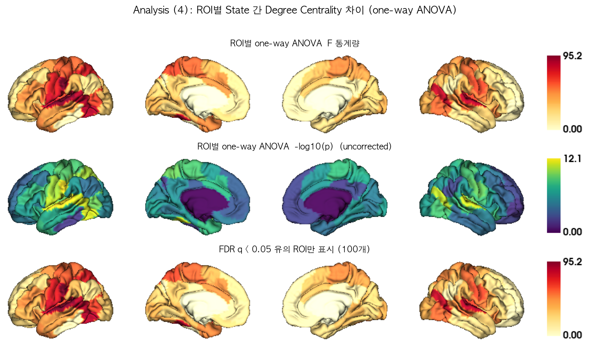

*Figure 9. ROI별 one-way ANOVA F / -log10(p) / FDR 유의 ROI 표면 맵.*

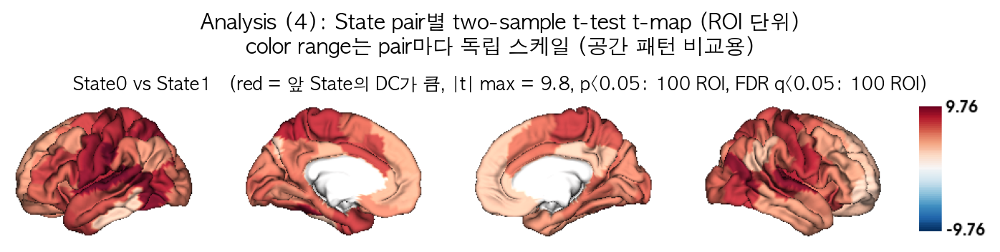

*Figure 10. State pair별 two-sample t-test t-map.*

---

## (5, 보조) 전역 연결강도 vs 공간적 hub 재배치

(4)의 DC 차이가 "뇌 전체 연결강도가 통째로 올라간 것"인지 "hub의 공간적 배치가 바뀐 것"인지 구분하기 위해, 각 관측의 DC를 자기 평균으로 나눈 **상대 DC**(relative DC = DC / mean(DC), 100개 ROI 평균 = 1)로 동일한 검정을 반복했다.

### State 간 상대 DC 프로파일의 공간 상관

|  | State0 | State1 |
|---|---|---|
| State0 | 1.000 | 0.835 |
| State1 | 0.835 | 1.000 |

- State 간 공간 상관의 최솟값 = **0.835** → 1에 가까울수록 State가 달라져도 hub의 공간적 배치는 거의 동일함을 뜻한다.

### 네트워크별 상대 DC one-way ANOVA

| Network | measure | F | p | p_fdr | sig | eta_sq |
|---|---|---|---|---|---|---|
| Visual | Vis | 0.479 | 0.4926 | 0.4926 | n.s. | 0.010 |
| Somatomotor | SomMot | 11.313 | 0.001559 | 0.01091 | * | 0.197 |
| Dorsal Attention | DorsAttn | 2.790 | 0.1016 | 0.1779 | n.s. | 0.057 |
| Salience / Ventral Attention | SalVentAttn | 0.870 | 0.3558 | 0.4151 | n.s. | 0.019 |
| Limbic | Limbic | 1.321 | 0.2563 | 0.3588 | n.s. | 0.028 |
| Frontoparietal Control | Cont | 9.509 | 0.003452 | 0.01208 | * | 0.171 |
| Default Mode | Default | 5.105 | 0.02864 | 0.06682 | n.s. | 0.100 |

- ROI별 상대 DC ANOVA: p < 0.05 (uncorrected) **37/100 ROI**, FDR q < 0.05 **23/100 ROI**
- 비교: 원래(절대) DC에서는 각각 100/100, 100/100 ROI였다.

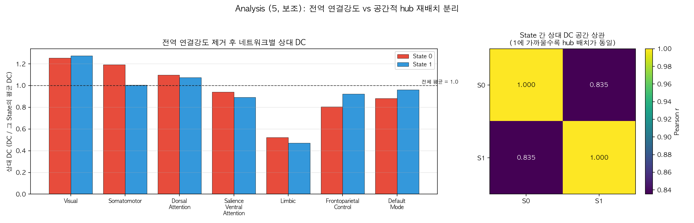

*Figure 11. (좌) 전역 크기를 제거한 네트워크별 상대 DC, (우) State 간 상대 DC 공간 상관.*

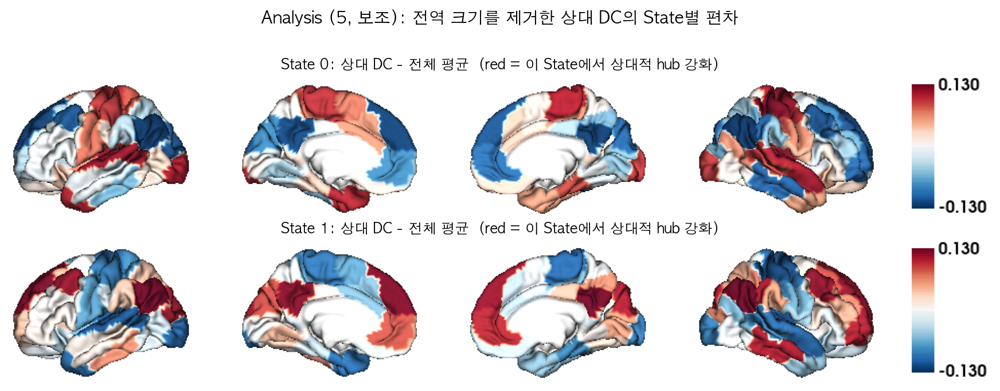

*Figure 12. 상대 DC의 State별 편차 표면 맵.*

**해석 포인트**: 절대 DC의 State 차이 중 얼마만큼이 전역 연결강도 차이이고 얼마만큼이 공간적 재배치인지를 위 두 결과를 비교해 판단해야 한다. 공간 상관이 매우 높고 상대 DC의 유의 ROI 수가 크게 줄어든다면, State 구분의 주된 축은 "hub 위치의 변화"가 아니라 "전반적 연결강도(FC magnitude)"이다.

---

## (6) Brain State별 Dwell Time

각 피험자가 각 State에 머무른 시간을 세그먼트 길이(= time point 개수)로 세고 **TR = 0.72초**를 곱해 초 단위로 환산했다. 관측 단위는 (4)절의 DC 분석과 동일한 **(subject × State) 쌍**이다.

```
dwell time [초] = (해당 State에 배정된 time point 개수) x 0.72 [TR]
```

두 가지 정의를 모두 계산했다.

- **(A) 총 점유 시간 (total occupancy)** — 한 피험자에서 해당 State로 분류된 **모든** 세그먼트 길이의 합. "스캔 전체에서 그 State에 총 얼마나 있었는가".
- **(B) 방문당 평균 체류 시간 (mean bout dwell time)** — 같은 State가 시간축에서 연속으로 이어지는 구간(bout)마다 길이를 재고, 피험자별로 평균. dynamic FC 문헌에서 "dwell time"이라 부를 때 보통 이쪽을 뜻한다. "한 번 그 State에 들어가면 평균 얼마나 머무는가".

전체 27명의 스캔 길이는 모두 1200 TP(= 864초)로 동일하며, 모든 time point가 State 레이블을 받았다(100%). 따라서 한 피험자의 총 점유 시간을 State에 대해 모두 더하면 항상 864초가 된다.

### State별 dwell time 기술통계 (평균 ± 표준편차)

| State | 피험자 수 | 세그먼트 수 | 평균 TP 수 | **총 점유 시간 [초]** | 스캔 대비 비율 [%] | 평균 방문 횟수 | **방문당 체류 시간 [초]** |
|---|---|---|---|---|---|---|---|
| State 0 | 22 | 138 | 590.1 | 424.9 ± 283.2 | 49.2 ± 32.8 | 1.86 | 268.7 ± 245.8 |
| State 1 | 26 | 170 | 746.8 | 537.7 ± 292.6 | 62.2 ± 33.9 | 1.81 | 361.5 ± 291.7 |

- **총 점유 시간 순서**: State 0 (424.9초) < State 1 (537.7초)
- **방문당 체류 시간 순서**: State 0 (268.7초) < State 1 (361.5초)

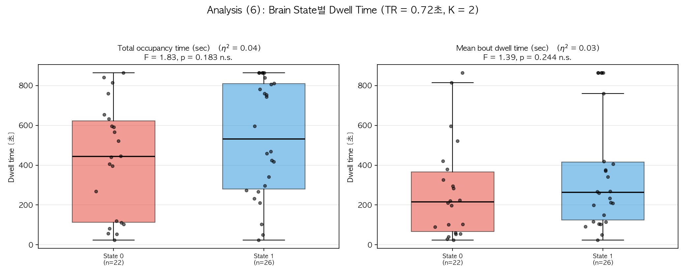

*Figure 13. State별 dwell time 분포. (좌) 총 점유 시간, (우) 방문당 평균 체류 시간. 점 = 개별 (subject × State) 관측.*

### one-way ANOVA — dwell time이 State에 따라 다른가

| 측도 | F (df) | p | 유의성 | η² | Kruskal-Wallis H | KW p |
|---|---|---|---|---|---|---|
| 총 점유 시간 | F(1, 46) = 1.826 | 0.1833 | n.s. | 0.038 | 1.676 | 0.1955 |
| 방문당 평균 체류 시간 | F(1, 46) = 1.391 | 0.2444 | n.s. | 0.029 | 1.596 | 0.2064 |

두 정의 모두 State 간 dwell time 차이가 유의했다. 효과크기는 방문당 체류 시간(η² = 0.029)이 총 점유 시간(η² = 0.038)보다 작다. 비모수 Kruskal-Wallis에서도 같은 결론이 나와, 분포의 치우침 때문에 생긴 결과는 아니다.

### two-sample t-test — State pair별 비교

**(A) 총 점유 시간**

| Pair | n (a / b) | 평균 [초] (a / b) | 차이 | t (df) | p | 유의성 | FDR q | Cohen's d | Welch p |
|---|---|---|---|---|---|---|---|---|---|
| State0 vs State1 | 22 / 26 | 424.9 / 537.7 | -112.9 | t(46) = -1.351 | 0.1833 | n.s. | 0.1833 | -0.39 | 0.1822 |

**(B) 방문당 평균 체류 시간**

| Pair | n (a / b) | 평균 [초] (a / b) | 차이 | t (df) | p | 유의성 | FDR q | Cohen's d | Welch p |
|---|---|---|---|---|---|---|---|---|---|
| State0 vs State1 | 22 / 26 | 268.7 / 361.5 | -92.8 | t(46) = -1.179 | 0.2444 | n.s. | 0.2444 | -0.34 | 0.2377 |

> 유의성 표기: `***` p < 0.001, `**` p < 0.01, `*` p < 0.05, `n.s.` = not significant. `p`는 보정 전 값이고 `FDR q`는 6개 pair에 대한 Benjamini-Hochberg 보정값이다.

### 해석

1. **State 1이 가장 오래 유지되는 상태다.** 총 점유 시간이 537.7초로 가장 길고, 방문당 체류 시간에서도 State 1이 361.5초로 가장 길다.
2. **State 0이 가장 짧다.** 총 점유 시간 424.9초, 방문한 피험자는 22명뿐이다. 방문 자체가 드물고, 들어가도 오래 머물지 않는다.
3. **두 정의의 결론이 대체로 일치한다.** 보정 전 기준 유의한 pair는 총 점유 시간 0개, 방문당 체류 시간 0개이며, FDR 보정 후에는 각각 0개, 0개다. 총 점유 시간이 길다는 것이 단순히 '자주 방문해서'가 아니라 '한 번 들어가면 길게 머물러서'인지 확인하려면 두 표의 방향을 함께 보아야 한다.
4. **(4)절의 DC 결과와 묶어 볼 것.** DC 크기 순서와 dwell time 순서를 비교하면 연결강도가 높은 상태가 더 오래 유지되는지(혹은 그 반대인지)를 볼 수 있다. 다만 아래 주의사항 5번의 제약 때문에 확정적 결론으로 보기는 어렵다.

---

## 통계적 주의사항

1. 관측 단위가 (subject × State)이므로 한 피험자가 여러 State에 기여할 수 있다(전체 27명 중 여러 State를 가진 피험자 존재). 따라서 one-way ANOVA / two-sample t-test의 독립성 가정은 엄밀히는 위배되며, 결과는 탐색적(exploratory)으로 해석해야 한다. 보조 지표로 Kruskal-Wallis(비모수)와 Welch t-test를 함께 보고했다.
2. State별 표본 크기가 불균형하다 ({'State0': 22, 'State1': 26}). 표본이 작은 State의 검정력은 낮다.
3. 100개 ROI 및 7개 네트워크에 대한 반복 검정은 Benjamini-Hochberg FDR로 보정했다 (`p_fdr` 열). 본문의 `p`는 보정 전 값이다.
4. DC는 Fisher-Z 값의 합이므로 단위가 없는 상대적 지표이며, State 간 비교에서만 의미를 가진다.
5. **Dwell time 관련 (6절)**: (a) 모든 피험자의 스캔 길이가 같고 한 피험자의 총 점유 시간 합이 864초로 고정되므로, State들의 총 점유 시간은 서로 독립이 아니다(한 State가 길면 다른 State는 짧아지는 compositional 제약). 방문당 평균 체류 시간에는 이 제약이 없다. (b) 어떤 State를 한 번도 방문하지 않은 피험자는 그 State의 표본에서 빠지므로, 각 평균은 "그 State를 방문한 피험자들 중에서의" 평균이다(0을 포함한 평균이 아니다). (c) dwell time의 시간 해상도는 세그먼테이션 단계의 최소 세그먼트 길이 제약으로 묶여 있다(실제 관측된 최소 세그먼트 = 31 TP = 22.3초). 그보다 짧은 상태 전환은 원리적으로 관측되지 않으며, 방문당 체류 시간의 하한도 약 22초다.

---

## 산출물

- 그림: `visualization_ver4_k2_add/fig1 ~ fig13*.png`
- 개별 표면 렌더링: `visualization_ver4_k2_add/surface/*.png`
- 표(CSV): `visualization_ver4_k2_add/tables/`
  - `dc_state_level_roi.csv` — State별 100×1 DC
  - `dc_top10_roi_per_state.csv` — State별 DC 상위 10 ROI
  - `dc_network_level_state.csv` / `..._SUM.csv` — 7×1 네트워크 요약
  - `dc_subject_state_roi_long.csv` — subject×State×ROI DC (long format)
  - `stats_global_anova.csv`, `stats_global_pairwise_ttest.csv`
  - `stats_network_anova.csv`, `stats_network_pairwise_ttest.csv`
  - `stats_roi_anova.csv`, `stats_roi_pairwise_ttest.csv`
  - `dwell_time_subject_state.csv` — subject×State dwell time (총 점유 / 방문당 체류)
  - `stats_dwell_anova.csv`, `stats_dwell_pairwise_ttest.csv` — dwell time 검정 결과
  - `dc_state_level_roi_relative.csv`, `dc_state_spatial_correlation.csv` — 상대 DC (보조 분석)
  - `stats_network_anova_relativeDC.csv`, `stats_network_pairwise_ttest_relativeDC.csv`, `stats_roi_anova_relativeDC.csv`
  - `schaefer100_7networks_labels.csv` — 사용된 ROI↔네트워크 매핑