# Degree Centrality 기반 Brain State 해석 분석 (V4, K=3)

- 생성 스크립트: `full_pipeline_v4_add.py`
- 기반 파이프라인: `full_pipeline_v4_k3.py` (세그먼트 → CM → K-means Brain State)
- 피험자 수: **27**, 총 세그먼트(=CM) 수: **308**, ROI: **Schaefer-100 (7 Networks, cortex only)**
- Brain State 수 K = **3**, State별 세그먼트 수: {0: 169, 1: 122, 2: 17}
- CM: Pearson 상관 + Fisher-Z 변환

> **주의**: 이번 실행 환경에는 ENIGMA TOOLBOX가 없어 표면(surface) 그림을 다시 렌더링하지 못했다. 아래 표면 그림은 이전 실행에서 만들어 둔 PNG 파일을 그대로 참조한 것이다.

---

## 핵심 결과 요약

1. **State 간 DC는 매우 크게 다르다.** Global DC(100개 ROI 평균)의 one-way ANOVA는 F(2, 54) = 214.6, p = 2.02e-26 (η² = 0.89)이고, 3개 State pair 모두 two-sample t-test에서 유의했다 (|t| = 10.8 ~ 17.6).
2. **DC 크기 순서**: State 0 (5.57) < State 1 (8.09) < State 2 (11.27). 가장 강한 State는 **State 2**, 가장 약한 State는 **State 0**이다.
3. **네트워크 수준에서도 7개 네트워크 전부 유의**하게 달랐다 (FDR q < 0.05, F = 40.5 ~ 188.2). ROI 수준에서는 99/100 ROI가 FDR q < 0.05였다.
4. **DC가 가장 높은 영역은 모든 State에서 일관되게 Visual network**이며 (Vis 상대 DC ≈ 1.25), 가장 낮은 영역은 Limbic network다 (≈ 0.53). 즉 hub의 위치 자체는 State가 바뀌어도 크게 흔들리지 않는다.
5. **차이의 대부분은 전역 연결강도(FC magnitude)에서 온다.** 전역 크기를 제거한 상대 DC로 다시 보면 State 간 공간 상관이 r = 0.78 ~ 0.96로 높고, 7개 네트워크 중 2개(Somatomotor, Frontoparietal Control)만 FDR q < 0.05를 유지했으며, 유의 ROI도 99개 → 21개로 줄었다. 따라서 K-means가 잡아낸 Brain State의 주된 축은 "hub의 재배치"보다 "전반적 연결강도의 고저"로 해석하는 것이 타당하다. (자세한 내용은 (5)절)
6. **State별로 머무는 시간이 다르다.** 방문당 평균 체류 시간은 State 0(355.8초)이 가장 길고 State 2(65.7초)이 가장 짧다 (one-way ANOVA F(2, 54) = 7.47, p = 0.00137, η² = 0.22). 총 점유 시간도 같은 순서이며 (F = 9.35, p = 0.000326, η² = 0.26), DC가 가장 낮은 State 0가 가장 오래 유지된다. 다만 이 차이가 **무작위 분할 대비** 유의한지는 별도 대조군 검정이 필요하다 (`full_pipeline_v5.py` 참고). (자세한 내용은 (6)절)
7. **주의**: 표본이 가장 작은 State는 State 2로 세그먼트 17개 / 피험자 9명뿐이라 검정력이 낮고, 또한 관측 단위가 (subject × State)라 독립성 가정이 완전하지 않다. (마지막 절 참고)

---

## 방법: Degree Centrality 정의

100×100 연결성 행렬 `Z`(Fisher-Z)에 **row-wise proportional thresholding**을 적용한다.

```
1) 대각(자기 자신 연결)을 후보에서 제외             → 각 행 99개 후보
2) 각 행에서 값이 큰 상위 10% element만 유지        → 행당 10개 유지
3) 유지된 element를 행 방향으로 합산                → DC_i = sum_j∈top(i) Z_ij
```

- 결과: 100×1 벡터 (ROI별 weighted degree centrality)
- Thresholding 기준: **z (부호 유지, 즉 가장 강한 양의 연결)**
- 행별로 독립적으로 threshold하므로 유지 마스크는 비대칭이며, DC는 "각 ROI가 자신의 가장 강한 연결 상위 10%로부터 받는 총 연결 강도"를 의미한다.

---

## (1)+(2) State별 Degree Centrality 와 피질 표면 분포

### State별 DC 요약 통계

| State | n_CM | DC mean | DC SD | DC min | DC max | 최대 DC ROI |
|---|---|---|---|---|---|---|
| State 0 | 169 | 5.565 | 1.512 | 1.071 | 9.535 | 7Networks_LH_Vis_8 (Vis) |
| State 1 | 122 | 8.091 | 2.059 | 1.832 | 12.369 | 7Networks_LH_Vis_9 (Vis) |
| State 2 | 17 | 11.268 | 2.240 | 4.116 | 15.443 | 7Networks_RH_Vis_8 (Vis) |

### State별 DC 상위 5개 ROI

**State 0**
| rank | roi_label | network | hemisphere | DC |
|---|---|---|---|---|
| 1 | 7Networks_LH_Vis_8 | Vis | LH | 9.535 |
| 2 | 7Networks_RH_Vis_8 | Vis | RH | 9.465 |
| 3 | 7Networks_LH_Vis_9 | Vis | LH | 9.312 |
| 4 | 7Networks_RH_Vis_7 | Vis | RH | 8.711 |
| 5 | 7Networks_RH_Vis_5 | Vis | RH | 8.274 |

**State 1**
| rank | roi_label | network | hemisphere | DC |
|---|---|---|---|---|
| 1 | 7Networks_LH_Vis_9 | Vis | LH | 12.369 |
| 2 | 7Networks_LH_Vis_8 | Vis | LH | 12.276 |
| 3 | 7Networks_RH_Vis_8 | Vis | RH | 12.231 |
| 4 | 7Networks_RH_Vis_7 | Vis | RH | 11.756 |
| 5 | 7Networks_RH_Vis_2 | Vis | RH | 11.381 |

**State 2**
| rank | roi_label | network | hemisphere | DC |
|---|---|---|---|---|
| 1 | 7Networks_RH_Vis_8 | Vis | RH | 15.443 |
| 2 | 7Networks_LH_Vis_9 | Vis | LH | 15.243 |
| 3 | 7Networks_RH_Vis_7 | Vis | RH | 15.047 |
| 4 | 7Networks_LH_Vis_8 | Vis | LH | 15.044 |
| 5 | 7Networks_LH_Vis_2 | Vis | LH | 14.656 |

### 표면 시각화 (ENIGMA TOOLBOX, fsa5)

각 그림은 좌→우로 `LH lateral · LH medial · RH medial · RH lateral` 순서다.

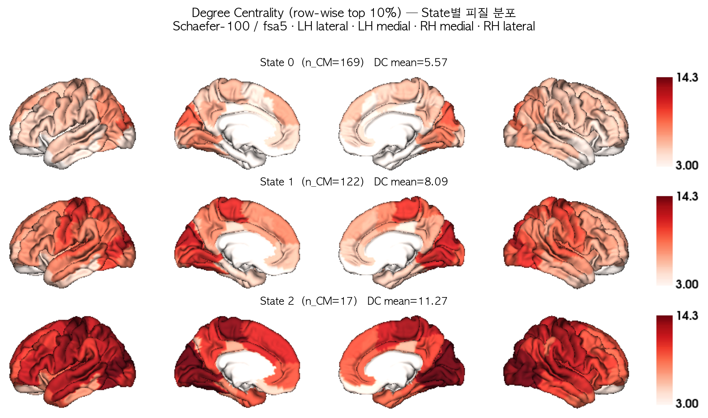

*Figure 1. State별 Degree Centrality의 피질 분포 (공통 color range).*

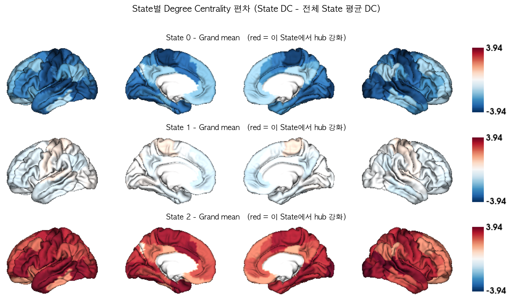

*Figure 2. 전체 State 평균 대비 각 State의 DC 편차. 붉은색 = 해당 State에서 상대적으로 hub 역할이 강화된 영역.*

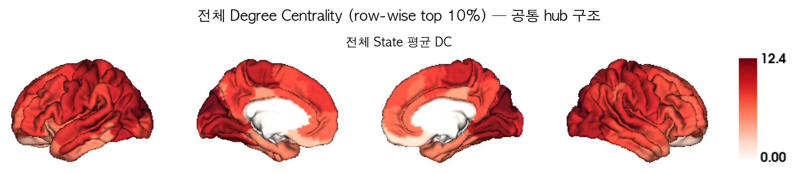

*Figure 3. 모든 State 평균 DC — State와 무관한 공통 hub 구조.*

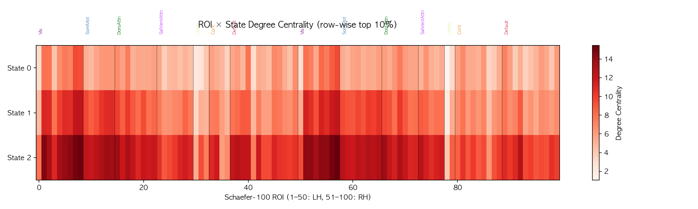

*Figure 4. ROI × State DC 히트맵 (네트워크 경계 표시).*

---

## (3) Yeo 7-Network 요약

Schaefer-100 parcel을 CBIG `Schaefer2018_100Parcels_7Networks_order_info.txt` 의 네트워크 레이블로 묶어, 네트워크 내 ROI의 DC **평균**으로 7×1 벡터를 만들었다.

| Network | code | n_roi | State0 | State1 | State2 |
|---|---|---|---|---|---|
| Visual | Vis | 17 | 7.097 | 10.217 | 13.509 |
| Somatomotor | SomMot | 14 | 5.571 | 9.756 | 12.704 |
| Dorsal Attention | DorsAttn | 15 | 5.981 | 8.900 | 12.205 |
| Salience / Ventral Attention | SalVentAttn | 12 | 4.954 | 7.586 | 10.924 |
| Limbic | Limbic | 5 | 2.625 | 4.081 | 6.951 |
| Frontoparietal Control | Cont | 13 | 5.139 | 6.527 | 9.039 |
| Default Mode | Default | 24 | 5.366 | 7.043 | 10.537 |

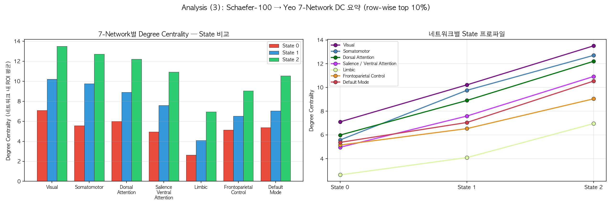

*Figure 5. (좌) 네트워크별 State 비교 grouped bar plot, (우) 네트워크별 State 프로파일.*

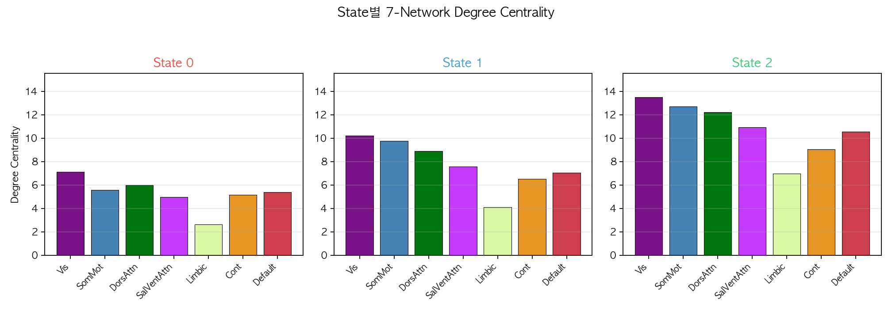

*Figure 6. State별 7-Network DC bar plot (Yeo 표준 색상).*

---

## (4) State 간 Degree Centrality 차이 검정

- 관측 단위: **(subject × State) 쌍** — 각 피험자의 세그먼트 CM 중 해당 State에 배정된 것들을 Fisher-Z 공간에서 평균한 뒤 DC를 계산
- 총 관측 수 **N = 57** (State별 피험자 수: {'State0': 26, 'State1': 22, 'State2': 9})
- 검정 1: one-way ANOVA (State가 요인)
- 검정 2: State pair별 two-sample t-test (equal variance, Student's t)
- 다중비교: Benjamini-Hochberg FDR (`p_fdr`)

### 4-a. Global DC (100개 ROI 평균)

**one-way ANOVA**: F(2, 54) = **214.567**, p = **2.018e-26** ***, η² = 0.888  

(비모수 확인: Kruskal-Wallis H = 45.380, p = 1.399e-10)

State별 평균 ± 표준편차:

| State | n | mean | SD |
|---|---|---|---|
| State 0 | 26 | 6.420 | 0.889 |
| State 1 | 22 | 8.726 | 0.510 |
| State 2 | 9 | 12.136 | 0.658 |

**State pair별 two-sample t-test**

| pair | n_a | n_b | mean_a | mean_b | mean_diff | t | p | sig | p_fdr | cohens_d |
|---|---|---|---|---|---|---|---|---|---|---|
| State0 vs State1 | 26 | 22 | 6.420 | 8.726 | -2.306 | -10.752 | 3.863e-14 | *** | 3.863e-14 | -3.11 |
| State0 vs State2 | 26 | 9 | 6.420 | 12.136 | -5.715 | -17.625 | 2.343e-18 | *** | 7.029e-18 | -6.82 |
| State1 vs State2 | 22 | 9 | 8.726 | 12.136 | -3.410 | -15.530 | 1.368e-15 | *** | 2.052e-15 | -6.14 |

### 4-b. 네트워크별 DC (7개 네트워크)

**one-way ANOVA (네트워크별)**

| Network | measure | F | p | p_fdr | sig | eta_sq |
|---|---|---|---|---|---|---|
| Visual | Vis | 72.453 | 5.142e-16 | 7.198e-16 | *** | 0.729 |
| Somatomotor | SomMot | 91.686 | 4.346e-18 | 7.605e-18 | *** | 0.773 |
| Dorsal Attention | DorsAttn | 188.183 | 4.581e-25 | 3.207e-24 | *** | 0.875 |
| Salience / Ventral Attention | SalVentAttn | 118.831 | 1.671e-20 | 3.898e-20 | *** | 0.815 |
| Limbic | Limbic | 40.497 | 1.803e-11 | 1.803e-11 | *** | 0.600 |
| Frontoparietal Control | Cont | 44.830 | 3.361e-12 | 3.922e-12 | *** | 0.624 |
| Default Mode | Default | 130.926 | 1.944e-21 | 6.803e-21 | *** | 0.829 |

**네트워크 × State pair two-sample t-test** (전체 표는 `tables/stats_network_pairwise_ttest.csv`)

| measure | pair | mean_a | mean_b | mean_diff | t | p | sig | p_fdr_across_networks | cohens_d |
|---|---|---|---|---|---|---|---|---|---|
| DorsAttn | State0 vs State2 | 6.805 | 13.104 | -6.299 | -17.713 | 2.019e-18 | *** | 4.24e-17 | -6.85 |
| SalVentAttn | State0 vs State2 | 5.936 | 11.987 | -6.051 | -14.823 | 3.802e-16 | *** | 3.992e-15 | -5.73 |
| Default | State0 vs State2 | 6.147 | 11.513 | -5.366 | -14.451 | 7.882e-16 | *** | 5.517e-15 | -5.59 |
| DorsAttn | State0 vs State1 | 6.805 | 9.586 | -2.781 | -11.791 | 1.677e-15 | *** | 8.804e-15 | -3.42 |
| SomMot | State0 vs State2 | 6.576 | 13.433 | -6.857 | -12.025 | 1.321e-13 | *** | 5.261e-13 | -4.65 |
| Vis | State0 vs State2 | 7.894 | 14.027 | -6.133 | -11.968 | 1.503e-13 | *** | 5.261e-13 | -4.63 |
| Default | State1 vs State2 | 7.808 | 11.513 | -3.704 | -11.567 | 2.199e-12 | *** | 6.597e-12 | -4.58 |
| SomMot | State0 vs State1 | 6.576 | 10.143 | -3.566 | -8.701 | 2.796e-11 | *** | 7.339e-11 | -2.52 |
| DorsAttn | State1 vs State2 | 9.586 | 13.104 | -3.518 | -9.994 | 6.691e-11 | *** | 1.561e-10 | -3.95 |
| SalVentAttn | State1 vs State2 | 8.305 | 11.987 | -3.682 | -9.516 | 2.01e-10 | *** | 4.221e-10 | -3.77 |
| SalVentAttn | State0 vs State1 | 5.936 | 8.305 | -2.369 | -7.782 | 6.208e-10 | *** | 1.185e-09 | -2.25 |
| Limbic | State0 vs State2 | 3.451 | 7.360 | -3.909 | -8.424 | 9.865e-10 | *** | 1.712e-09 | -3.26 |
| Cont | State0 vs State2 | 5.976 | 10.270 | -4.295 | -8.397 | 1.06e-09 | *** | 1.712e-09 | -3.25 |
| Default | State0 vs State1 | 6.147 | 7.808 | -1.661 | -7.052 | 7.62e-09 | *** | 1.143e-08 | -2.04 |
| Vis | State0 vs State1 | 7.894 | 10.532 | -2.638 | -6.400 | 7.254e-08 | *** | 1.016e-07 | -1.85 |
| Vis | State1 vs State2 | 10.532 | 14.027 | -3.496 | -6.887 | 1.445e-07 | *** | 1.897e-07 | -2.73 |
| SomMot | State1 vs State2 | 10.143 | 13.433 | -3.290 | -6.519 | 3.872e-07 | *** | 4.783e-07 | -2.58 |
| Cont | State0 vs State1 | 5.976 | 7.409 | -1.433 | -5.524 | 1.488e-06 | *** | 1.736e-06 | -1.60 |
| Limbic | State0 vs State1 | 3.451 | 4.878 | -1.427 | -5.417 | 2.141e-06 | *** | 2.367e-06 | -1.57 |
| Cont | State1 vs State2 | 7.409 | 10.270 | -2.861 | -5.219 | 1.38e-05 | *** | 1.449e-05 | -2.07 |
| Limbic | State1 vs State2 | 4.878 | 7.360 | -2.482 | -4.602 | 7.659e-05 | *** | 7.659e-05 | -1.82 |

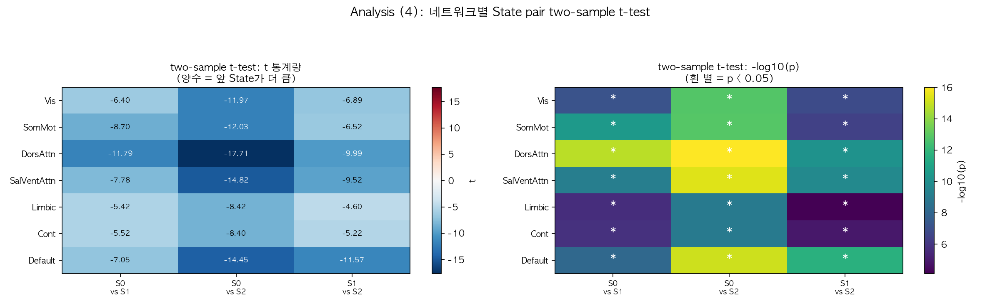

*Figure 8. 네트워크별 State pair two-sample t-test 결과 (t 통계량 / -log10 p).*

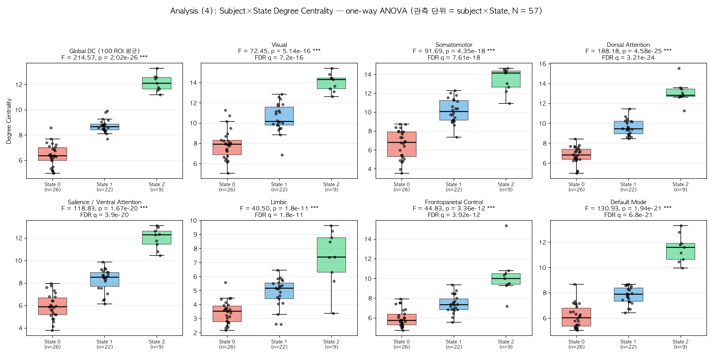

*Figure 7. Global DC 및 네트워크별 DC의 State 간 분포 (점 = 개별 subject×State 관측).*

### 4-c. ROI별 DC (100개 ROI)

- one-way ANOVA에서 **p < 0.05 (uncorrected): 99/100 ROI**, **FDR q < 0.05: 99/100 ROI**

F 값 상위 15개 ROI:

| roi_number | roi_label | network | F | p | sig | p_fdr | eta_sq |
|---|---|---|---|---|---|---|---|
| 16 | 7Networks_LH_DorsAttn_Post_1 | DorsAttn | 122.406 | 8.687e-21 | *** | 8.687e-19 | 0.819 |
| 17 | 7Networks_LH_DorsAttn_Post_2 | DorsAttn | 117.722 | 2.053e-20 | *** | 1.027e-18 | 0.813 |
| 12 | 7Networks_LH_SomMot_3 | SomMot | 111.509 | 6.713e-20 | *** | 2.238e-18 | 0.805 |
| 10 | 7Networks_LH_SomMot_1 | SomMot | 99.871 | 7.178e-19 | *** | 1.794e-17 | 0.787 |
| 67 | 7Networks_RH_DorsAttn_Post_1 | DorsAttn | 97.461 | 1.205e-18 | *** | 2.409e-17 | 0.783 |
| 59 | 7Networks_RH_SomMot_1 | SomMot | 96.548 | 1.47e-18 | *** | 2.45e-17 | 0.781 |
| 22 | 7Networks_LH_DorsAttn_PrCv_1 | DorsAttn | 93.487 | 2.894e-18 | *** | 4.134e-17 | 0.776 |
| 18 | 7Networks_LH_DorsAttn_Post_3 | DorsAttn | 90.370 | 5.872e-18 | *** | 7.34e-17 | 0.770 |
| 19 | 7Networks_LH_DorsAttn_Post_4 | DorsAttn | 84.381 | 2.415e-17 | *** | 2.684e-16 | 0.758 |
| 13 | 7Networks_LH_SomMot_4 | SomMot | 83.516 | 2.981e-17 | *** | 2.981e-16 | 0.756 |
| 43 | 7Networks_LH_Default_PFC_2 | Default | 81.094 | 5.423e-17 | *** | 4.93e-16 | 0.750 |
| 11 | 7Networks_LH_SomMot_2 | SomMot | 78.596 | 1.019e-16 | *** | 8.495e-16 | 0.744 |
| 25 | 7Networks_LH_SalVentAttn_FrOperIns_1 | SalVentAttn | 77.905 | 1.217e-16 | *** | 9.258e-16 | 0.743 |
| 40 | 7Networks_LH_Default_Par_1 | Default | 77.661 | 1.296e-16 | *** | 9.258e-16 | 0.742 |
| 7 | 7Networks_LH_Vis_7 | Vis | 76.131 | 1.929e-16 | *** | 1.286e-15 | 0.738 |

**State pair별 ROI 수준 two-sample t-test 요약**

| pair | n_a | n_b | ROI p<0.05 | ROI FDR q<0.05 | max abs(t) | 가장 유의한 ROI |
|---|---|---|---|---|---|---|
| State0 vs State1 | 26 | 22 | 99 | 99 | 11.019 | 7Networks_LH_DorsAttn_Post_2 |
| State0 vs State2 | 26 | 9 | 99 | 99 | 15.337 | 7Networks_LH_DorsAttn_PrCv_1 |
| State1 vs State2 | 22 | 9 | 96 | 96 | 8.563 | 7Networks_LH_DorsAttn_Post_1 |

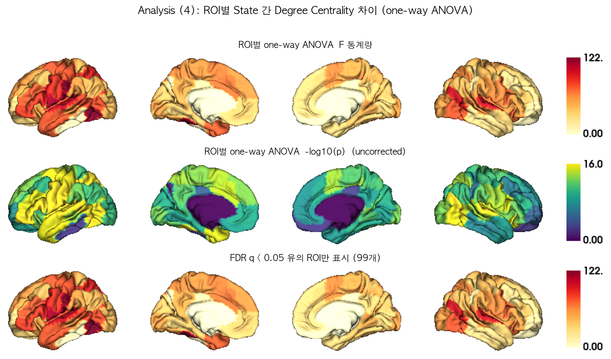

*Figure 9. ROI별 one-way ANOVA F / -log10(p) / FDR 유의 ROI 표면 맵.*

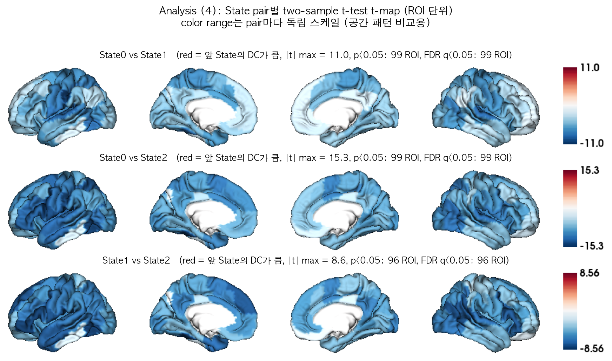

*Figure 10. State pair별 two-sample t-test t-map.*

---

## (5, 보조) 전역 연결강도 vs 공간적 hub 재배치

(4)의 DC 차이가 "뇌 전체 연결강도가 통째로 올라간 것"인지 "hub의 공간적 배치가 바뀐 것"인지 구분하기 위해, 각 관측의 DC를 자기 평균으로 나눈 **상대 DC**(relative DC = DC / mean(DC), 100개 ROI 평균 = 1)로 동일한 검정을 반복했다.

### State 간 상대 DC 프로파일의 공간 상관

|  | State0 | State1 | State2 |
|---|---|---|---|
| State0 | 1.000 | 0.835 | 0.778 |
| State1 | 0.835 | 1.000 | 0.958 |
| State2 | 0.778 | 0.958 | 1.000 |

- State 간 공간 상관의 최솟값 = **0.778** → 1에 가까울수록 State가 달라져도 hub의 공간적 배치는 거의 동일함을 뜻한다.

### 네트워크별 상대 DC one-way ANOVA

| Network | measure | F | p | p_fdr | sig | eta_sq |
|---|---|---|---|---|---|---|
| Visual | Vis | 1.164 | 0.3198 | 0.3198 | n.s. | 0.041 |
| Somatomotor | SomMot | 6.992 | 0.001994 | 0.01396 | * | 0.206 |
| Dorsal Attention | DorsAttn | 1.233 | 0.2996 | 0.3198 | n.s. | 0.044 |
| Salience / Ventral Attention | SalVentAttn | 1.808 | 0.1738 | 0.3041 | n.s. | 0.063 |
| Limbic | Limbic | 1.537 | 0.2243 | 0.314 | n.s. | 0.054 |
| Frontoparietal Control | Cont | 4.902 | 0.01106 | 0.0387 | * | 0.154 |
| Default Mode | Default | 3.475 | 0.03805 | 0.08877 | n.s. | 0.114 |

- ROI별 상대 DC ANOVA: p < 0.05 (uncorrected) **35/100 ROI**, FDR q < 0.05 **21/100 ROI**
- 비교: 원래(절대) DC에서는 각각 99/100, 99/100 ROI였다.

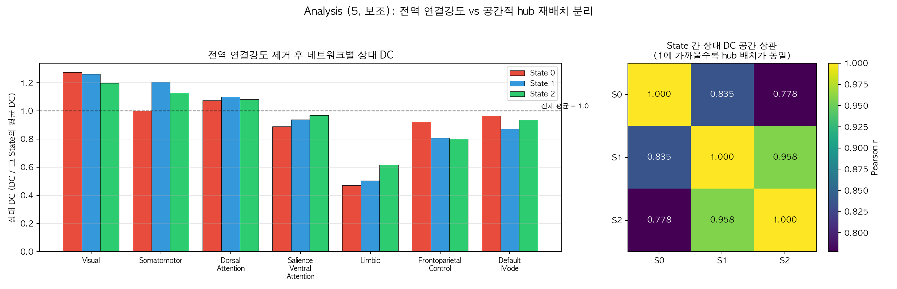

*Figure 11. (좌) 전역 크기를 제거한 네트워크별 상대 DC, (우) State 간 상대 DC 공간 상관.*

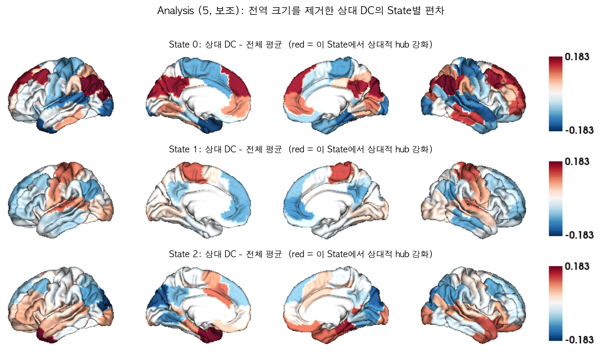

*Figure 12. 상대 DC의 State별 편차 표면 맵.*

**해석 포인트**: 절대 DC의 State 차이 중 얼마만큼이 전역 연결강도 차이이고 얼마만큼이 공간적 재배치인지를 위 두 결과를 비교해 판단해야 한다. 공간 상관이 매우 높고 상대 DC의 유의 ROI 수가 크게 줄어든다면, State 구분의 주된 축은 "hub 위치의 변화"가 아니라 "전반적 연결강도(FC magnitude)"이다.

---

## (6) Brain State별 Dwell Time

각 피험자가 각 State에 머무른 시간을 세그먼트 길이(= time point 개수)로 세고 **TR = 0.72초**를 곱해 초 단위로 환산했다. 관측 단위는 (4)절의 DC 분석과 동일한 **(subject × State) 쌍**이다.

```
dwell time [초] = (해당 State에 배정된 time point 개수) x 0.72 [TR]
```

두 가지 정의를 모두 계산했다.

- **(A) 총 점유 시간 (total occupancy)** — 한 피험자에서 해당 State로 분류된 **모든** 세그먼트 길이의 합. "스캔 전체에서 그 State에 총 얼마나 있었는가".
- **(B) 방문당 평균 체류 시간 (mean bout dwell time)** — 같은 State가 시간축에서 연속으로 이어지는 구간(bout)마다 길이를 재고, 피험자별로 평균. dynamic FC 문헌에서 "dwell time"이라 부를 때 보통 이쪽을 뜻한다. "한 번 그 State에 들어가면 평균 얼마나 머무는가".

전체 27명의 스캔 길이는 모두 1200 TP(= 864초)로 동일하며, 모든 time point가 State 레이블을 받았다(100%). 따라서 한 피험자의 총 점유 시간을 State에 대해 모두 더하면 항상 864초가 된다.

### State별 dwell time 기술통계 (평균 ± 표준편차)

| State | 피험자 수 | 세그먼트 수 | 평균 TP 수 | **총 점유 시간 [초]** | 스캔 대비 비율 [%] | 평균 방문 횟수 | **방문당 체류 시간 [초]** |
|---|---|---|---|---|---|---|---|
| State 0 | 26 | 169 | 744.5 | 536.1 ± 291.1 | 62.0 ± 33.7 | 1.85 | 355.8 ± 292.2 |
| State 1 | 22 | 122 | 525.5 | 378.3 ± 240.8 | 43.8 ± 27.9 | 2.36 | 176.4 ± 140.1 |
| State 2 | 9 | 17 | 164.7 | 118.6 ± 126.7 | 13.7 ± 14.7 | 1.56 | 65.7 ± 53.4 |

- **총 점유 시간 순서**: State 2 (118.6초) < State 1 (378.3초) < State 0 (536.1초)
- **방문당 체류 시간 순서**: State 2 (65.7초) < State 1 (176.4초) < State 0 (355.8초)

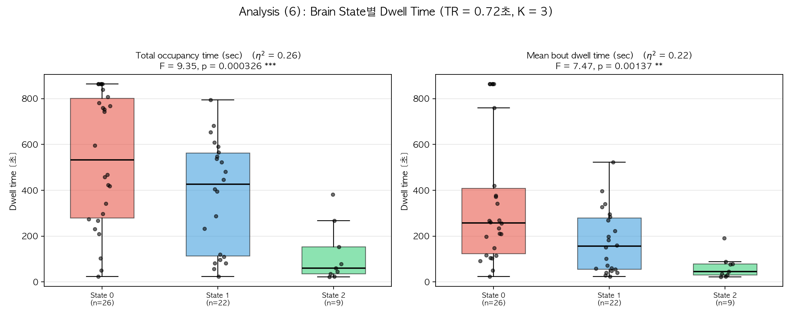

*Figure 13. State별 dwell time 분포. (좌) 총 점유 시간, (우) 방문당 평균 체류 시간. 점 = 개별 (subject × State) 관측.*

### one-way ANOVA — dwell time이 State에 따라 다른가

| 측도 | F (df) | p | 유의성 | η² | Kruskal-Wallis H | KW p |
|---|---|---|---|---|---|---|
| 총 점유 시간 | F(2, 54) = 9.349 | 0.0003262 | *** | 0.257 | 15.402 | 0.0004524 |
| 방문당 평균 체류 시간 | F(2, 54) = 7.467 | 0.001371 | ** | 0.217 | 15.770 | 0.0003764 |

두 정의 모두 State 간 dwell time 차이가 유의했다. 효과크기는 방문당 체류 시간(η² = 0.217)이 총 점유 시간(η² = 0.257)보다 작다. 비모수 Kruskal-Wallis에서도 같은 결론이 나와, 분포의 치우침 때문에 생긴 결과는 아니다.

### two-sample t-test — State pair별 비교

**(A) 총 점유 시간**

| Pair | n (a / b) | 평균 [초] (a / b) | 차이 | t (df) | p | 유의성 | FDR q | Cohen's d | Welch p |
|---|---|---|---|---|---|---|---|---|---|
| State0 vs State1 | 26 / 22 | 536.1 / 378.3 | +157.7 | t(46) = 2.022 | 0.04902 | * | 0.04902 | +0.59 | 0.04563 |
| State0 vs State2 | 26 / 9 | 536.1 / 118.6 | +417.5 | t(33) = 4.137 | 0.0002279 | *** | 0.0006838 | +1.60 | 1.75e-06 |
| State1 vs State2 | 22 / 9 | 378.3 / 118.6 | +259.8 | t(29) = 3.048 | 0.00488 | ** | 0.00732 | +1.21 | 0.0005695 |

**(B) 방문당 평균 체류 시간**

| Pair | n (a / b) | 평균 [초] (a / b) | 차이 | t (df) | p | 유의성 | FDR q | Cohen's d | Welch p |
|---|---|---|---|---|---|---|---|---|---|
| State0 vs State1 | 26 / 22 | 355.8 / 176.4 | +179.4 | t(46) = 2.632 | 0.01153 | * | 0.01729 | +0.76 | 0.008574 |
| State0 vs State2 | 26 / 9 | 355.8 / 65.7 | +290.0 | t(33) = 2.933 | 0.006068 | ** | 0.01729 | +1.13 | 3.972e-05 |
| State1 vs State2 | 22 / 9 | 176.4 / 65.7 | +110.6 | t(29) = 2.282 | 0.03 | * | 0.03 | +0.90 | 0.003488 |

> 유의성 표기: `***` p < 0.001, `**` p < 0.01, `*` p < 0.05, `n.s.` = not significant. `p`는 보정 전 값이고 `FDR q`는 6개 pair에 대한 Benjamini-Hochberg 보정값이다.

### 해석

1. **State 0이 가장 오래 유지되는 상태다.** 총 점유 시간이 536.1초로 가장 길고, 방문당 체류 시간에서도 State 0이 355.8초로 가장 길다.
2. **State 2이 가장 짧다.** 총 점유 시간 118.6초, 방문한 피험자는 9명뿐이다. 방문 자체가 드물고, 들어가도 오래 머물지 않는다.
3. **두 정의의 결론이 대체로 일치한다.** 보정 전 기준 유의한 pair는 총 점유 시간 3개, 방문당 체류 시간 3개이며, FDR 보정 후에는 각각 3개, 3개다. 총 점유 시간이 길다는 것이 단순히 '자주 방문해서'가 아니라 '한 번 들어가면 길게 머물러서'인지 확인하려면 두 표의 방향을 함께 보아야 한다.
4. **(4)절의 DC 결과와 묶어 볼 것.** DC 크기 순서와 dwell time 순서를 비교하면 연결강도가 높은 상태가 더 오래 유지되는지(혹은 그 반대인지)를 볼 수 있다. 다만 아래 주의사항 5번의 제약 때문에 확정적 결론으로 보기는 어렵다.

---

## 통계적 주의사항

1. 관측 단위가 (subject × State)이므로 한 피험자가 여러 State에 기여할 수 있다(전체 27명 중 여러 State를 가진 피험자 존재). 따라서 one-way ANOVA / two-sample t-test의 독립성 가정은 엄밀히는 위배되며, 결과는 탐색적(exploratory)으로 해석해야 한다. 보조 지표로 Kruskal-Wallis(비모수)와 Welch t-test를 함께 보고했다.
2. State별 표본 크기가 불균형하다 ({'State0': 26, 'State1': 22, 'State2': 9}). 표본이 작은 State의 검정력은 낮다.
3. 100개 ROI 및 7개 네트워크에 대한 반복 검정은 Benjamini-Hochberg FDR로 보정했다 (`p_fdr` 열). 본문의 `p`는 보정 전 값이다.
4. DC는 Fisher-Z 값의 합이므로 단위가 없는 상대적 지표이며, State 간 비교에서만 의미를 가진다.
5. **Dwell time 관련 (6절)**: (a) 모든 피험자의 스캔 길이가 같고 한 피험자의 총 점유 시간 합이 864초로 고정되므로, State들의 총 점유 시간은 서로 독립이 아니다(한 State가 길면 다른 State는 짧아지는 compositional 제약). 방문당 평균 체류 시간에는 이 제약이 없다. (b) 어떤 State를 한 번도 방문하지 않은 피험자는 그 State의 표본에서 빠지므로, 각 평균은 "그 State를 방문한 피험자들 중에서의" 평균이다(0을 포함한 평균이 아니다). (c) dwell time의 시간 해상도는 세그먼테이션 단계의 최소 세그먼트 길이 제약으로 묶여 있다(실제 관측된 최소 세그먼트 = 31 TP = 22.3초). 그보다 짧은 상태 전환은 원리적으로 관측되지 않으며, 방문당 체류 시간의 하한도 약 22초다.

---

## 산출물

- 그림: `visualization_ver4_k3_add/fig1 ~ fig13*.png`
- 개별 표면 렌더링: `visualization_ver4_k3_add/surface/*.png`
- 표(CSV): `visualization_ver4_k3_add/tables/`
  - `dc_state_level_roi.csv` — State별 100×1 DC
  - `dc_top10_roi_per_state.csv` — State별 DC 상위 10 ROI
  - `dc_network_level_state.csv` / `..._SUM.csv` — 7×1 네트워크 요약
  - `dc_subject_state_roi_long.csv` — subject×State×ROI DC (long format)
  - `stats_global_anova.csv`, `stats_global_pairwise_ttest.csv`
  - `stats_network_anova.csv`, `stats_network_pairwise_ttest.csv`
  - `stats_roi_anova.csv`, `stats_roi_pairwise_ttest.csv`
  - `dwell_time_subject_state.csv` — subject×State dwell time (총 점유 / 방문당 체류)
  - `stats_dwell_anova.csv`, `stats_dwell_pairwise_ttest.csv` — dwell time 검정 결과
  - `dc_state_level_roi_relative.csv`, `dc_state_spatial_correlation.csv` — 상대 DC (보조 분석)
  - `stats_network_anova_relativeDC.csv`, `stats_network_pairwise_ttest_relativeDC.csv`, `stats_roi_anova_relativeDC.csv`
  - `schaefer100_7networks_labels.csv` — 사용된 ROI↔네트워크 매핑