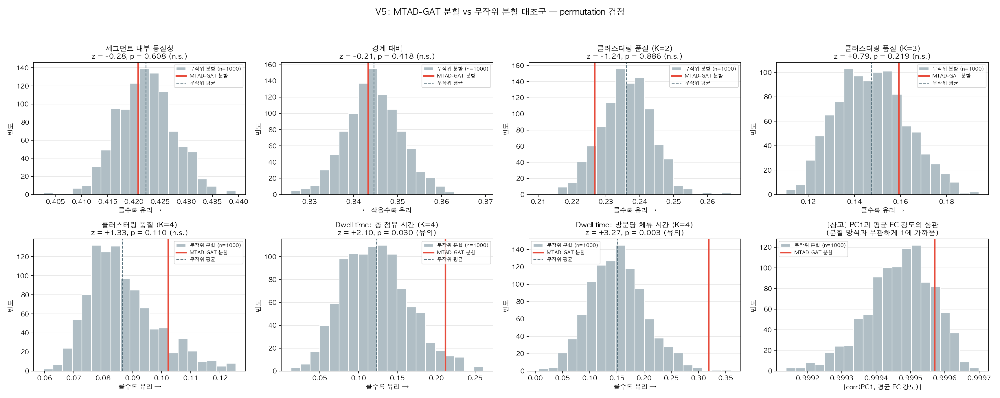
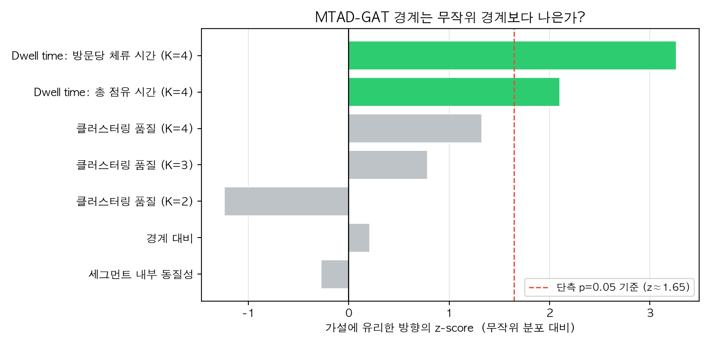

# V5: 무작위 분할 대조군 — 핵심 가설 검정

- 생성 스크립트: `full_pipeline_v5.py`
- 무작위 분할 반복 수: **1000회**, 경계 대비 윈도우: **30 TP**, seed: 42
- 피험자 **27명**, 세그먼트 **308개**, 스캔 길이 1200 TP
- 귀무 모형: 피험자별 세그먼트 **개수와 길이 분포는 그대로 두고 경계 위치만 무작위 재배치**

---

## 검정 대상 가설

> MTAD-GAT가 탐지한 임베딩 변화점은 단순한 잡음이 아니라, 뇌 기능 상태가 전환되는 의미 있는 경계다.

이 가설이 참이라면 MTAD-GAT 경계로 자른 세그먼트는 **무작위로 자른 세그먼트보다** (a) 내부가 균질하고 (b) 경계를 사이에 두고 FC가 뚜렷이 달라지며 (c) 상태로 더 잘 군집화되어야 한다. 지금까지의 V1~V4 분석에는 이 비교 대상이 없었다.

---

## 결론 요약

7개 지표 중 **2개**에서만 MTAD-GAT 분할이 무작위 분할보다 유의하게 나았다 (permutation p < 0.05).

- **FC 구조 지표 5개(세그먼트 내부 동질성·경계 대비·군집 품질)는 5개 모두 무작위와 구별되지 않았다.**
- **유의한 것은 dwell time 지표뿐이다.** 다만 무작위 분할에서도 state별 dwell time 차이가 크게 나오므로(η² 평균 0.151), V4에서 보고한 dwell time ANOVA 자체가 아니라 **무작위 대비 초과분**만이 증거다.

- **세그먼트 내부 동질성**: 관측 0.4208 vs 무작위 0.4223 ± 0.0054 → z = -0.28, p = 0.6084 (무작위와 구별 안 됨)
- **경계 대비**: 관측 0.3433 vs 무작위 0.3446 ± 0.0063 → z = -0.21, p = 0.4176 (무작위와 구별 안 됨)
- **클러스터링 품질 (K=2)**: 관측 0.2266 vs 무작위 0.2361 ± 0.0076 → z = -1.24, p = 0.8861 (무작위와 구별 안 됨)
- **클러스터링 품질 (K=3)**: 관측 0.1593 vs 무작위 0.1475 ± 0.0150 → z = +0.79, p = 0.2188 (무작위와 구별 안 됨)
- **클러스터링 품질 (K=4)**: 관측 0.1022 vs 무작위 0.0866 ± 0.0118 → z = +1.33, p = 0.1099 (무작위와 구별 안 됨)
- **Dwell time: 총 점유 시간 (K=4)**: 관측 0.2118 vs 무작위 0.1226 ± 0.0424 → z = +2.10, p = 0.0300 (**유의**)
- **Dwell time: 방문당 체류 시간 (K=4)**: 관측 0.3188 vs 무작위 0.1513 ± 0.0513 → z = +3.27, p = 0.0030 (**유의**)

---

## 방법

### 귀무 모형 (무작위 분할)

```
실제 분할 : 피험자 A의 세그먼트 길이 = [70, 33, 252, 87, ...]  (MTAD-GAT 경계)
무작위 분할: 같은 길이 목록을 무작위로 섞어 배치 = [252, 87, 70, 33, ...]
            → 세그먼트 개수 동일, 길이 분포 동일, 경계 위치만 다름
```

길이 분포를 그대로 유지하는 이유: 세그먼트가 짧을수록 CM 추정이 불안정해져 지표가 달라지므로, 길이를 맞추지 않으면 "경계 위치의 효과"와 "길이의 효과"가 뒤섞인다.

### 검정 지표

| 지표 | 방향 | 정의 |
|---|---|---|
| 세그먼트 내부 동질성 | 클수록 유리 | 세그먼트 전/후반 CM 상관 — 경계가 맞으면 세그먼트 안은 균질해야 함 |
| 경계 대비 | 작을수록 유리 | 경계 양쪽 윈도우 CM 상관 — 진짜 전환점이면 양쪽이 달라야 함 |
| 클러스터링 품질 (K=2) | 클수록 유리 | 세그먼트 CM 군집의 silhouette |
| 클러스터링 품질 (K=3) | 클수록 유리 | 세그먼트 CM 군집의 silhouette |
| 클러스터링 품질 (K=4) | 클수록 유리 | 세그먼트 CM 군집의 silhouette |
| Dwell time: 총 점유 시간 (K=4) | 클수록 유리 | state별 총 점유 시간 차이의 효과크기 eta^2 — state가 진짜면 더 크게 갈려야 함 |
| Dwell time: 방문당 체류 시간 (K=4) | 클수록 유리 | state별 방문당 체류 시간 차이의 효과크기 eta^2 |

- 모든 CM은 본 파이프라인과 동일하게 Pearson 상관 + Fisher-Z 변환 후 상삼각 4,950차원으로 평탄화했다.
- silhouette은 표준화된 4,950차원 특징에 KMeans(n_init=10)를 적용해 계산했다.
- permutation p-value = (1 + 무작위 중 관측값 이상인 횟수) / (1 + 1000), 단측.

---

## 결과

### Permutation 검정

| 지표 | 방향 | 관측값 | 무작위 (평균 ± SD) | 무작위 범위 | z | 백분위 | p_perm | 판정 |
|---|---|---|---|---|---|---|---|---|
| 세그먼트 내부 동질성 | 클수록 유리 | 0.4208 | 0.4223 ± 0.0054 | [0.4027, 0.4395] | -0.28 | 39.2% | 0.6084 | n.s. |
| 경계 대비 | 작을수록 유리 | 0.3433 | 0.3446 ± 0.0063 | [0.3258, 0.3695] | -0.21 | 41.7% | 0.4176 | n.s. |
| 클러스터링 품질 (K=2) | 클수록 유리 | 0.2266 | 0.2361 ± 0.0076 | [0.2101, 0.2670] | -1.24 | 11.4% | 0.8861 | n.s. |
| 클러스터링 품질 (K=3) | 클수록 유리 | 0.1593 | 0.1475 ± 0.0150 | [0.1105, 0.1940] | +0.79 | 78.2% | 0.2188 | n.s. |
| 클러스터링 품질 (K=4) | 클수록 유리 | 0.1022 | 0.0866 ± 0.0118 | [0.0596, 0.1254] | +1.33 | 89.1% | 0.1099 | n.s. |
| Dwell time: 총 점유 시간 (K=4) | 클수록 유리 | 0.2118 | 0.1226 ± 0.0424 | [0.0130, 0.2610] | +2.10 | 97.1% | 0.0300 | 유의 |
| Dwell time: 방문당 체류 시간 (K=4) | 클수록 유리 | 0.3188 | 0.1513 ± 0.0513 | [0.0061, 0.3600] | +3.27 | 99.8% | 0.0030 | 유의 |



*Figure 1. 각 지표의 무작위 분할 귀무분포(회색)와 MTAD-GAT 분할의 관측값(빨간 선). 관측값이 분포 한가운데 있으면 무작위와 구별되지 않는다는 뜻이다.*



*Figure 2. 가설에 유리한 방향으로 정렬한 z-score. 점선(z≈1.65)을 넘어야 단측 p < 0.05다.*

### [참고] 전역강도 축은 분할 방식과 무관하게 나타난다

- PC1 설명분산: MTAD-GAT 0.385 vs 무작위 0.379 ± 0.012
- |corr(PC1, 세그먼트 평균 FC 강도)|: MTAD-GAT 1.000 vs 무작위 0.999 ± 0.000

V4 add-on 분석에서 "K-means가 찾은 축은 사실상 전역 연결강도 하나"라는 결과가 나왔는데, 무작위로 잘라도 같은 축이 똑같이 지배적으로 나타난다. 즉 그 축은 MTAD-GAT 분할이 찾아낸 구조가 아니라, **세그먼트 FC 데이터 자체의 일반적 성질**이다.

---

## 해석

1. **FC 구조 지표는 전부 무작위와 구별되지 않았다.** 세그먼트 내부 동질성(p = 0.608), 경계 대비(p = 0.418), 클러스터링 품질 (K=2)(p = 0.886), 클러스터링 품질 (K=3)(p = 0.219), 클러스터링 품질 (K=4)(p = 0.110) 모두 유의하지 않았다. 경계가 진짜 상태 전환점이라면 가장 먼저 드러나야 할 세그먼트 내부 동질성과 경계 대비에서 방향조차 유리하지 않았다는 점이 특히 중요하다.
2. **유일하게 살아남은 것은 dwell time이다.** Dwell time: 총 점유 시간 (K=4): 관측 0.2118 vs 무작위 0.1226 ± 0.0424 (p = 0.0300), Dwell time: 방문당 체류 시간 (K=4): 관측 0.3188 vs 무작위 0.1513 ± 0.0513 (p = 0.0030). 즉 MTAD-GAT 경계로 자르면 state별 체류 시간이 무작위로 자를 때보다 더 크게 갈린다.
3. **다중비교를 감안하면 더 좁혀야 한다.** 7개 지표를 검정했으므로 Bonferroni 기준은 p < 0.0071다. 이 기준을 넘는 지표는 **Dwell time: 방문당 체류 시간 (K=4)**(1개).
4. **그래도 과대해석은 금물이다.** 무작위 분할의 dwell time η² 평균이 0.151나 된다는 점에 주목해야 한다. 즉 **아무렇게나 잘라도** state별 체류 시간 차이는 크게 나오며, 실제로 무작위 분할의 상당수가 통계적으로 유의한 ANOVA 결과를 낸다. 따라서 V4 리포트의 dwell time ANOVA(p < 0.001) 자체는 증거가 되지 못하고, **무작위 대비 초과분**만이 증거다.
5. **대안 설명을 배제하지 못했다.** 세그먼트가 길수록 더 긴 시간을 평균하므로 FC 크기가 낮게 추정되는 경향이 있다. 이 길이↔FC강도 결합은 귀무 모형에도 존재하지만(그래서 무작위 η²도 0이 아니다), 실제 분할에서 더 강하게 나타났을 수 있다. 또한 방문당 체류 시간은 인접 세그먼트가 같은 state로 묶이는 정도에 민감한데, 이는 "경계가 정확하다"는 뜻일 수도 있고 반대로 "한 상태를 불필요하게 여러 번 잘랐다(과분할)"는 뜻일 수도 있다. 두 해석을 가르려면 경계 수를 바꿔가며 재검정해야 한다.
6. **종합하면**, "MTAD-GAT 경계가 FC 구조상 의미 있는 상태 전환점"이라는 원래 가설은 지지되지 않는다. 지지되는 것은 그보다 훨씬 약한 주장 — "MTAD-GAT 경계는 state 체류 시간의 분포에 무작위가 아닌 영향을 준다" — 뿐이며, 이것도 대안 설명이 남아 있다.

---

## 이 검정의 한계

1. **BrainLM 재학습은 포함하지 않았다.** 상태별 트랜스포머를 무작위 분할마다 다시 학습하는 것은 계산량이 과도하다. 다만 세그먼트 경계 자체가 무작위와 구별되지 않는다면 그 뒤 표현학습 단계를 검정할 의미가 적다.
2. **귀무 모형은 길이 분포를 보존하는 한 가지 방식만 사용했다.** 피험자 내 길이 순서를 섞는 방식이므로, 가능한 경계 배치의 일부만 탐색한다. 더 엄격하게 하려면 최소 길이 제약 하에서 경계를 균등 무작위로 뽑는 변형도 함께 보고하는 것이 좋다.
3. **지표는 FC 기반이다.** MTAD-GAT 경계가 FC가 아닌 다른 측면(예: 신호 진폭, 주파수 구성)에서 의미 있는 전환점일 가능성은 이 검정으로 배제되지 않는다.
4. **표본이 27명으로 작다.** 효과가 작다면 검정력 부족으로 놓쳤을 수 있다.

---

## 산출물

- 그림: `visualization_ver5/fig1_permutation_null.png`, `visualization_ver5/fig2_zscore_summary.png`
- 표(CSV): `visualization_ver5/tables/`
  - `observed_metrics.csv` — MTAD-GAT 분할의 지표값
  - `null_distribution.csv` — 무작위 분할 1000회의 지표값
  - `permutation_test.csv` — permutation 검정 결과 (z, p)