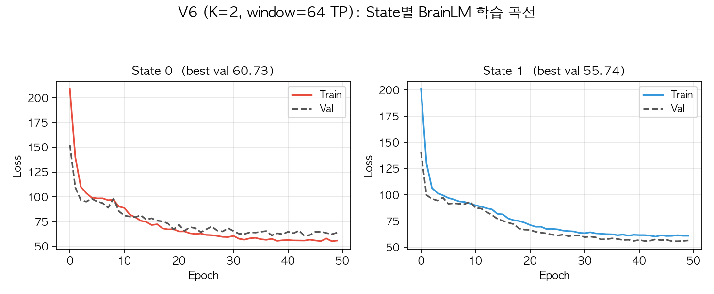
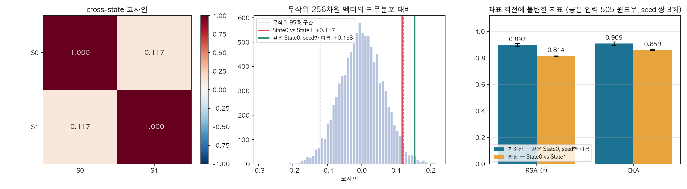
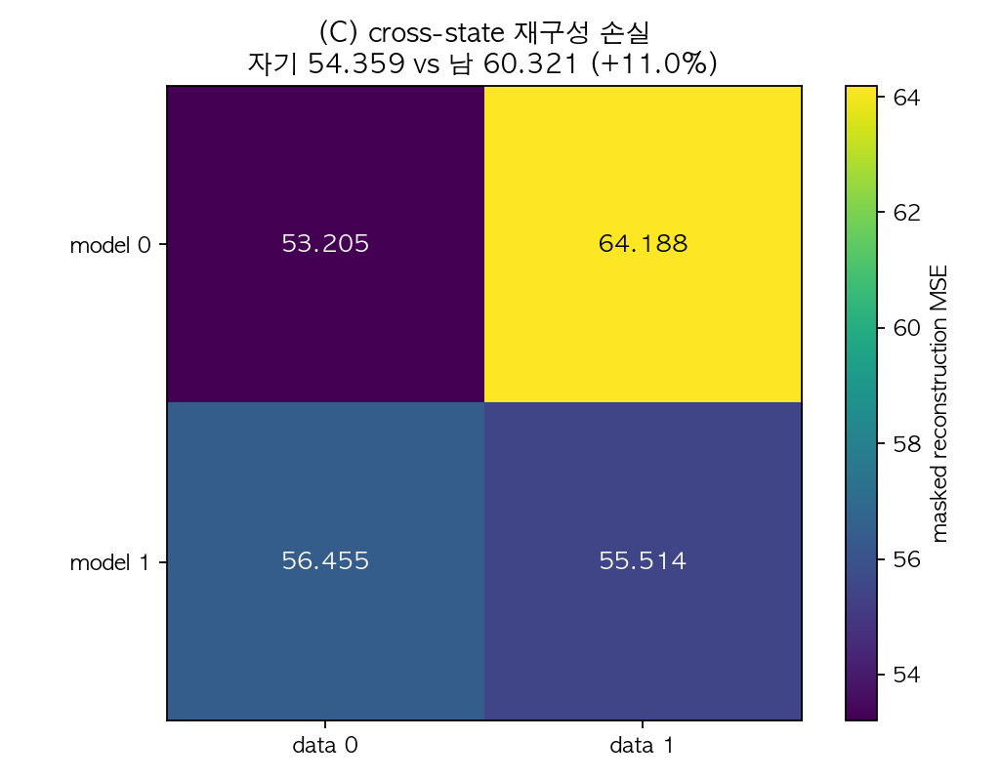
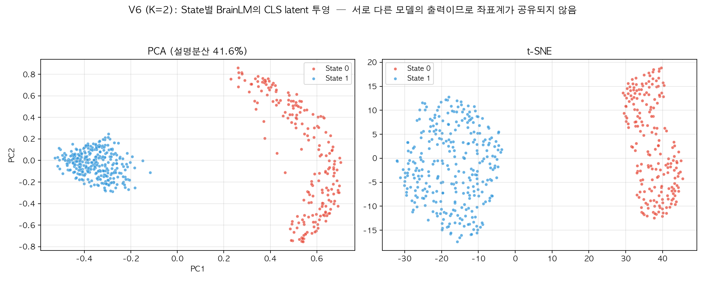
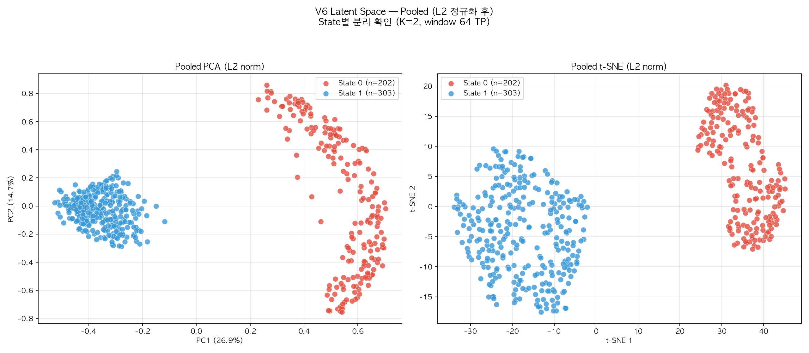
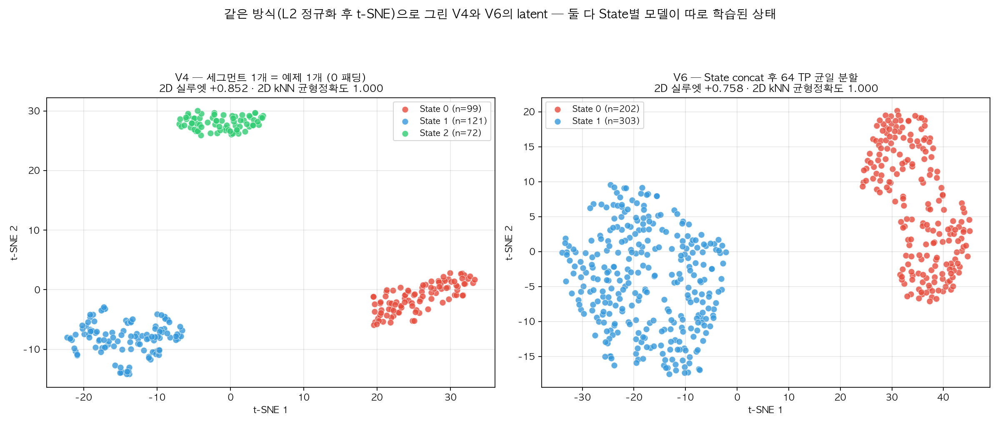
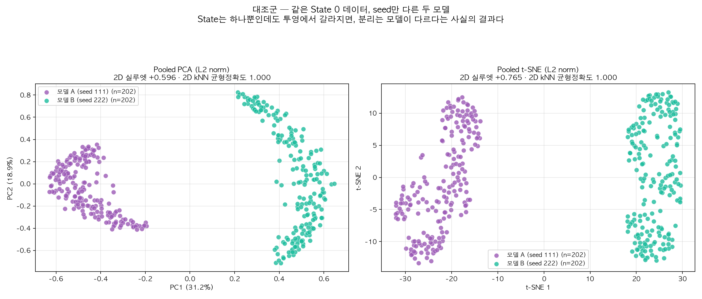

# V6: State concat → 균일 윈도우 → BrainLM latent 비교 (K=2)

- 생성 스크립트: `full_pipeline_v6.py`
- 윈도우 길이 **64 TP (46.1초)**, 보폭 64 TP, 패딩 없음
- 피험자 27명, 세그먼트 308개, device = mps
- 학습된 State: [0, 1]

---

## V4와 무엇이 다른가

| | V4 | V6 (현재) |
|---|---|---|
| 학습 예제 | 세그먼트 1개 = 예제 1개 | State 전체를 이어붙여 균일 분할 |
| 예제 길이 | 제각각 (31~549 TP), 0 패딩 | 모두 64 TP, 패딩 없음 |
| 예제 수 | 세그먼트 수와 동일 | 윈도우 수 (아래 표) |
| CM과의 대응 | 1:1 유지 | 사라짐 |

## (1) concat 및 윈도우 분할

| State | 세그먼트 | 총 TP | 윈도우 수 | 경계 걸침 |
|---|---|---|---|---|
| State 0 | 138 | 12,982 | 202 | 118 (58.4%) |
| State 1 | 170 | 19,418 | 303 | 151 (49.8%) |

> **경계 걸침**: 이어붙인 자리를 윈도우가 가로지르는 경우. 서로 다른 시간대 또는 서로 다른 피험자의 신호가 한 윈도우에 섞인다.

## (2) 학습 결과

| State | 윈도우 | train/val/test | best val loss | epochs |
|---|---|---|---|---|
| State 0 | 202 | 155/16/31 | 60.729 | 50 |
| State 1 | 303 | 227/40/36 | 55.742 | 50 |

*Figure 1. State별 BrainLM 학습 곡선.*

## (3) latent 비교

### (A) cross-state 코사인 — 요청된 지표

|  | State0 | State1 |
|---|---|---|
| State0 | 1.0000 | 0.1166 |
| State1 | 0.1166 | 1.0000 |

- 오프-대각 평균 **+0.1166**
- 무작위 256차원 단위벡터 두 개의 코사인 95% 구간: **[-0.1212, +0.1200]**
- 관측값 중 귀무구간 안에 있는 것: **2/2개**

> **해석**: 관측된 코사인이 전부 "무작위 벡터 두 개"의 범위 안에 있습니다. State별로 모델을 따로 학습하면 각 모델의 latent 좌표계가 공유되지 않으므로, 코사인 ≈ 0은 State 분리의 증거가 아니라 **설정상 당연한 결과**입니다. 아래 (B)와 (C)를 함께 보아야 합니다.

*Figure 2. (좌) cross-state 코사인 (중) 귀무분포 대비 — 같은 데이터·다른 seed(+0.153)가 State 간(+0.117)보다 높다 (우) 공통 입력 505 윈도우로 재계산한 RSA·CKA와 기준선. 원본 `fig3_latent_comparison.png`는 잘못된 RSA·CKA를 담고 있어 `_fixed` 버전으로 대체했다 (`v6_fig3_fix.py`).*

### (B) RSA / CKA — 좌표 회전에 불변한 비교

> **이전 값(RSA 0.0037 / CKA 0.0260)은 계산이 잘못되어 폐기했습니다.** 모델 0에는 State 0 데이터를, 모델 1에는 State 1 데이터를 넣고 비교했기 때문에 '모델 차이'와 '입력 차이'가 섞여 있었습니다. 아래는 **두 모델에 똑같은 505개 윈도우를 통과시켜** 다시 계산한 값입니다.

또한 절대값만으로는 판정할 수 없습니다. 독립적으로 학습한 두 모델은 같은 데이터로 학습해도 RSA·CKA가 1이 되지 않기 때문입니다. 그래서 **같은 State 0 데이터로 seed만 바꿔 학습한 두 모델**을 기준선으로 함께 측정했습니다 (seed 쌍 3회 반복).

| 비교 | RSA_r (평균 ± SD) | CKA (평균 ± SD) | n_used |
|---|---|---|---|
| 기준선 — 같은 State 0 데이터, seed만 다름 | 0.8966 ± 0.0123 | 0.9086 ± 0.0140 | 505 |
| 관심 — State 0 모델 vs State 1 모델 | 0.8138 ± 0.0021 | 0.8593 ± 0.0033 | 505 |

| seed 쌍 | 기준선 RSA | 관심 RSA | 차이 | 기준선 CKA | 관심 CKA | 차이 |
|---|---|---|---|---|---|---|
| (111, 222) | 0.9066 | 0.8154 | +0.0912 | 0.9191 | 0.8630 | +0.0561 |
| (333, 444) | 0.9003 | 0.8115 | +0.0888 | 0.9139 | 0.8566 | +0.0573 |
| (555, 666) | 0.8828 | 0.8145 | +0.0683 | 0.8927 | 0.8582 | +0.0345 |

> **해석**: 3회 모두 기준선이 더 높았고 두 분포는 겹치지 않습니다(기준선 최솟값 0.8828 > 관심 최댓값 0.8154). 즉 **좌표계가 다르다는 사실 자체는 의미가 없지만, 표현이 담고 있는 거리 구조는 실제로 조금 다릅니다**. 다만 차이는 RSA 0.07~0.09, CKA 0.03~0.06으로 작습니다. 재현 스크립트: `v6_rsa_cka_repeat.py`.

### (C) cross-state 재구성 손실 — 좌표계 문제가 없는 지표

|  | data0 | data1 |
|---|---|---|
| model0 | 53.2047 | 64.1877 |
| model1 | 56.4550 | 55.5141 |

- 자기 State 데이터 평균 손실 **54.3594**
- 다른 State 데이터 평균 손실 **60.3214** (+11.0%)

> 각 모델에 다른 State의 데이터를 넣었을 때 손실이 **유의하게 커지면**, 그 State들의 시간 동역학이 실제로 다르다는 직접적 증거가 됩니다. 차이가 없으면 State 구분이 BrainLM이 학습한 표현 수준에서는 의미가 없다는 뜻입니다.

*Figure 3. 행 = 모델, 열 = 데이터. 대각선이 자기 데이터.*

#### (C-1) 정정 — 위 수치는 학습 데이터 누수였다

> **위의 +11.0%는 폐기합니다.** 손실을 각 State의 *전체* 윈도우에서 쟀는데, 자기 데이터 칸에는 그 모델이 학습에 사용한 윈도우가 들어 있습니다(State 0: 155/202, State 1: 227/303 = 약 75%). 반면 남의 데이터는 전부 처음 보는 것이므로, 비교가 사실상 '학습한 것 vs 처음 보는 것'이 되어 암기를 측정하고 있었습니다.

저장된 체크포인트를 그대로 불러와 **학습에 쓰지 않은 윈도우(val + test)에서만** 다시 측정했습니다 (`v6_heldout_recon.py`).

| | data0 | data1 |
|---|---|---|
| model0 | 61.385 | 60.918 |
| model1 | 58.990 | 58.956 |

| 자기 vs 남의 데이터 손실 증가율 | 전체 윈도우 (기존) | 미학습 윈도우만 | 평가 예제 수 |
|---|---|---|---|
| 전체 | +11.0% | **−0.4%** | 47 + 76 |
| model 0 | +20.6% | **−0.8%** | 47 |
| model 1 | +1.7% | **+0.1%** | 76 |

다른 설정에서도 같습니다.

| 설정 | 전체 윈도우 | 미학습 윈도우만 |
|---|---|---|
| V6 K=4 전체 | −3.7% | −8.6% |
| V4 방식 (세그먼트 1개 = 예제, 0 패딩) 전체 | +11.0% | +0.5% |

> **결론**: State별로 모델을 따로 학습하는 방식으로는 State 간 차이를 보일 수 없습니다. 미학습 데이터에서 효과가 사라집니다(V4·V6, K = 2·3·4 전부). DC와 dwell time은 연결성 행렬에서 직접 계산한 통계이므로 이 문제와 무관합니다.

#### (C-2) 레이블 섞기 대조군의 해석도 바뀐다

실제 +10.97% vs 대조군 24회 평균 +5.88% ± 0.77 (z = +6.60, permutation p = 0.040)은 **양쪽 모두 같은 누수를 갖고 있으므로 비교 자체는 여전히 성립합니다.** 다만 의미가 달라집니다. 미학습 윈도우에서 실제 효과가 −0.4%이므로, 이 초과분이 말해주는 것은

- (X) 두 State의 시간 동역학이 다르다
- (O) 같은 State로 묶인 세그먼트들이 무작위 분할보다 서로 비슷해서, 모델이 자기 학습 데이터를 더 잘 외운다

입니다. 군집화가 의미 있는 묶음을 찾았다는 증거는 되지만, 일반화되는 동역학 차이의 증거는 아닙니다.

### (D) latent 투영

*Figure 4. PCA / t-SNE 투영. 서로 다른 모델의 출력을 한 공간에 겹쳐 그린 것이므로 군집이 갈라져 보여도 그 자체는 증거가 되지 않는다.*

#### (D-1) V4와 같은 방식으로 그린 t-SNE

V4에서는 State별 latent를 모두 쌓고 L2 정규화한 뒤 PCA / t-SNE로 투영했습니다. V6에도 같은 절차를 적용했습니다 (`v6_tsne_figures.py`).

*Figure 5. V6 pooled PCA / t-SNE (L2 정규화 후). State 0 n=202, State 1 n=303.*

*Figure 6. 같은 절차로 그린 V4(좌)와 V6(우)의 pooled t-SNE.*

| | t-SNE 2D 실루엣 | 2D kNN 균형정확도 | PCA 2D 실루엣 |
|---|---|---|---|
| V4 (State 0·1·2, 모델 3개, n=292) | +0.852 | 1.000 | +0.968 |
| V6 (State 0·1, 모델 2개, n=505) | +0.758 | 1.000 | +0.667 |

둘 다 2차원 좌표만으로 최근접이웃 분류를 돌리면 균형정확도 1.000, 즉 한 점도 틀리지 않습니다.

#### (D-2) 그 분리는 State 때문인가 — 대조군

같은 State 0 데이터(202개 윈도우)로 **난수 seed만 111과 222로 바꿔** BrainLM을 두 번 학습하고, 위와 똑같은 절차로 투영했습니다 (`v6_tsne_control.py`). 데이터가 완전히 같으므로 '진짜 차이'는 0입니다.

*Figure 7. 대조군 — 같은 State 0 데이터, seed만 다른 두 모델의 latent.*

| 비교한 두 집단 | t-SNE 2D 실루엣 | 2D kNN 균형정확도 |
|---|---|---|
| V4 — State 0 vs 1 vs 2 (모델 3개) | +0.852 | 1.000 |
| V6 — State 0 vs State 1 (모델 2개) | +0.758 | 1.000 |
| **대조군 — 같은 State 0, seed만 다름 (모델 2개)** | **+0.765** | **1.000** |
| V7 — 공유 모델 하나, 피험자 단위 5-fold | — | 0.710 |

> **해석**: State가 하나뿐인 대조군(+0.765)이 실제 State 비교(+0.758)보다 오히려 더 잘 갈립니다. 독립적으로 학습한 두 신경망은 각자 좌표축을 무작위로 정하므로, 어느 모델에서 나온 벡터인지에 따라 latent가 서로 다른 영역에 모이고 투영하면 당연히 분리됩니다. 따라서 **V4·V6의 t-SNE 분리는 State의 성질이 아니라 '모델이 둘'이라는 실험 설계의 부산물**이며, State 분리의 증거로 제시할 수 없습니다. 모델을 하나만 학습해 좌표계를 통일한 V7에서는 정확도가 1.000이 아니라 0.710으로 내려갑니다.

---

## 한계

1. **이어붙인 자리**: 윈도우의 일부가 서로 다른 시간대·피험자 신호를 걸칩니다(위 표의 '경계 걸침'). 이 자리에는 실제로 존재하지 않는 급격한 변화가 생깁니다.
2. **State별 모델이 따로 학습**되므로 latent 좌표계가 공유되지 않습니다. (A)의 코사인과 (D)의 t-SNE 분리는 이 때문에 증거가 될 수 없고 — (D-2)의 seed 대조군이 이를 직접 보입니다 — (B)·(C)가 보완 지표입니다.
3. **순환성**: State 레이블은 같은 시계열에서 만든 CM에서 유도되었습니다. 독립적인 검증을 하려면 무작위 분할 대조군이 필요합니다.
4. **교차 재구성 손실의 학습 데이터 누수** — (C-1) 참조. 미학습 윈도우에서 효과가 사라집니다.
5. **CM과의 1:1 대응 상실**: 윈도우가 세그먼트 경계를 넘나들므로 "이 latent는 이 CM의 표현"이라는 해석이 더 이상 성립하지 않습니다.

## 산출물

- 그림: `visualization_ver6_k2_stride64/fig1~fig9*.png`
- latent: `visualization_ver6_k2_stride64/latents_v6_state*.npy`
- 표: `visualization_ver6_k2_stride64/tables/` — concat_windows, training_results, cross_state_cosine, rsa_cka, cross_state_recon_loss
- 체크포인트: `checkpoint/brainlm_v6_k2/`