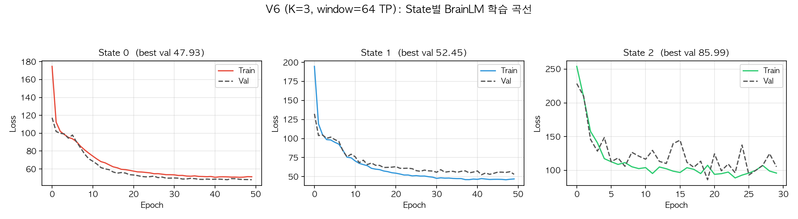
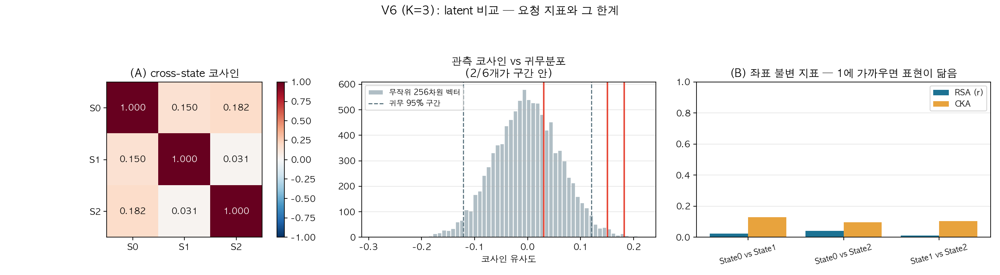
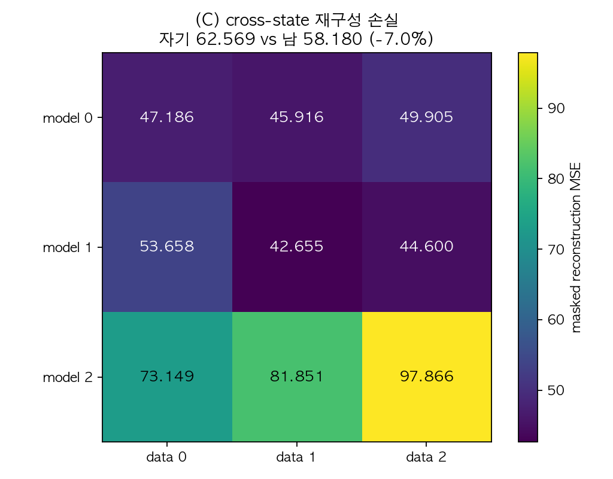
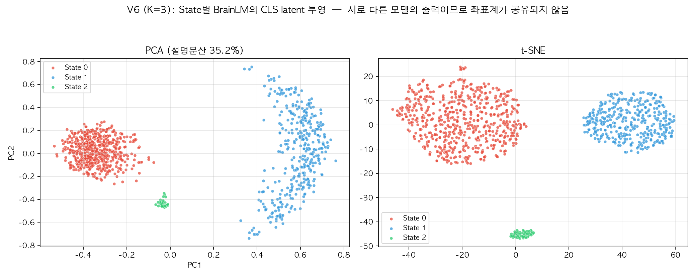

# V6: State concat → 균일 윈도우 → BrainLM latent 비교 (K=3)

- 생성 스크립트: `full_pipeline_v6.py`
- 윈도우 길이 **64 TP (46.1초)**, 보폭 32 TP, 패딩 없음
- 피험자 27명, 세그먼트 308개, device = mps
- 학습된 State: [0, 1, 2]

---

## V4와 무엇이 다른가

| | V4 | V6 (현재) |
|---|---|---|
| 학습 예제 | 세그먼트 1개 = 예제 1개 | State 전체를 이어붙여 균일 분할 |
| 예제 길이 | 제각각 (31~549 TP), 0 패딩 | 모두 64 TP, 패딩 없음 |
| 예제 수 | 세그먼트 수와 동일 | 윈도우 수 (아래 표) |
| CM과의 대응 | 1:1 유지 | 사라짐 |

## (1) concat 및 윈도우 분할

| State | 세그먼트 | 총 TP | 윈도우 수 | 경계 걸침 |
|---|---|---|---|---|
| State 0 | 169 | 19,358 | 603 | 296 (49.1%) |
| State 1 | 122 | 11,560 | 360 | 204 (56.7%) |
| State 2 | 17 | 1,482 | 45 | 25 (55.6%) |

> **경계 걸침**: 이어붙인 자리를 윈도우가 가로지르는 경우. 서로 다른 시간대 또는 서로 다른 피험자의 신호가 한 윈도우에 섞인다.

## (2) 학습 결과

| State | 윈도우 | train/val/test | best val loss | epochs |
|---|---|---|---|---|
| State 0 | 603 | 434/95/74 | 47.928 | 50 |
| State 1 | 360 | 281/31/48 | 52.454 | 50 |
| State 2 | 45 | 31/3/11 | 85.990 | 30 |

*Figure 1. State별 BrainLM 학습 곡선.*

## (3) latent 비교

### (A) cross-state 코사인 — 요청된 지표

|  | State0 | State1 | State2 |
|---|---|---|---|
| State0 | 1.0000 | 0.1504 | 0.1824 |
| State1 | 0.1504 | 1.0000 | 0.0307 |
| State2 | 0.1824 | 0.0307 | 1.0000 |

- 오프-대각 평균 **+0.1212**
- 무작위 256차원 단위벡터 두 개의 코사인 95% 구간: **[-0.1212, +0.1200]**
- 관측값 중 귀무구간 안에 있는 것: **2/6개**

*Figure 2. (좌) cross-state 코사인 (중) 귀무분포 대비 (우) 좌표 불변 지표.*

### (B) RSA / CKA — 좌표 회전에 불변한 비교

| pair | RSA_r | CKA | n_used |
|---|---|---|---|
| State0 vs State1 | 0.0238 | 0.1295 | 45 |
| State0 vs State2 | 0.0411 | 0.0968 | 45 |
| State1 vs State2 | 0.0108 | 0.1051 | 45 |

> 좌표축이 달라도 **예제들 사이의 거리 구조**는 비교할 수 있습니다. 1에 가까우면 두 모델이 비슷한 표현 구조를 배웠다는 뜻입니다.

### (C) cross-state 재구성 손실 — 좌표계 문제가 없는 지표

|  | data0 | data1 | data2 |
|---|---|---|---|
| model0 | 47.1856 | 45.9158 | 49.9047 |
| model1 | 53.6583 | 42.6554 | 44.5995 |
| model2 | 73.1493 | 81.8513 | 97.8660 |

- 자기 State 데이터 평균 손실 **62.5690**
- 다른 State 데이터 평균 손실 **58.1798** (-7.0%)

> 각 모델에 다른 State의 데이터를 넣었을 때 손실이 **유의하게 커지면**, 그 State들의 시간 동역학이 실제로 다르다는 직접적 증거가 됩니다. 차이가 없으면 State 구분이 BrainLM이 학습한 표현 수준에서는 의미가 없다는 뜻입니다.

*Figure 3. 행 = 모델, 열 = 데이터. 대각선이 자기 데이터.*

### (D) latent 투영

*Figure 4. PCA / t-SNE 투영. 서로 다른 모델의 출력을 한 공간에 겹쳐 그린 것이므로 군집이 갈라져 보여도 그 자체는 증거가 되지 않는다.*

---

## 한계

1. **이어붙인 자리**: 윈도우의 일부가 서로 다른 시간대·피험자 신호를 걸칩니다(위 표의 '경계 걸침'). 이 자리에는 실제로 존재하지 않는 급격한 변화가 생깁니다.
2. **State별 모델이 따로 학습**되므로 latent 좌표계가 공유되지 않습니다. (A)의 코사인은 이 때문에 해석이 어렵고, (B)·(C)가 보완 지표입니다.
3. **순환성**: State 레이블은 같은 시계열에서 만든 CM에서 유도되었습니다. 독립적인 검증을 하려면 무작위 분할 대조군이 필요합니다.
4. **CM과의 1:1 대응 상실**: 윈도우가 세그먼트 경계를 넘나들므로 "이 latent는 이 CM의 표현"이라는 해석이 더 이상 성립하지 않습니다.

## 산출물

- 그림: `visualization_ver6_k3/fig1~fig4*.png`
- latent: `visualization_ver6_k3/latents_v6_state*.npy`
- 표: `visualization_ver6_k3/tables/` — concat_windows, training_results, cross_state_cosine, rsa_cka, cross_state_recon_loss
- 체크포인트: `checkpoint/brainlm_v6_k3/`