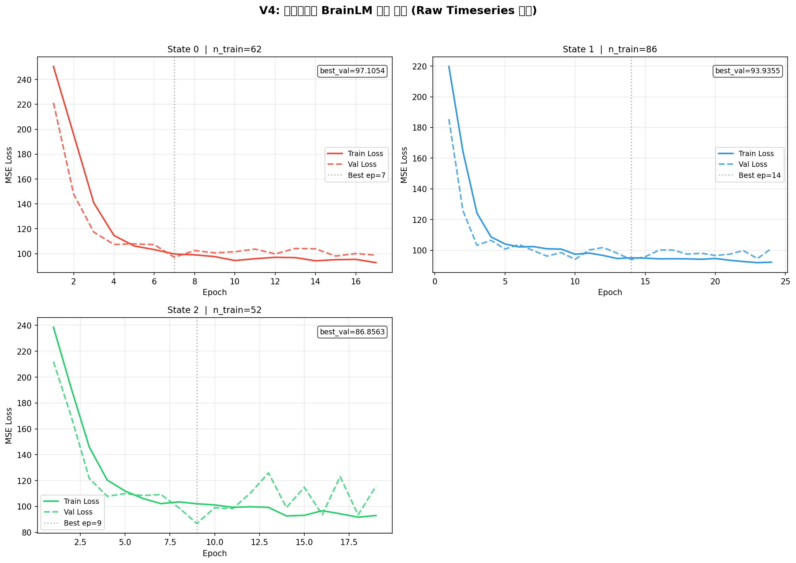
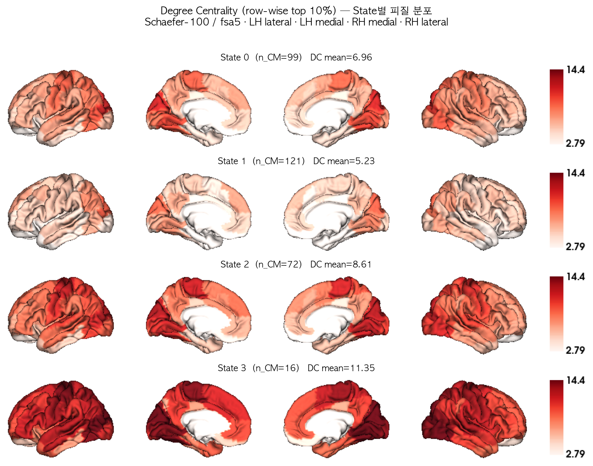
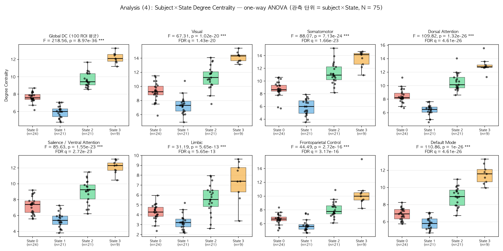
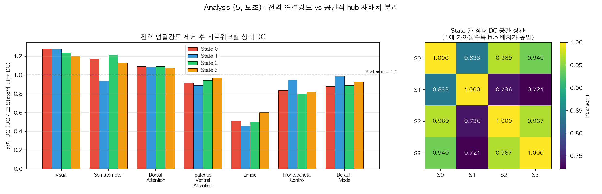
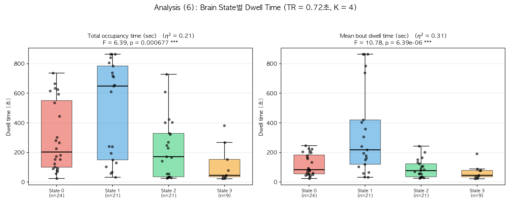
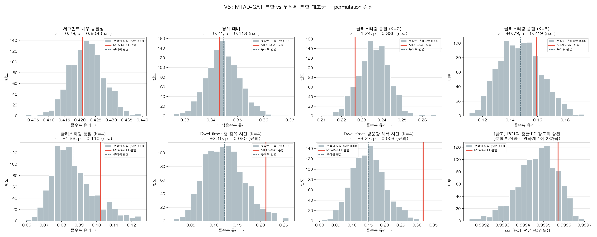

# 『V4 연구결과 발표』 슬라이드별 해설

- 해설 대상: `V4_연구결과_발표.pptx` (18장)
- 근거 자료: `v4_add_report.md` (V4 K=4 해석 분석), `v5_report.md` (무작위 분할 대조군)
- 목적: 발표 내용 학습 + 교수님 질문 대비
- 작성일: 2026-10-18

---

## 이 보고서 읽는 법

슬라이드마다 네 가지를 답합니다.

1. **슬라이드에 있는 것** — 실제로 화면에 나오는 내용
2. **쉽게 풀면** — 전공 지식 없이 이해하는 설명
3. **나온 용어** — 그 슬라이드에서 처음 나오는 말의 뜻
4. **예상 질문** — 교수님이 물으실 만한 것과 답

용어는 맨 뒤 **부록 사전**에 모아 두었습니다. 발표 때는 PPT의 **발표자 노트**(슬라이드 아래 칸)에 말할 내용이 이미 적혀 있으니 함께 보세요.

> **전체 구조**: 18장은 세 덩어리입니다. **1부(3~6장)** 무엇을 어떻게 만들었나 → **2부(7~12장)** 만들어진 상태들이 서로 뭐가 다른가 → **3부(13~17장)** 그 차이가 진짜인가. 마지막 18장이 결론입니다.

---

## 들어가기 전에: 연구를 네 문장으로

```
1) 27명의 뇌를 100구역으로 나눠, 0.72초마다 1,200번 신호를 기록했다
   (= 한 사람당 14분 24초)

2) AI(MTAD-GAT)가 "신호 패턴이 바뀌는 지점"을 찾아 시간을 잘랐다
   → 27명 합쳐서 308개 조각(세그먼트)

3) 조각마다 "어느 구역과 어느 구역이 같이 움직였나"를 100×100 표로 만들고,
   비슷한 표끼리 4묶음으로 묶었다 → 이 묶음을 Brain State라 부른다

4) 그 4개 상태가 서로 무엇이 다른지 분석하고,
   그 차이가 우연이 아닌지 검정했다
```

**이 발표의 핵심 메시지 한 줄**: 4개 상태는 서로 다른 *종류*가 아니라, **연결 강도라는 하나의 축 위에 놓인 4개의 눈금**이었고, 그마저도 무작위로 잘랐을 때와 잘 구별되지 않았다.

---

## 슬라이드 1 — 표지

**슬라이드에 있는 것**
제목 「MTAD-GAT 기반 Brain State 정의와 해석」. 부제로 "per-cluster BrainLM · Degree Centrality 해석 · 무작위 대조군 검정". 아래에 데이터 정보 (HCP rs-fMRI · Schaefer-100 · 27명 · 308 세그먼트).

**쉽게 풀면**
부제가 발표의 목차입니다. 세 가지를 보고한다는 뜻입니다 — ① 상태별로 AI 모델을 따로 학습시킨 것, ② 상태들이 뭐가 다른지 분석한 것, ③ 그게 진짜인지 검정한 것.

**나온 용어**

| 용어 | 뜻 |
|---|---|
| MTAD-GAT | 시계열에서 "이상한 지점"을 찾는 AI 모델. 이 연구는 그 지점을 **상태가 바뀌는 경계**로 해석해 썼다 |
| BrainLM | 뇌 신호용 AI 모델. 신호 일부를 가리고 맞히게 학습시켜 뇌 신호의 패턴을 익힌다 |
| per-cluster | 상태(클러스터)마다 **따로** 모델을 만들었다는 뜻 |
| Degree Centrality (DC) | 한 뇌 구역이 다른 구역들과 얼마나 강하게 이어져 있는지를 숫자 하나로 요약한 값 |
| HCP rs-fMRI | Human Connectome Project의 휴식 상태(resting-state) fMRI 공개 데이터 |
| Schaefer-100 | 뇌 피질을 100구역으로 나눈 표준 지도 |

---

## 슬라이드 2 — 오늘 보고드릴 세 가지

**슬라이드에 있는 것**
번호 붙은 카드 3장.

| | 제목 | 내용 |
|---|---|---|
| 1 | 파이프라인은 설계대로 동작했다 | 세그먼트 308개에서 State별 BrainLM 3개가 과적합 없이 수렴. State 간 DC 차이는 매우 크다 (η² = 0.90) |
| 2 | State를 가르는 축은 '전역 연결강도' 하나였다 | 전역 크기를 제거하면 유의 ROI가 100개 → 32개로 감소. K=2·3·4 모두 같은 축을 다른 위치에서 자른 결과 |
| 3 | 무작위 분할 대조군을 통과하지 못했다 | FC 구조 지표 5개 전부 무작위와 구별 불가. dwell time 1개만 통과 (p = 0.003) |

**쉽게 풀면**
발표 전체의 결론을 맨 앞에 깔아두는 슬라이드입니다. 좋은 소식(1) → 예상 밖의 발견(2) → 나쁜 소식(3) 순서입니다.

이렇게 **결론부터 말하는 구조**를 쓴 이유는, 교수님이 중간에 질문하셔도 이미 핵심은 전달됐기 때문입니다.

**나온 용어**

| 용어 | 뜻 |
|---|---|
| 과적합 (overfitting) | AI가 연습문제만 통째로 외워서, 처음 보는 문제는 못 푸는 상태 |
| 수렴 (convergence) | 학습이 안정적으로 끝나 성능이 더 이상 출렁이지 않는 것 |
| η² (에타 제곱) | 효과크기. "전체 차이 중 몇 %를 집단 구분이 설명하는가". 0.90 = 90% |
| 유의 ROI | 통계적으로 "상태에 따라 진짜 달라졌다"고 판정된 뇌 구역 |
| FC (기능적 연결성) | 두 구역의 신호가 시간에 따라 비슷하게 움직이는 정도 |

**예상 질문**
> *"3번이 사실이면 1·2번은 의미가 없는 것 아닌가?"*
> 1번은 "기술적으로 동작했다"는 뜻이고, 2번은 대조군과 무관하게 성립합니다(무작위로 잘라도 같은 축이 나오므로 오히려 보강됩니다). 무너지는 건 "AI가 찾은 경계가 특별하다"는 주장입니다.

---

## 슬라이드 3 — 섹션 01: 파이프라인 설계와 학습 결과

**슬라이드에 있는 것**
섹션 구분 화면. 큰 숫자 "01"과 제목.

**쉽게 풀면**
발표가 1부로 넘어간다는 표시입니다. 내용은 없고, 숨 고르는 지점입니다.

---

## 슬라이드 4 — V4 파이프라인 5단계

**슬라이드에 있는 것**
5개 카드가 화살표로 이어진 흐름도.

| 단계 | 이름 | 하는 일 |
|---|---|---|
| 1 | MTAD-GAT | GRU 은닉상태 변화량으로 상태 전환 경계 탐지 |
| 2 | 세그먼트 | 27명 × 평균 11.4개 = 308개 |
| 3 | CM + K-means | Pearson + Fisher-Z → 4,950차원 → State 레이블 |
| 4 | BrainLM | State별 독립 학습, 입력 = 원시 BOLD 시계열 |
| 5 | 해석 분석 | Degree Centrality + dwell time |

아래 강조 박스: *"CM은 State 레이블을 다는 데만 쓰고, 표현학습에는 시간 순서가 보존된 원시 BOLD 시계열을 넣는다."*

**쉽게 풀면**
공장 생산 라인이라고 보면 됩니다.

1. **AI가 가위질 위치를 정한다.** MTAD-GAT라는 모델이 신호를 읽으면서 "여기서 분위기가 바뀌네" 하는 지점을 찾습니다.
2. **자른다.** 308조각이 나옵니다.
3. **조각마다 꼬리표를 붙인다.** 각 조각의 "연결 관계표"를 만들고, 비슷한 표끼리 4묶음으로 분류합니다. 꼬리표 = State 0, 1, 2, 3.
4. **묶음마다 AI를 따로 키운다.** 중요한 건 **AI에게 주는 입력이 연결표가 아니라 원래 신호**라는 점입니다.
5. **분석한다.**

**왜 4단계에서 원래 신호를 주느냐**가 이 버전(V4)의 핵심입니다. 연결표는 "누가 누구와 친한가"만 담고 **시간 순서를 버립니다.** 영화를 보고 등장인물 관계도만 남기면 줄거리가 사라지는 것과 같죠. 그래서 꼬리표를 다는 데만 연결표를 쓰고, 학습에는 줄거리가 살아 있는 원본을 넣었습니다.

**나온 용어**

| 용어 | 뜻 |
|---|---|
| GRU 은닉상태 | AI가 신호를 읽어가며 속으로 유지하는 "요약 기억". 이 값이 확 바뀌면 신호 성격이 변했다는 신호로 봄 |
| CM (연결성 행렬) | 100×100 연결 관계표 |
| Pearson 상관 | 두 신호가 같이 움직이는 정도를 재는 가장 기본적인 방법 |
| Fisher-Z 변환 | 상관계수(−1~1에 눌려 있음)를 통계 처리하기 좋게 펴 주는 변환 |
| 4,950차원 | 100×100 표에서 중복과 대각선을 뺀 칸 수 = 100×99÷2 |
| BOLD 시계열 | fMRI가 실제로 재는 값. 혈액 속 산소 농도의 시간 변화 |
| 표현학습 | AI가 데이터를 요약하는 방법을 스스로 익히는 것 |

---

## 슬라이드 5 — 버전별 설계 비교

**슬라이드에 있는 것**
V2 / V3 / V4 비교표.

| 항목 | V2 | V3 | V4 (현재) |
|---|---|---|---|
| BrainLM 입력 | CM 시퀀스 (4950-dim) | Raw TS (공유 모델) | Raw TS (클러스터별) |
| 모델 구조 | 클러스터별 독립 | 단일 공유 | 클러스터별 독립 |
| 학습 예제 | CM 슬라이딩 윈도우 | 4개 세그먼트 concat | 각 세그먼트 = 1 예제 |
| 총 예제 수 | ~288 | ~83 | 308 |
| 오프-대각 코사인 | ~ −0.016 | ~0.97 | −0.006 |

아래 주의 박스: *"맨 아래 '오프-대각 코사인'은 뒤에서 다시 다룹니다."*

**쉽게 풀면**
이전 시도들과 뭐가 달라졌는지 보여주는 표입니다. 맨 아랫줄이 중요합니다.

**오프-대각 코사인**은 "서로 다른 상태의 AI가 만든 요약이 얼마나 안 닮았는가"를 재는 값입니다. 0에 가까울수록 "완전히 다르다"는 뜻이고, 연구에서는 그게 좋은 결과라고 봤습니다.

- V3(0.97): 모델 하나로 전부 처리 → 요약이 다 비슷함 → 실패로 해석
- V4(−0.006): 모델을 따로 만듦 → 거의 안 닮음 → 성공으로 해석

**그런데 이 해석이 틀렸습니다.** 17번 슬라이드에서 그 이유를 다룹니다. 그래서 이 슬라이드에 미리 주의 박스를 달아뒀습니다.

**나온 용어**

| 용어 | 뜻 |
|---|---|
| 코사인 유사도 | 두 벡터가 같은 방향을 보는 정도. 1 = 같은 방향, 0 = 무관, −1 = 반대 |
| 오프-대각 (off-diagonal) | 표에서 대각선을 뺀 칸. 대각선은 "자기 자신과의 비교"라 항상 1이라 의미 없음 |
| Raw TS | Raw Time Series. 가공하지 않은 원래 신호 |
| 슬라이딩 윈도우 | 창문을 조금씩 밀며 구간을 잘라내는 방식 |
| concat | 이어 붙이기 |

**예상 질문**
> *"V4의 예제 수가 308인데 V3는 왜 83인가?"*
> V3는 세그먼트 4개를 이어 붙여 예제 1개로 만들었기 때문입니다. V4는 세그먼트 하나를 그대로 예제 하나로 썼습니다.

---

## 슬라이드 6 — State별 BrainLM 학습 결과

**슬라이드에 있는 것**
왼쪽에 학습 곡선 그림, 오른쪽에 요약 불릿과 주의 박스.



*각 State별로 따로 학습한 BrainLM의 Train / Validation Loss 곡선*

- 3개 State 모두 과적합 징후 없이 수렴
- 최적 검증 손실: 98.83 / 101.15 / 115.67
- 마스킹 비율 15%, d_model 256, encoder 4층·8헤드
- 피험자 단위 train/val/test 분할로 데이터 누수 차단
- **State 3은 학습에서 제외** — 세그먼트 16개뿐이라 검증 세트 구성 불가

**쉽게 풀면**
AI를 가르칠 때는 **연습문제(train)**와 **시험문제(validation)**를 나눕니다. 그래프의 두 선이 그것입니다.

- 두 선이 **같이 내려가면** → 잘 배우고 있다
- 연습문제 선만 내려가고 **시험 선이 올라가면** → 외우기만 한 것(과적합)

여기서는 두 선이 나란히 내려가 **제대로 배웠습니다.**

**"손실(Loss)"** 은 틀린 정도입니다. 낮을수록 좋습니다. 98.83 / 101.15 / 115.67은 세 모델의 성적인데, 서로 다른 데이터로 학습했으니 **직접 비교하면 안 됩니다.**

**"피험자 단위 분할"** 이 중요합니다. 같은 사람의 데이터가 연습문제와 시험문제에 동시에 들어가면, AI가 그 사람의 뇌 특징을 외워서 시험을 잘 보게 됩니다. 이걸 **데이터 누수**라 하고, 그래서 사람 단위로 갈랐습니다.

**나온 용어**

| 용어 | 뜻 |
|---|---|
| Loss (손실) | AI가 틀린 정도를 숫자로 잰 값. 낮을수록 좋음 |
| Train / Validation | 연습용 데이터 / 중간점검용 데이터 |
| 마스킹 비율 15% | 신호의 15%를 가리고 맞히게 시키는 학습법 (masked autoencoder) |
| d_model 256 | AI가 내부에서 쓰는 요약 벡터의 길이 |
| encoder 4층·8헤드 | 트랜스포머 구조의 크기. 층이 많을수록 복잡한 패턴을 잡지만 데이터가 많이 필요 |
| 데이터 누수 (data leakage) | 시험 문제가 연습 과정에 섞여 들어가 성적이 부풀려지는 것 |

**예상 질문**
> *"State 3을 뺐는데 뒤의 분석에는 왜 나오나?"*
> BrainLM 학습에서만 뺐습니다. DC·dwell time 같은 해석 분석은 AI 학습이 필요 없어서 4개 상태 전부 포함했습니다. 다만 표본이 9명뿐이라 검정력이 낮습니다.

---

## 슬라이드 7 — 섹션 02: Brain State는 무엇이 다른가

섹션 구분 화면입니다. "02"와 제목만 있습니다.

---

## 슬라이드 8 — State별 Degree Centrality 분포

**슬라이드에 있는 것**
왼쪽에 뇌 표면 그림, 오른쪽에 DC 정의와 크기 순서표.



*State별 Degree Centrality의 피질 표면 분포 (공통 color range)*

DC 정의:
- 100×100 Fisher-Z 행렬의 각 행에서 상위 10%만 유지
- 유지된 값을 행 방향으로 합산 → 100×1 벡터

DC 크기 순서: State 1 (5.23) < State 0 (6.96) < State 2 (8.61) < State 3 (11.35)

**쉽게 풀면**
**DC 계산법**을 반 친구 관계로 풀면 이렇습니다.

1. 100명의 친밀도 표를 만든다 (100×100)
2. 각자 **가장 친한 10명**만 남기고 나머지는 지운다 (상위 10%)
3. 남은 10명과의 친밀도를 더한다 → 그 사람의 **DC**

약하게 아는 사이까지 다 더하면 잡음이 섞이니까, 강한 연결만 봅니다.

뇌 그림은 **DC가 높은 곳을 밝게** 칠한 것입니다. 네 그림 모두 비슷한 곳이 밝은데, **전체 밝기만** 다릅니다. 이게 다음 슬라이드들의 복선입니다.

**나온 용어**

| 용어 | 뜻 |
|---|---|
| 피질 (cortex) | 뇌의 바깥쪽 주름진 표면. 고차원 기능을 담당 |
| color range | 색깔과 숫자를 대응시키는 범위. **공통** range란 네 그림을 같은 기준으로 칠했다는 뜻 → 그래야 밝기 비교가 가능 |
| thresholding | 약한 값을 잘라내는 것 |
| 100×1 벡터 | 숫자 100개가 세로로 늘어선 것. 구역당 DC 하나씩 |

**예상 질문**
> *"왜 하필 상위 10%인가?"*
> 관행적 선택입니다. 원 보고서에는 5%로 바꾼 민감도 분석 옵션(`--top-pct`)이 있지만 실행하지는 않았습니다. 물으시면 "확인해보겠다"가 정직한 답입니다.

---

## 슬라이드 9 — State 간 차이는 통계적으로 매우 크다

**슬라이드에 있는 것**
위에 수치 카드 3개, 아래에 상자그림.

| 수치 | 의미 |
|---|---|
| F = 218.6 | Global DC one-way ANOVA · F(3, 71), p = 8.97e-36 |
| η² = 0.90 | 전체 분산의 90%를 State가 설명 |
| 6 / 6 pair | 모든 State 쌍에서 유의 (\|t\| = 8.5 ~ 23.6) |



*Global DC 및 네트워크별 DC의 State 간 분포 (점 = subject × State 관측)*

**쉽게 풀면**
**ANOVA(분산분석)** 는 "셋 이상의 집단 평균이 서로 다른가"를 한 번에 검정하는 방법입니다.

**F값**은 쉽게 말해 이런 비율입니다.

```
        집단 사이의 차이
F =  ─────────────────────
      집단 안의 들쑥날쑥함
```

반 평균끼리 많이 다르고(분자 큼), 각 반 안에서는 애들 성적이 고만고만하면(분모 작음) F가 커집니다. 보통 4만 넘어도 "차이가 있다"고 하는데 **218은 압도적**입니다.

**η²(에타 제곱)** 는 "차이의 90%가 상태 구분 때문"이라는 뜻입니다.

**상자그림(boxplot)** 읽는 법: 상자는 가운데 50%가 모인 구간, 가로선은 중앙값, 수염은 전체 범위입니다. 상자들이 서로 안 겹치면 집단이 잘 갈린 것입니다.

**나온 용어**

| 용어 | 뜻 |
|---|---|
| ANOVA | 셋 이상 집단 평균 비교 검정 |
| F(3, 71) | 자유도. 3 = 집단 4개 − 1, 71 = 관측 75개 − 4 |
| p = 8.97e-36 | 0.00000...897 (0이 35개). "우연일 확률이 사실상 0" |
| two-sample t-test | 두 집단 평균 비교. 4개 상태면 쌍이 6개 |
| 관측 단위 (subject × State) | 분석의 기본 단위가 "사람 1명 × 상태 1개" 조합이라는 뜻. 총 75개 |
| 상자그림 (boxplot) | 분포를 상자와 수염으로 나타낸 그림 |

**예상 질문**
> *"F가 218인데 왜 결론이 부정적인가?"*
> **큰 F가 '경계를 잘 찾았다'는 증거는 아니기 때문입니다.** 무작위로 잘라도 비슷하게 큰 F가 나옵니다(15번 슬라이드). F는 "차이가 있다"만 말해주지 "그 차이가 의미 있게 만들어진 것인가"는 말해주지 않습니다.

---

## 슬라이드 10 — 그런데 차이의 대부분은 '전역 연결강도'였다

**슬라이드에 있는 것**
위에 그림, 아래에 수치 카드 3개.



*(좌) 전역 크기 제거 후 네트워크별 상대 DC  (우) State 간 상대 DC 공간 상관*

| 수치 | 의미 |
|---|---|
| 0.72 ~ 0.97 | State 간 공간 상관 — hub 배치는 State가 바뀌어도 거의 동일 |
| 100 → 32 | 유의 ROI 수 — 전역 크기 제거 시 3분의 1로 감소 |
| 2 / 7 | 남은 유의 네트워크 — Somatomotor, Frontoparietal Control |

**쉽게 풀면**
**이 발표에서 가장 중요한 슬라이드입니다.**

9번에서 "상태들이 엄청나게 다르다"고 했는데, **뭐가 다른지** 파고든 결과입니다.

핵심 도구는 **상대 DC**입니다. 각 구역의 DC를 **그 상태의 평균 DC로 나눈** 값입니다.

- 1.0 = 평균만큼
- 1.25 = 평균보다 25% 높음

왜 나누느냐면, 전체가 세지면 **모든 구역이 같이** 세져서 누가 진짜 중심인지 가려지기 때문입니다. 평균으로 나누면 전체 크기가 지워지고 **순위만** 남습니다.

결과 세 가지:

1. **공간 상관 0.72~0.97**: 두 상태의 "구역별 순위표"가 얼마나 닮았는지를 잰 값. 1에 가까우면 판박이입니다. 즉 **중심지는 안 바뀝니다.**
2. **100 → 32**: "진짜로 다른" 구역이 100개에서 32개로 줄었습니다. 나머지 68개의 차이는 **전체가 세져서 생긴 착시**였습니다.
3. **7개 중 2개**: 네트워크 수준에서도 5개가 탈락했습니다.

**결론**: 상태를 가르는 건 "중심지 재배치"가 아니라 **"전체 볼륨"** 입니다. 스피커의 곡이 바뀐 게 아니라 볼륨 손잡이만 돌아간 겁니다.

**나온 용어**

| 용어 | 뜻 |
|---|---|
| 상대 DC | DC ÷ 그 상태의 평균 DC |
| 전역 연결강도 (global FC magnitude) | 연결표 전체 숫자들의 전반적 크기 |
| 공간 상관 | 두 상태의 구역별 값 패턴이 얼마나 닮았는지 (−1 ~ 1) |
| hub 재배치 | 중심 역할을 하는 구역이 바뀌는 것 |
| Somatomotor | 체성감각·운동 담당 네트워크 |
| Frontoparietal Control | 전두두정 통제 네트워크. 집중·판단 담당 |

**예상 질문**
> *"그럼 남은 2개 네트워크는 의미가 있나?"*
> 네. 전역 크기를 걷어내고도 살아남았고, **K=2·3·4 세 경우 모두에서 같은 2개**가 나왔습니다. 현재 연구에서 가장 재현성 있는 공간적 소견입니다. 다만 "세 번 재현"은 같은 27명을 다르게 자른 것이라 외부 데이터 재현은 아닙니다.

---

## 슬라이드 11 — State별 체류 시간 (dwell time)

**슬라이드에 있는 것**
왼쪽에 그림, 오른쪽에 표와 요약.



*(좌) 총 점유 시간  (우) 방문당 평균 체류 시간 · TR = 0.72초*

| State | 총 점유 [초] | 방문당 [초] |
|---|---|---|
| State 0 | 301.2 ± 235.8 | 116.1 ± 72.4 |
| **State 1** | **491.3 ± 327.1** | **340.8 ± 298.4** |
| State 2 | 225.6 ± 202.7 | 90.7 ± 60.8 |
| State 3 | 115.8 ± 128.4 | 66.3 ± 53.0 |

- DC가 가장 낮은 State 1이 가장 오래 유지
- 방문당 체류: F(3,71) = 10.78, p = 6.4e-06
- 총 점유: F = 6.39, p = 6.8e-04

**쉽게 풀면**
**dwell time(체류 시간)** = 한 상태에 머문 시간입니다. 조각의 길이(시점 개수)에 0.72초를 곱해 계산합니다.

두 가지로 쟀습니다.

- **총 점유 시간**: 스캔 전체에서 그 상태에 있었던 시간을 **다 합친** 것
- **방문당 체류 시간**: 한 번 들어가서 나올 때까지 평균 시간

결과는 깔끔한 반비례입니다. 연결이 **약한** State 1은 한 번 들어가면 **340초(5분 40초)** 머물고, 연결이 **강한** State 3은 **66초** 만에 나옵니다.

**± 뒤의 숫자(표준편차)가 큽니다.** State 1은 340.8 ± 298.4인데, 이는 사람마다 편차가 매우 크다는 뜻입니다. 평균만 보면 안 됩니다.

**나온 용어**

| 용어 | 뜻 |
|---|---|
| dwell time | 한 상태에 연속으로 머문 시간 |
| TR (Repetition Time) | MRI가 뇌를 한 번 찍는 주기. 이 데이터는 0.72초 |
| time point (TP) | 측정 시점 하나 |
| 표준편차 (±) | 값들이 평균에서 흩어진 정도. 클수록 들쑥날쑥 |
| 총 점유 vs 방문당 | 합계 vs 1회 평균 |

**예상 질문**
> *"이 숫자가 전체 시간의 몇 %인가?"*
> **주의가 필요한 질문입니다.** 각 평균은 **그 상태를 방문한 사람들만**의 평균입니다. State 3은 27명 중 9명만 방문했습니다(18명은 한 번도 안 감). 전체 27명 기준 실제 점유율은 State 1 = 44.2%, State 0 = 31.0%, State 2 = 20.3%, State 3 = 4.5%입니다.

---

## 슬라이드 12 — K를 2·3·4로 바꿔도 결론은 같다

**슬라이드에 있는 것**
K별 비교표와 설명 카드 2개.

| | K = 2 | K = 3 | K = 4 |
|---|---|---|---|
| Global DC ANOVA | F = 118.3 | F = 214.6 | F = 218.6 |
| 절대 DC 유의 ROI (FDR) | 100 / 100 | 99 / 100 | 100 / 100 |
| 상대 DC 유의 ROI (FDR) | 23 | 21 | 32 |
| **상대 DC 유의 네트워크** | **SomMot, Cont** | **SomMot, Cont** | **SomMot, Cont** |
| silhouette | 0.227 | 0.170 | 0.094 |

레이블 중첩 구조: K=3 → K=2 ARI 0.901 (308개 중 1개만 어긋남) / K=4 → K=3 최저·최고 DC State가 100% 보존, 중간만 분할

**쉽게 풀면**
"상태가 4개"라고 했지만, **4라는 숫자는 사람이 정한 것**입니다. 그래서 2개, 3개로도 나눠보고 결과를 비교했습니다.

**결과: 세 경우가 전부 같았습니다.** 특히 살아남는 네트워크 2개가 동일합니다.

**교차표**를 보면 이유가 명확합니다. K를 3에서 4로 늘려도 **가장 낮은 상태와 가장 높은 상태는 그대로 유지되고, 중간만 둘로 쪼개집니다.** 체온을 36/37도로 나누든 36/36.5/37로 나누든 **같은 체온계를 다른 눈금으로 읽는 것**과 같습니다.

**silhouette**은 "묶음이 얼마나 깔끔하게 나뉘었나" 점수인데, **K=2에서 최대이고 K가 커질수록 계속 나빠집니다.** 원래 4종류가 있었다면 K=4에서 점수가 튀어야 하는데 그렇지 않습니다. 즉 **애초에 딱 떨어지는 종류가 없다**는 뜻입니다.

**나온 용어**

| 용어 | 뜻 |
|---|---|
| K | 묶음의 개수. K-means에서 사람이 정해주는 값 |
| FDR | 여러 번 검정할 때 "운 좋게 유의하게 나온 것"을 걸러내는 보정 |
| silhouette | 군집이 잘 나뉜 정도. −1 ~ 1, 클수록 좋음 |
| ARI (Adjusted Rand Index) | 두 분류 결과의 일치도. 0 = 무작위, 1 = 완전 일치 |
| 교차표 | 두 분류 방식이 서로 어떻게 대응되는지 세어 본 표 |

**예상 질문**
> *"F값이 K=2일 때 118이고 K=4일 때 218인데, 그럼 4가 더 좋은 것 아닌가?"*
> **아닙니다.** 잘게 자를수록 각 묶음이 더 극단적인 값들로 채워져서 F는 자동으로 커집니다. **K 선택의 근거로 F를 쓰면 안 됩니다.** 오히려 silhouette은 K=2에서 최대입니다.

---

## 슬라이드 13 — 섹션 03: 이 결과는 믿을 수 있는가

섹션 구분 화면입니다. "무작위 분할 대조군 1,000회 · 잠재표현 직교성 재검토"라는 부제가 붙습니다.

---

## 슬라이드 14 — 무작위 분할 대조군 설계

**슬라이드에 있는 것**
설계 설명 박스와 검정 지표 목록.

> **왜 필요한가**: 시계열을 아무 데서나 308조각으로 잘라도 조각마다 FC는 다르고 K-means는 무조건 무언가로 묶어준다. 따라서 '묶였다'는 사실 자체는 가설의 증거가 되지 못한다.

```
실제  : [70, 33, 252, 87, …]  ← MTAD-GAT 경계
무작위: [252, 87, 70, 33, …]  ← 같은 길이, 순서만 섞음
```

검정 지표 4종:
- 세그먼트 내부 동질성 — 전/후반 CM 상관 (↑)
- 경계 대비 — 경계 양쪽 CM 상관 (↓)
- 군집 품질 silhouette — K = 2, 3, 4 (↑)
- dwell time 효과크기 η² — 2가지 정의 (↑)

**쉽게 풀면**
**이 발표에서 두 번째로 중요한 슬라이드입니다.**

지금까지는 "AI가 찾은 지점에서 자른 결과"만 봤습니다. **비교 대상이 없었습니다.**

비유: 학생들을 **키 순서로** 두 반에 나눴더니 두 반 평균 성적이 달랐습니다. 이게 "키가 성적과 관련 있다"는 증거일까요? 아닙니다. **제비뽑기로 나눠도** 평균은 다릅니다. 키로 나눈 게 의미 있으려면 **제비뽑기보다 더 크게 갈려야** 합니다.

그래서 **조각 개수(308개)와 길이는 똑같이** 두고 **자르는 위치만** 무작위로 바꿔 1,000번 반복했습니다.

**길이를 맞춘 이유**: 짧은 조각은 연결표 계산이 불안정합니다. 길이를 안 맞추면 "위치 효과"와 "길이 효과"가 섞여서 뭐 때문인지 알 수 없게 됩니다.

**네 가지 지표의 뜻**:

| 지표 | 묻는 것 | 좋은 방향 |
|---|---|---|
| 내부 동질성 | 한 조각 안이 균일한가 | 높을수록 좋음 |
| 경계 대비 | 경계를 사이에 두고 확 달라지는가 | 낮을수록 좋음 |
| 군집 품질 | 조각들이 상태로 깔끔히 묶이는가 | 높을수록 좋음 |
| dwell time η² | 상태별 체류 시간이 크게 갈리는가 | 높을수록 좋음 |

**나온 용어**

| 용어 | 뜻 |
|---|---|
| 대조군 (control) | 비교 기준. 대조군 없는 결과는 해석 불가 |
| 귀무 모형 (null model) | "아무 효과도 없을 때"를 흉내 낸 모형 |
| permutation test (순열 검정) | 데이터를 무작위로 섞어 "우연히 나올 값의 분포"를 직접 만들고, 실제 값이 거기서 얼마나 극단적인지 보는 방법 |

---

## 슬라이드 15 — 대조군 결과: 7개 중 1개만 통과

**슬라이드에 있는 것**
8칸짜리 큰 그림 하나와 아래 요약 띠.



*회색 = 무작위 분할 1,000회 분포 · 빨간 선 = MTAD-GAT 분할 관측값 · 각 패널 제목에 z와 p 표기*

> 통과한 지표: dwell time 방문당 체류 η² = 0.3188 (무작위 0.1513, z = +3.27, p = 0.003) — 7개 검정의 Bonferroni 기준 0.0071을 넘는 유일한 지표

**쉽게 풀면**
**그림 읽는 법이 전부입니다.**

- **회색 산더미** = 아무렇게나 자른 1,000번의 성적 분포
- **빨간 세로선** = AI가 자른 성적

빨간 선이 산더미 **한가운데** 꽂혀 있으면 → 아무렇게나 자른 것과 **똑같다**는 뜻입니다.
빨간 선이 산더미 **바깥 끝**으로 나가 있으면 → 특별하다는 뜻입니다.

**결과**: 8칸 중 6칸에서 빨간 선이 한가운데 있습니다. **dwell time 두 칸만** 바깥으로 나갔습니다.

특히 뼈아픈 것:
- **내부 동질성과 경계 대비는 방향조차 유리하지 않습니다.** 경계가 진짜 전환점이라면 가장 먼저 티가 나야 할 지표인데 무작위 평균과 사실상 같습니다.
- **군집 품질 K=2는 무작위가 오히려 더 좋습니다**(백분위 11%).

**나온 용어**

| 용어 | 뜻 |
|---|---|
| 귀무분포 (null distribution) | "아무 효과 없을 때 나올 수 있는 값들의 분포". 그림의 회색 산더미 |
| z-score | 관측값이 평균에서 표준편차 몇 개만큼 떨어졌는지. 1.65 넘으면 단측 p < 0.05 |
| 백분위 | 무작위 1,000개 중 몇 %보다 큰지 |
| Bonferroni 보정 | 여러 번 검정할 때 쓰는 엄격한 보정. 기준을 검정 횟수로 나눔 (0.05 ÷ 7 = 0.0071) |

**예상 질문**
> *"K=4 군집 품질은 p = 0.11로 꽤 근접했는데?"*
> 네, 백분위 89%입니다. 다만 유의 기준을 못 넘었고, 설령 넘었더라도 해석에 함정이 있습니다. "경계가 전역 FC 강도 변화 지점에 맞춰졌다"는 뜻인데, 그 전역 강도는 머리 움직임·각성도와 엉켜 있는 값입니다.

---

## 슬라이드 16 — dwell time 결과를 다시 읽으면

**슬라이드에 있는 것**
경고 박스, 수치 카드 3개, 대안 설명 목록.

> **무작위로 잘라도 dwell time η² 평균이 0.15다.** 즉 아무렇게나 잘라도 State별 체류 시간 차이는 크게 나오고, 무작위 분할의 상당수가 통계적으로 유의한 ANOVA 결과를 낸다. V4에서 보고한 p = 6.4e-06 자체는 증거가 되지 못한다.

| 수치 | 의미 |
|---|---|
| 0.32 | 관측 η² (방문당 체류) — MTAD-GAT 분할 |
| 0.15 | 무작위 η² 평균 — 1,000회 분포의 중심 |
| p = .003 | 초과분의 유의성 — Bonferroni 기준 통과 |

남은 대안 설명:
- 방문당 체류 시간은 인접 세그먼트가 같은 State로 묶이는 정도에 민감 — '경계가 정확하다'는 뜻일 수도, '한 상태를 불필요하게 여러 번 잘랐다(과분할)'는 뜻일 수도 있음
- 세그먼트가 길수록 FC 크기가 낮게 추정되는 경향(길이↔강도 결합)도 완전히 배제되지 않음

**쉽게 풀면**
**이 슬라이드가 발표에서 가장 중요한 방법론적 포인트입니다.**

11번에서 dwell time ANOVA가 p = 6.4e-06으로 아주 좋게 나왔습니다. 그런데 **무작위로 잘라도** η²가 평균 0.15 나옵니다. 무작위 분할 중 상당수가 "통계적으로 유의한" 결과를 냅니다.

그러니 **p값 자체는 증거가 아닙니다.** 증거는 **0.32 − 0.15 = 초과분**뿐입니다.

다행히 이 초과분은 유의했습니다(p = 0.003). **현재 연구에서 대조군을 통과한 유일한 결과**입니다.

**다만 대안 설명이 남아 있습니다.** "방문당 체류 시간이 길다"는 건 인접한 조각들이 같은 상태로 묶였다는 뜻인데, 이게 두 가지로 해석됩니다.

- **좋은 해석**: 경계를 정확히 찾아서 같은 상태가 이어졌다
- **나쁜 해석**: 한 상태를 **쓸데없이 여러 번 잘랐다**(과분할)

지금 데이터로는 둘을 구별할 수 없습니다.

**나온 용어**

| 용어 | 뜻 |
|---|---|
| 효과크기 (effect size) | 차이가 **얼마나 큰지**. p값은 "우연인가"만 알려주고 크기는 안 알려줌 |
| 초과분 | 무작위 기준선을 넘어선 부분. 진짜 증거가 되는 양 |
| 과분할 (over-segmentation) | 하나로 둬도 될 구간을 불필요하게 여러 조각으로 자른 것 |

---

## 슬라이드 17 — 잠재표현 '직교성' 결과 재검토

**슬라이드에 있는 것**
문제 설명 박스, 검증표, 계산 근거 카드.

> **문제**: cross-cluster 코사인은 서로 다른 모델이 만든 평균 잠재벡터를 비교한 값이다. 두 모델은 따로 초기화되어 따로 학습되었으므로 좌표계를 공유하지 않는다.

| | 관측 코사인 | 무작위 벡터 95% 구간 | 구간 내 |
|---|---|---|---|
| State 0 vs 1 | −0.0593 | [−0.121, +0.120] | 예 |
| State 0 vs 2 | −0.0053 | [−0.121, +0.120] | 예 |
| State 1 vs 2 | +0.0477 | [−0.121, +0.120] | 예 |

256차원 무작위 단위벡터: 평균 0, 표준편차 1/√256 = 0.0625, 관측 평균의 z = 0.16

**쉽게 풀면**
논문 초록의 자랑거리였던 **"잠재표현이 거의 직교했다(코사인 −0.006)"** 를 다시 따져보는 슬라이드입니다.

원래 논리는 이랬습니다: 세 모델이 만든 요약 벡터가 서로 안 닮았다(0에 가깝다) → 상태들이 잘 구분됐다.

**문제는 세 모델을 따로따로 학습시켰다는 점입니다.**

비유하자면 — 서로 모르는 세 사람에게 각자 **자기만의 암호**로 일기를 쓰게 한 뒤, 그 암호문들을 비교해서 "안 닮았으니 세 사람의 하루가 달랐다"고 결론 내리는 격입니다. 암호 체계가 다르니 **안 닮은 게 당연합니다.**

실제로 확인해봤습니다. 256차원 공간에서 **아무 관계 없는** 벡터 두 개의 코사인은 평균 0, 95% 구간 [−0.121, +0.120]입니다. 관측된 세 값이 **전부 그 구간 안**에 있습니다.

즉 **"무작위 벡터와 구별할 수 없다"** 는 뜻입니다.

같은 이유로 **V3의 0.97도 유효한 대조군이 아닙니다.** 모델 하나를 쓰면 모든 요약이 같은 좌표계에 있으니 닮는 게 당연합니다.

**나온 용어**

| 용어 | 뜻 |
|---|---|
| 잠재표현 (latent) | AI가 입력을 요약해 만든 숫자 벡터 |
| 직교 (orthogonal) | 두 벡터가 수직. 코사인 = 0. "아무 관계 없음"에 해당 |
| 좌표계 | 숫자들이 의미를 갖는 기준틀. 모델마다 다름 |
| 95% 구간 | 무작위로 나올 값의 95%가 들어가는 범위 |
| 1/√256 | 256차원에서 무작위 두 벡터의 코사인 표준편차 공식 |

**예상 질문**
> *"그럼 직교성 대신 뭘 봐야 하나?"*
> 세 가지를 제안드렸습니다(18번 슬라이드). ① 모델 **하나**로 모든 조각의 요약을 뽑은 뒤 ② 처음 보는 피험자에서 상태를 맞히는 **분류 정확도**를 재거나 ③ 상태 레이블을 섞어 돌리는 permutation test로 비교하는 방법입니다.

---

## 슬라이드 18 — 정리와 다음 단계

**슬라이드에 있는 것**
왼쪽에 현재 결론과 논문 프레이밍 제안, 오른쪽에 다음 단계 4개.

**현재 말할 수 있는 것**
- 세그먼트 FC를 군집화하면 겉보기에 구분되는 State가 얻어지지만, 그 구조는 사실상 전역 연결강도라는 단일 연속 축을 임의의 K개로 절단한 결과다
- 전역 강도를 보정하면 Somatomotor와 Frontoparietal Control 두 네트워크의 상대적 비중 변화만 K와 무관하게 일관되게 남는다

**논문 프레이밍 제안**: "새로운 상태 정의 방법 제안"보다 "널리 쓰이는 분할·군집 관행이 무작위 분할과 구별되지 않는다"는 방법론적 검증 쪽이 현재 데이터로 방어 가능하다

**다음 단계**

| | 할 일 | 이유 |
|---|---|---|
| 1 | 과분할 여부 판별 | 경계 개수를 바꿔가며 dwell time 초과분의 변화 추적 |
| 2 | 직교성 검정 교체 | 공유 모델 latent → held-out 피험자 분류 정확도 / permutation test |
| 3 | 움직임 교란 통제 | 피험자별 FD 산출 후 State별 FD 비교 (전역강도와 직결) |
| 4 | 외부 데이터 재현 | 현재 '세 번 재현'은 같은 27명을 다르게 자른 것 |

**쉽게 풀면**
**이 연구가 실패했다는 뜻이 아닙니다.** 그럴듯한 아이디어를 제대로 된 대조군으로 검정해서 "아니었다"를 밝힌 것도 논문이 됩니다. 오히려 이 분야에 **대조군 없이 발표된 연구가 많다**는 점에서 가치가 있습니다.

다음 단계 중 **1번과 3번이 가장 급합니다.**
- **1번**: 지금 결론에서 가장 약한 고리입니다. 유일하게 살아남은 dwell time 결과가 "경계가 정확해서"인지 "과분할 때문"인지 가려야 합니다.
- **3번**: 전역 강도는 머리 움직임과 직결됩니다. "피험자가 뒤척인 구간 아니냐"는 질문에 답할 수단이 지금은 없습니다.

**나온 용어**

| 용어 | 뜻 |
|---|---|
| FD (Framewise Displacement) | 프레임 간 머리 움직임 양. fMRI 품질 관리의 표준 지표 |
| held-out 피험자 | 학습에 전혀 쓰지 않고 남겨둔 사람. 진짜 성능을 재는 기준 |
| 프레이밍 (framing) | 같은 결과를 어떤 이야기로 제시하는가 |

---

# 부록: 용어·통계 사전

## A. 뇌영상 용어

| 용어 | 설명 |
|---|---|
| **fMRI** | 기능적 자기공명영상. 뇌의 혈류 변화를 찍어 간접적으로 활동을 추정 |
| **BOLD 신호** | fMRI가 실제로 재는 값. 혈액 속 산소 농도 변화. 신경 활동을 **직접** 재는 게 아니라 그에 따른 혈류 반응을 잼 |
| **resting-state (rs-fMRI)** | 특별한 과제 없이 가만히 있을 때 찍은 fMRI |
| **TR** | 뇌를 한 번 스캔하는 주기. 이 연구는 0.72초 |
| **time point (TP)** | 측정 시점 하나. 1,200 TP = 864초 = 14분 24초 |
| **ROI** | Region of Interest, 관심 영역. 분석 단위가 되는 뇌 구역 |
| **Schaefer-100** | 뇌 피질을 100개 ROI로 나눈 표준 지도 |
| **Yeo 7 Network** | 뇌를 기능별 7개로 나눈 분류: Visual(시각), Somatomotor(체성감각·운동), Dorsal Attention(배측 주의), Salience/Ventral Attention(현저성), Limbic(변연계), Frontoparietal Control(전두두정 통제), Default Mode(기본 모드) |
| **기능적 연결성 (FC)** | 두 ROI 신호의 시간적 유사성. 해부학적 연결이 아님 |
| **연결성 행렬 (CM)** | 모든 ROI 쌍의 FC를 모은 100×100 표 |
| **Degree Centrality (DC)** | 한 ROI가 가진 강한 연결들의 합. 중심성 지표 |
| **허브(hub)** | 연결이 집중되는 중심 노드 |
| **HCP** | Human Connectome Project. 이 연구가 쓴 공개 데이터셋 |
| **세그먼트** | 시계열을 잘라 만든 조각. 이 연구에서는 308개 |
| **dwell time** | 한 상태에 연속으로 머문 시간 |
| **FD (head motion)** | 머리 움직임 양. 움직이면 신호 전체가 흔들려 FC가 통째로 왜곡됨 |

## B. 통계 용어

| 용어 | 설명 |
|---|---|
| **평균 ± 표준편차** | 표준편차는 값들이 평균에서 얼마나 흩어져 있는지. 클수록 들쑥날쑥 |
| **상관계수 (r)** | 두 값이 함께 움직이는 정도. −1(정반대) ~ 0(무관) ~ +1(완전 일치) |
| **p-value** | "진짜 차이가 없는데도 이만한 차이가 우연히 나올 확률". 보통 0.05 미만이면 "유의". **p가 작다고 차이가 크다는 뜻은 아님** |
| **유의하다** | "우연이라 보기 어렵다"는 통계적 판정. 일상어의 "중요하다"와 다름 |
| **ANOVA (분산분석)** | 셋 이상 집단의 평균을 한 번에 비교. "집단 **사이**의 차이"를 "집단 **안**의 흩어짐"으로 나눈 값이 F |
| **F값** | ANOVA 결과 수치. 클수록 차이가 뚜렷. **단, 집단을 잘게 나눌수록 자동으로 커지므로 K 선택 근거로 쓰면 안 됨** |
| **자유도 (df)** | F(3, 71)의 3과 71. 3 = 집단 수 − 1, 71 = 관측 수 − 집단 수 |
| **t-test** | 두 집단의 평균 비교 |
| **효과크기** | 차이가 **얼마나 큰지**. p값은 크기를 알려주지 않아 함께 봐야 함 |
| **η² (에타 제곱)** | ANOVA의 효과크기. 0.01 작음 / 0.06 중간 / 0.14 이상 큼 |
| **Cohen's d** | t-test의 효과크기. 0.2 / 0.5 / 0.8 |
| **다중비교 문제** | 검정을 여러 번 하면 그중 하나쯤은 우연히 유의하게 나옴 |
| **FDR (Benjamini-Hochberg)** | 다중비교 보정법. 보정 후 값을 **q값**이라 함 |
| **Bonferroni 보정** | 더 엄격한 보정. 기준을 검정 횟수로 나눔 |
| **Kruskal-Wallis** | ANOVA의 비모수 버전. 정규분포 가정이 필요 없음 |
| **Welch 검정** | 두 집단의 분산이 다를 때 쓰는 t-test 변형 |
| **독립성 가정** | 관측끼리 서로 영향을 주지 않는다는 전제. 한 사람이 여러 관측을 내면 위배됨 |
| **검정력 (power)** | 진짜 차이가 있을 때 그걸 잡아낼 확률. 표본이 작으면 낮음 |
| **permutation test** | 데이터를 무작위로 섞어 "우연히 나올 값의 분포"를 직접 만드는 방법. 가정이 거의 필요 없어 강력함 |
| **귀무분포** | "아무 효과도 없을 때 나올 수 있는 값들의 분포" |
| **대조군 (control)** | 비교 기준. 대조군 없는 결과는 해석 불가 |
| **z-score** | 평균에서 표준편차 몇 개만큼 떨어졌는지 |
| **상자그림 (boxplot)** | 상자 = 가운데 50%, 가로선 = 중앙값, 수염 = 범위 |

## C. 기계학습·분석 용어

| 용어 | 설명 |
|---|---|
| **K-means** | 데이터를 K개 묶음으로 나누는 알고리즘 |
| **K** | 묶음의 개수. 사람이 정해줘야 함 |
| **silhouette** | 군집이 얼마나 잘 나뉘었는지 재는 점수. −1 ~ 1 |
| **ARI** | 두 분류 결과의 일치도. 0 = 무작위, 1 = 완전 일치 |
| **PCA / PC1** | 주성분분석. 데이터 변동을 가장 잘 설명하는 축을 찾는 방법 |
| **Fisher-Z 변환** | 상관계수를 arctanh로 변환해 통계 처리를 적절하게 만듦 |
| **MTAD-GAT** | 시계열 이상탐지 AI. 여기서는 상태 전환 경계 탐지에 사용 |
| **GRU** | 순차 데이터를 읽으며 "요약 기억"을 유지하는 신경망 구조 |
| **BrainLM** | 뇌 신호용 트랜스포머. 신호 일부를 가리고 복원하도록 학습 |
| **masked autoencoder** | 입력의 일부를 가리고 맞히게 하는 학습 방식 |
| **트랜스포머 (Transformer)** | 입력 전체를 한 번에 보며 중요한 부분에 집중하는 신경망 구조 |
| **잠재표현 (latent)** | AI가 입력을 요약해 만든 숫자 벡터 |
| **코사인 유사도** | 두 벡터가 같은 방향을 보는 정도. 1 / 0 / −1 |
| **과적합 (overfitting)** | 연습 데이터를 외워버려 새 데이터에서 성능이 떨어지는 것 |
| **데이터 누수 (leakage)** | 시험 데이터가 학습에 섞여 성적이 부풀려지는 것 |
| **train / validation / test** | 학습용 / 중간점검용 / 최종평가용 데이터 분할 |
